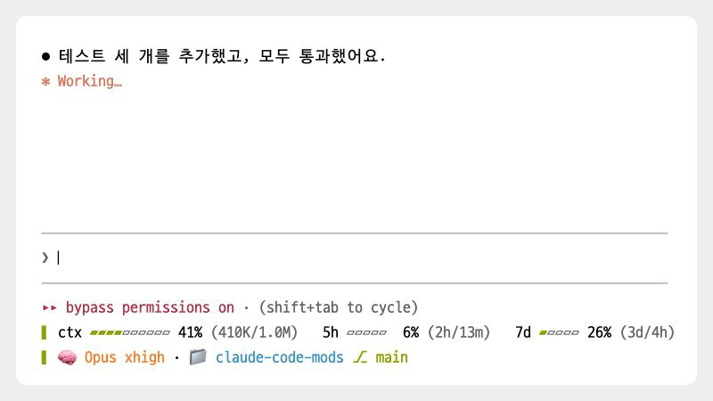
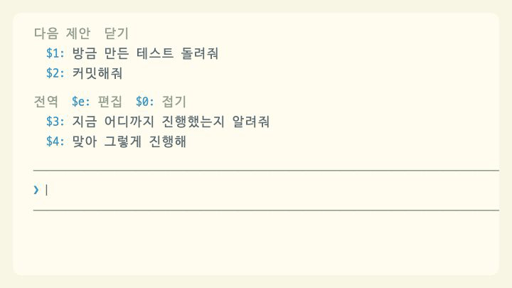
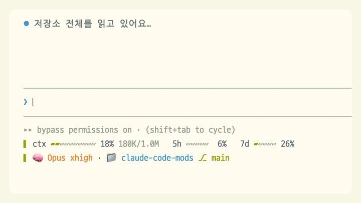
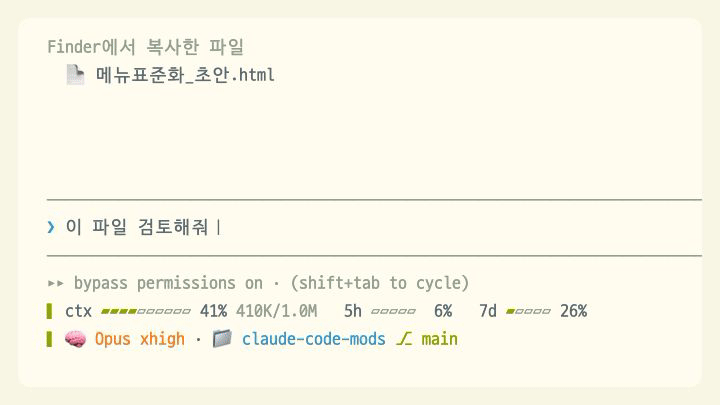

<p align="center">
  
</p>

<h1 align="center">claude-code-mods</h1>

<p align="center">Claude Code 입력창 주변에 기능을 더하는 모드 모음</p>

<p align="center">
  <a href="./LICENSE"></a>
  <a href="https://claude.com/claude-code"></a>
  <a href="#설치"></a>
  
  <a href="https://github.com/oobg/claude-code-mods/stargazers"></a>
</p>

<p align="center">
  <a href="#주요-기능"><b>주요 기능</b></a>
  &nbsp;|&nbsp;
  <a href="#설치"><b>설치</b></a>
  &nbsp;|&nbsp;
  <a href="#모드-목록"><b>모드 목록</b></a>
  &nbsp;|&nbsp;
  <a href="#상세-문서"><b>상세 문서</b></a>
  &nbsp;|&nbsp;
  <a href="./docs/development.md"><b>개발 가이드</b></a>
</p>

claude-code-mods는 Claude Code 입력창 주변에 기능을 추가하는 모드 모음이다. 입력창 위에서는 다음에 보낼 요청을 제안하고, 입력창 아래에서는 세션 상태를 표시한다. 입력창에서는 파일을 붙여넣거나 입력한 내용을 되돌리기가 편해진다. **모드는 필요한 것만 골라 설치하면 되고, 따로 설치할 프로그램은 없다.**

## 주요 기능

<table>
<tr>
<td width="50%" valign="top">
<a href="./docs/next-prompts.md"><picture>
<source media="(prefers-color-scheme: dark)" srcset="./.github/assets/showcase/suggest-dark.gif">

</picture></a>
<br><a href="./docs/next-prompts.md"><b>next-prompts</b></a><br>
<sub>턴이 끝나면 다음에 보낼 만한 요청을 2~3개 제안한다. <code>$1</code>을 치거나 번호를 클릭하면 입력창에 들어가고, 문구를 클릭하면 바로 보낸다</sub>
</td>
<td width="50%" valign="top">
<a href="./docs/quick-replies.md"><picture>
<source media="(prefers-color-scheme: dark)" srcset="./.github/assets/showcase/substitute-dark.gif">

</picture></a>
<br><a href="./docs/quick-replies.md"><b>quick-replies</b></a><br>
<sub>자주 쓰는 문구를 전역과 저장소별 프리셋으로 저장한다. 입력창에 <code>$4</code>처럼 번호를 치면 그 문구가 들어간다</sub>
</td>
</tr>
<tr>
<td width="50%" valign="top">
<a href="./docs/dashboard.md"><picture>
<source media="(prefers-color-scheme: dark)" srcset="./.github/assets/showcase/gauge-dark.gif">

</picture></a>
<br><a href="./docs/dashboard.md"><b>dashboard</b></a><br>
<sub>모델, 컨텍스트, 사용 한도, 브랜치를 입력창 아래 두 줄로 보여 준다. 게이지가 찰수록 색이 노랑, 주황, 빨강으로 바뀐다</sub>
</td>
<td width="50%" valign="top">
<a href="./docs/key-assist.md"><picture>
<source media="(prefers-color-scheme: dark)" srcset="./.github/assets/showcase/paste-dark.gif">

</picture></a>
<br><a href="./docs/key-assist.md"><b>key-assist</b></a><br>
<sub>Finder에서 복사한 파일을 붙여넣으면 파일 이름이 <code>@경로</code>로 바뀐다. Cmd+Z로 입력한 내용을 되돌린다</sub>
</td>
</tr>
</table>

## 특징

- **문구를 두 글자로 불러온다.** 다음 제안과 프리셋에 각각 번호가 붙는다. 입력창에 `$2`를 입력하면 2번 문구가 그 자리에 들어간다.
- **입력창에서 프리셋을 편집한다.** 편집 화면을 열어도 내용은 입력창에서 작성한다. 프리셋을 추가하거나 수정할 때도 입력창에 쓰고 Enter를 누르면 된다.
- **상태 표시줄 대신 두 줄짜리 대시보드를 쓴다.** 컨텍스트 사용량, 5시간과 7일 한도, Fable 한도, 모델, 브랜치를 한눈에 확인한다.
- **붙여넣은 파일 이름을 경로 멘션으로 바꾼다.** Finder에서 복사한 파일을 붙여넣으면 파일 이름이 `@경로` 멘션으로 바뀐다.
- **따로 설치할 프로그램이나 직접 고칠 설정 파일이 없다.** 마켓플레이스에서 필요한 모드만 골라 설치한다.

## 설치

### 요구 사항

- Claude Code 2.1.296 이상이 필요하다. 2.1.296~2.1.299에서 테스트했고, 모드 기능은 아직 초기 공개 단계라서 이후 버전에서는 동작이 달라질 수 있다.
- key-assist는 macOS 전용이다. Cmd+Z를 쓰려면 Command 키 입력을 Claude Code에 전달하는 터미널(Kitty 키보드 프로토콜을 쓰는 Orca, Ghostty, kitty, WezTerm 등)이 필요하다.

### 마켓플레이스에서 설치

이 저장소 자체가 `oobg` 마켓플레이스다. 먼저 Claude Code 입력창에서 마켓플레이스를 한 번 등록한다.

```
/plugin marketplace add oobg/claude-code-mods
```

그다음 필요한 모드만 골라 설치한다.

```
/plugin install next-prompts@oobg
/plugin install quick-replies@oobg
/plugin install dashboard@oobg
/plugin install key-assist@oobg
```

설치한 모드는 Claude Code를 다시 시작하거나 `/reload-plugins`를 실행하면 적용된다. 설치 여부는 `/plugin` 화면이나, 터미널에서 `claude plugin list`를 실행해 확인한다.

quick-replies의 기본 프리셋과 dashboard는 Claude Code를 시작하면 바로 표시되고, next-prompts의 제안은 첫 턴이 끝난 뒤에 표시된다.

## 모드 목록

| 모드 | 기능 | 위치 |
| --- | --- | --- |
| [next-prompts](./docs/next-prompts.md) | 턴이 끝나면 다음에 보낼 만한 요청을 2~3개 제안한다 | 입력창 위 |
| [quick-replies](./docs/quick-replies.md) | 자주 쓰는 문구를 전역 프리셋이나 저장소별 프리셋에 저장한다 | 입력창 위 |
| [dashboard](./docs/dashboard.md) | 모델, 컨텍스트, 사용 한도, 브랜치를 두 줄로 표시한다 | 입력창 아래 |
| [key-assist](./docs/key-assist.md) | 붙여넣은 파일 이름을 `@경로`로 바꾸고, Cmd+Z로 입력한 내용을 되돌린다 | 입력창 |

## $번호로 문구 입력하기

next-prompts와 quick-replies를 함께 쓰면 입력창 위 두 목록에 번호가 이어서 매겨진다. 다음 제안에는 `$1`부터 번호가 붙고, 프리셋에는 그다음 번호가 붙는다.

| 동작 | 결과 |
| --- | --- |
| 입력창에 `$2`를 입력한다 | 입력한 위치에 2번 문구가 들어간다. 문장 중간에서도 쓸 수 있다 |
| 번호(`$2:`)를 클릭한다 | 입력창의 기존 내용을 지우고 2번 문구로 바꾼다 |
| 문구를 클릭한다 | 클릭한 문구만 바로 보낸다. 입력창의 기존 내용은 함께 보내지 않는다 |
| 입력창에 `$e`를 입력한다 | 프리셋 편집 화면을 연다 |
| 입력창에 `$0`을 입력한다 | 프리셋을 접거나 펼친다 |

입력 내용의 맨 앞에 `$`가 있거나 `$` 바로 앞이 공백일 때만 바꾼다. `a$2`처럼 단어 중간에 있는 `$`는 바꾸지 않는다. 바뀐 내용은 Claude Code의 실행 취소 단축키 `ctrl+_`로 되돌린다. key-assist를 설치하고 Command 키 입력을 전달하는 터미널을 쓰면 Cmd+Z로도 되돌릴 수 있다.

## 업데이트와 삭제

먼저 마켓플레이스 목록을 갱신한다.

```
/plugin marketplace update oobg
```

그다음 `/plugin` 화면에서 설치한 모드를 업데이트하거나, 터미널에서 `claude plugin update <모드>@oobg`를 실행한다. 업데이트한 모드는 Claude Code를 다시 시작하면 적용된다.

모드를 삭제하려면 다음 명령을 실행한다.

```
/plugin uninstall next-prompts@oobg
/plugin uninstall quick-replies@oobg
/plugin uninstall dashboard@oobg
/plugin uninstall key-assist@oobg
```

key-assist를 삭제해도 키 설정에 추가된 `cmd+z` 항목은 남는다. 필요하지 않으면 `~/.claude/keybindings.json`에서 직접 지운다.

## 문제 해결

| 증상 | 해결 |
| --- | --- |
| 설치 목록에는 있는데 모드가 표시되지 않는다 | Claude Code를 다시 시작한다 |
| next-prompts 제안이 나오지 않는다 | 첫 턴이 끝나야 나온다. Claude의 답이 짧으면(120자 미만) 제안하지 않는다 |
| Cmd+Z가 동작하지 않는다 | Command 키 입력을 전달하는 터미널인지 확인한다. 아니면 `ctrl+_`를 쓴다 |
| Ctrl+Z를 눌렀더니 Claude Code가 멈췄다 | 터미널의 일시 중지 키다. `fg`를 입력해 돌아온다 |

모드별 문제 해결은 각 상세 문서의 "문제 해결" 절에 있다.

## 상세 문서

| 문서 | 내용 |
| --- | --- |
| [next-prompts](./docs/next-prompts.md) | 제안이 나오는 조건, 나타나는 방식, 모델 호출과 사용량 |
| [quick-replies](./docs/quick-replies.md) | 프리셋 범위와 번호, 접기와 자동 제목, 편집 화면 키, 저장 데이터 |
| [dashboard](./docs/dashboard.md) | 항목 설명, 표시 형태와 색상, `/usage` 조회, 참고 사항 |
| [key-assist](./docs/key-assist.md) | 파일 붙여넣기 동작, Cmd+Z 키 설정, 제한 사항 |
| [개발 가이드](./docs/development.md) | 입력창 위 영역을 여러 모드가 나눠 쓰는 방법, 개발 환경, 저장소 구조 |

## 라이선스

[MIT](./LICENSE)
