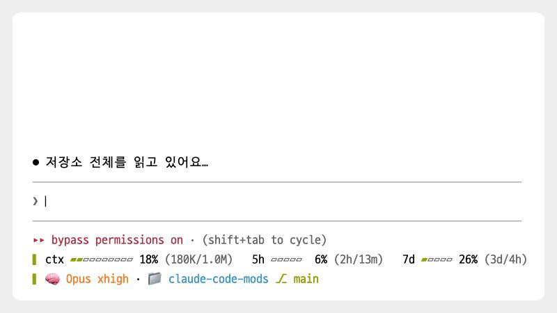
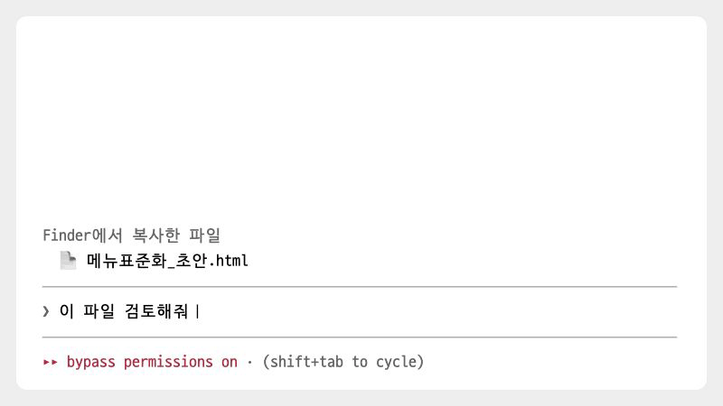
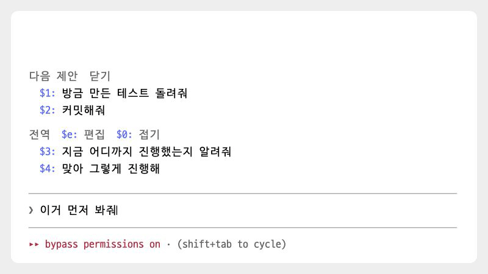
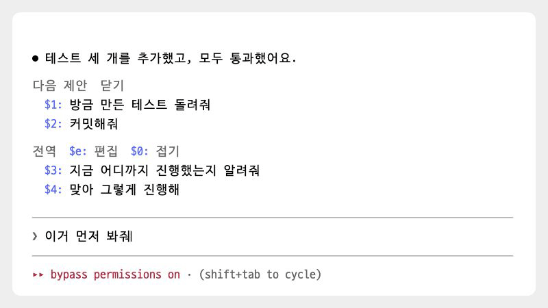

<p align="center">
  
</p>

<h1 align="center">claude-code-mods</h1>

<p align="center">Claude Code 입력창과 도구 결과에 기능을 더하는 모드 모음</p>

<p align="center">
  <a href="./LICENSE"></a>
  <a href="https://claude.com/claude-code"></a>
  <a href="#설치"></a>
  
  <a href="https://github.com/oobg/claude-code-mods/stargazers"></a>
</p>

<p align="center">
  <a href="#주요-기능"><b>주요 기능</b></a>
  &nbsp;|&nbsp;
  <a href="#설치"><b>설치</b></a>
  &nbsp;|&nbsp;
  <a href="#모드-목록"><b>모드 목록</b></a>
  &nbsp;|&nbsp;
  <a href="#상세-문서"><b>상세 문서</b></a>
  &nbsp;|&nbsp;
  <a href="https://oobg.github.io/claude-code-mods/"><b>문서 사이트</b></a>
</p>

claude-code-mods는 Claude Code의 입력창과 도구 결과에 기능을 추가하는 모드 5개를 모은 저장소입니다. 입력창 위에서는 다음 요청을 제안하고 자주 쓰는 문구 프리셋을 표시하며, 입력창 아래에서는 세션 상태를 보여 줍니다. Finder에서 복사한 파일을 붙여넣으면 파일 이름을 `@경로` 멘션으로 바꾸고, Cmd+Z로 입력 내용을 되돌릴 수 있습니다. 넓은 터미널에서는 Edit와 Write 결과의 diff를 좌우로 비교할 수 있습니다. **모드는 필요한 것만 골라 설치하면 되고, 따로 설치할 프로그램은 없습니다.**

## 주요 기능

<table class="cards">
<tr>
<td width="50%" valign="top">
<a href="./docs/next-prompts.md"><picture>
<source media="(prefers-color-scheme: dark)" srcset="./docs/images/showcase/suggest-dark.gif">

</picture></a>
<br><a href="./docs/next-prompts.md"><b>next-prompts</b></a><br>
<sub>턴이 끝나면 다음에 보낼 만한 요청을 2~3개 제안합니다. <code>$1</code>을 입력하고 스페이스를 누르거나 번호를 클릭하면 문구가 입력창에 들어가고, 문구를 클릭하면 바로 보냅니다</sub>
</td>
<td width="50%" valign="top">
<a href="./docs/quick-replies.md"><picture>
<source media="(prefers-color-scheme: dark)" srcset="./docs/images/showcase/preset-dark.gif">

</picture></a>
<br><a href="./docs/quick-replies.md"><b>quick-replies</b></a><br>
<sub>자주 쓰는 문구를 전역 또는 저장소별 프리셋으로 저장합니다. 입력창에 <code>$4</code>를 치고 스페이스를 누르면 해당 문구로 바뀝니다</sub>
</td>
</tr>
<tr>
<td width="50%" valign="top">
<a href="./docs/dashboard.md"><picture>
<source media="(prefers-color-scheme: dark)" srcset="./docs/images/showcase/gauge-dark.gif">

</picture></a>
<br><a href="./docs/dashboard.md"><b>dashboard</b></a><br>
<sub>모델, 컨텍스트, 사용 한도, 브랜치를 입력창 아래 두 줄에 표시합니다. 게이지가 찰수록 색이 노란색, 주황색, 빨간색 순으로 바뀝니다</sub>
</td>
<td width="50%" valign="top">
<a href="./docs/key-assist.md"><picture>
<source media="(prefers-color-scheme: dark)" srcset="./docs/images/showcase/paste-dark.gif">

</picture></a>
<br><a href="./docs/key-assist.md"><b>key-assist</b></a><br>
<sub>Finder에서 복사한 파일을 붙여넣으면 파일 이름이 <code>@경로</code>로 바뀝니다. Cmd+Z로 입력 내용을 되돌릴 수 있습니다</sub>
</td>
</tr>
<tr>
<td colspan="2" valign="top">
<a href="./docs/split-diff.md"><picture>
<source media="(prefers-color-scheme: dark)" srcset="./docs/images/showcase/split-diff-dark.gif">

</picture></a>
<br><a href="./docs/split-diff.md"><b>split-diff</b></a><br>
<sub>터미널 폭이 120칸 이상이면 Edit와 Write 결과의 diff에서 원래 내용은 왼쪽에, 바뀐 내용은 오른쪽에 표시합니다. 바뀐 단어는 더 밝은 색으로 강조합니다</sub>
</td>
</tr>
</table>

## 특징

- **$번호로 문구를 불러옵니다.** 다음 제안과 프리셋에 각각 번호가 붙습니다. 입력창에 `$2`를 입력하고 스페이스를 누르면 2번 문구가 그 자리에 들어갑니다. `$12`처럼 두 자리 번호도 쓸 수 있습니다.
- **프리셋도 입력창에서 편집합니다.** 편집 화면에서 프리셋을 추가하거나 수정할 때는 입력창에 내용을 쓰고 Enter를 누르면 됩니다.
- **상태 표시줄 대신 입력창 아래에 대시보드를 표시합니다.** 컨텍스트 사용량, 5시간과 7일 한도, Fable 한도, 모델, 브랜치를 두 줄로 확인할 수 있습니다.
- **파일을 경로 멘션으로 붙여넣습니다.** Finder에서 복사한 파일을 붙여넣으면 파일 이름 대신 `@경로` 멘션이 입력됩니다.
- **넓은 터미널에서는 diff를 좌우로 나눠 표시합니다.** 원래 줄과 바뀐 줄이 같은 높이에 나란히 표시됩니다.
- **따로 설치할 프로그램이나 직접 고칠 설정 파일이 없습니다.** 마켓플레이스에서 필요한 모드만 골라 설치합니다.

## 설치

### 요구 사항

- Claude Code 2.1.296 이상이 필요합니다. 2.1.296~2.1.299에서 테스트했습니다. 모드 기능은 아직 공개 초기 단계라 이후 버전에서는 동작이 달라질 수 있습니다.
- key-assist는 macOS 전용입니다. Cmd+Z를 사용하려면 Command 키 입력을 Claude Code에 전달할 수 있는 터미널이 필요합니다. Orca, Ghostty, kitty, WezTerm처럼 Kitty 키보드 프로토콜을 지원하는 터미널이 해당합니다.

### 마켓플레이스에서 설치

이 저장소가 `oobg` 마켓플레이스입니다. 먼저 Claude Code 입력창에서 마켓플레이스를 등록합니다.

```
/plugin marketplace add oobg/claude-code-mods
```

그다음 필요한 모드만 골라 설치합니다.

```
/plugin install next-prompts@oobg
/plugin install quick-replies@oobg
/plugin install dashboard@oobg
/plugin install key-assist@oobg
/plugin install split-diff@oobg
```

설치한 모드는 Claude Code를 다시 시작하거나 `/reload-plugins`를 실행하면 적용됩니다. 설치 여부는 `/plugin` 화면에서 확인하거나 터미널에서 `claude plugin list`를 실행해 확인할 수 있습니다.

Claude Code를 시작하면 quick-replies의 기본 프리셋과 dashboard가 바로 표시됩니다. next-prompts의 제안은 첫 턴이 끝난 뒤에 나타납니다.

## 모드 목록

| 모드 | 기능 | 위치 |
| --- | --- | --- |
| [next-prompts](./docs/next-prompts.md) | 턴이 끝나면 다음에 보낼 만한 요청을 2~3개 제안합니다 | 입력창 위 |
| [quick-replies](./docs/quick-replies.md) | 자주 쓰는 문구를 전역 프리셋이나 저장소별 프리셋에 저장합니다 | 입력창 위 |
| [dashboard](./docs/dashboard.md) | 모델, 컨텍스트, 사용 한도, 브랜치를 두 줄로 표시합니다 | 입력창 아래 |
| [key-assist](./docs/key-assist.md) | 붙여넣은 파일 이름을 `@경로`로 바꾸고, Cmd+Z로 입력한 내용을 되돌립니다 | 입력창 |
| [split-diff](./docs/split-diff.md) | 넓은 터미널에서 Edit와 Write 결과의 diff를 좌우로 나눠 표시합니다 | 도구 결과 |

## $번호로 문구 입력하기

next-prompts와 quick-replies를 함께 쓰면 입력창 위에 표시되는 두 목록의 번호가 이어집니다. 다음 제안은 `$1`부터, 프리셋은 그다음 번호부터 시작합니다.

<table class="cards">
<tr>
<td width="50%" valign="top">
<a href="./docs/quick-replies.md"><picture>
<source media="(prefers-color-scheme: dark)" srcset="./docs/images/showcase/substitute-dark.gif">

</picture></a>
<br><a href="./docs/quick-replies.md"><b><code>$2</code> 입력</b></a><br>
<sub>입력창에 <code>$2</code>를 치고 스페이스를 누르면 <code>$2</code>가 2번 문구로 바뀝니다. 문장 중간에서도 사용할 수 있습니다</sub>
</td>
<td width="50%" valign="top">
<a href="./docs/quick-replies.md"><picture>
<source media="(prefers-color-scheme: dark)" srcset="./docs/images/showcase/pick-dark.gif">

</picture></a>
<br><a href="./docs/quick-replies.md"><b>번호 클릭</b></a><br>
<sub>번호(<code>$2:</code>)를 클릭하면 입력창의 기존 내용을 모두 2번 문구로 바꿉니다</sub>
</td>
</tr>
<tr>
<td width="50%" valign="top">
<a href="./docs/next-prompts.md"><picture>
<source media="(prefers-color-scheme: dark)" srcset="./docs/images/showcase/send-dark.gif">

</picture></a>
<br><a href="./docs/next-prompts.md"><b>문구 클릭</b></a><br>
<sub>문구를 클릭하면 해당 문구만 바로 보냅니다. 입력창에 적어 둔 내용은 그대로 남습니다</sub>
</td>
<td width="50%" valign="top">
<a href="./docs/quick-replies.md"><picture>
<source media="(prefers-color-scheme: dark)" srcset="./docs/images/showcase/editor-dark.gif">

</picture></a>
<br><a href="./docs/quick-replies.md"><b><code>$e</code> 편집</b></a><br>
<sub>입력창에 <code>$e</code>를 입력하면 프리셋 편집 화면이 열립니다</sub>
</td>
</tr>
<tr>
<td width="50%" valign="top">
<a href="./docs/quick-replies.md"><picture>
<source media="(prefers-color-scheme: dark)" srcset="./docs/images/showcase/fold-dark.gif">

</picture></a>
<br><a href="./docs/quick-replies.md"><b><code>$0</code> 접기</b></a><br>
<sub>입력창에 <code>$0</code>을 입력하면 프리셋을 한 줄로 접고, 다시 입력하면 펼칩니다</sub>
</td>
<td width="50%"></td>
</tr>
</table>

입력창 맨 앞이나 공백 뒤에 `$`를 입력하고 번호와 스페이스를 쳐야 문구로 바뀌며, 바뀐 내용은 `ctrl+_`로 되돌릴 수 있습니다.

## 업데이트와 삭제

먼저 마켓플레이스 목록을 갱신합니다.

```
/plugin marketplace update oobg
```

그다음 `/plugin` 화면에서 설치한 모드를 업데이트하거나, 터미널에서 `claude plugin update <모드>@oobg`를 실행합니다. 업데이트한 모드는 Claude Code를 다시 시작하면 적용됩니다.

모드를 삭제하려면 다음 명령을 실행합니다.

```
/plugin uninstall next-prompts@oobg
/plugin uninstall quick-replies@oobg
/plugin uninstall dashboard@oobg
/plugin uninstall key-assist@oobg
/plugin uninstall split-diff@oobg
```

> [!NOTE]
> key-assist를 삭제해도 키 설정에 추가된 `cmd+z` 항목은 남습니다.
> 필요하지 않으면 `~/.claude/keybindings.json`에서 직접 지웁니다.

## 문제 해결

| 증상 | 해결 |
| --- | --- |
| 설치 목록에는 있는데 모드가 표시되지 않습니다 | Claude Code를 다시 시작합니다 |
| next-prompts 제안이 나오지 않습니다 | 첫 턴이 끝나야 제안이 나옵니다. 답 본문이 120자 미만이면 제안하지 않습니다 |
| Cmd+Z가 동작하지 않습니다 | Command 키 입력을 전달하는 터미널인지 확인합니다. 아니면 `ctrl+_`를 씁니다 |
| Ctrl+Z를 눌렀더니 Claude Code가 멈췄습니다 | Ctrl+Z는 터미널에서 실행 중인 프로세스를 일시 중지합니다. `fg`를 입력하면 다시 실행됩니다 |

모드별 자세한 해결 방법은 각 상세 문서의 "문제 해결" 절에서 확인할 수 있습니다.

## 상세 문서

각 모드의 상세 문서는 [문서 사이트](https://oobg.github.io/claude-code-mods/)에서도 볼 수 있습니다.

| 문서 | 내용 |
| --- | --- |
| [next-prompts](./docs/next-prompts.md) | 제안이 나오는 조건, 나타나는 방식, 모델 호출과 사용량 |
| [quick-replies](./docs/quick-replies.md) | 프리셋 범위와 번호, 접기와 자동 제목, 편집 화면 키, 저장 데이터 |
| [dashboard](./docs/dashboard.md) | 항목 설명, 표시 형태와 색상, `/usage` 조회, 참고 사항 |
| [key-assist](./docs/key-assist.md) | 파일 붙여넣기 동작, Cmd+Z 키 설정, 제한 사항 |
| [split-diff](./docs/split-diff.md) | 좌우 표시 조건, 줄 맞추기, 단어 강조, 제한 사항 |

## 라이선스

Copyright (c) 2026 oobg

이 프로젝트는 [MIT 라이선스](./LICENSE)에 따라 배포됩니다.
