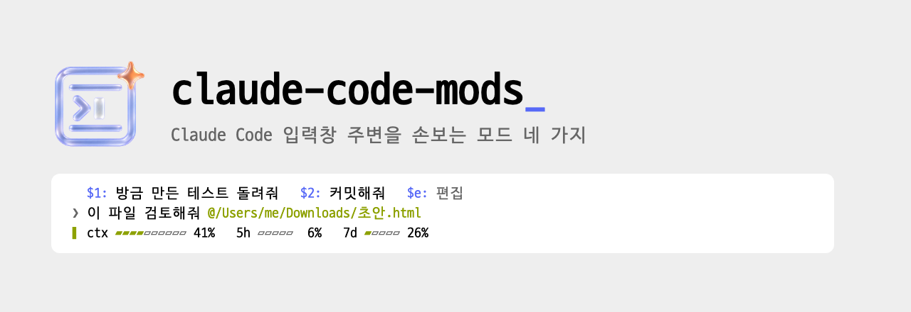

<p align="center">
  <picture>
    <source media="(prefers-color-scheme: dark)" srcset="./.github/assets/banner-dark.png">
    <source media="(prefers-color-scheme: light)" srcset="./.github/assets/banner-light.png">
    
  </picture>
</p>

<p align="center">
  <a href="./LICENSE"></a>
  <a href="https://claude.com/claude-code"></a>
  <a href="#설치"></a>
  
  <a href="https://github.com/oobg/claude-code-mods/stargazers"></a>
</p>

<p align="center">
  <a href="#보기"><b>보기</b></a>
  &nbsp;|&nbsp;
  <a href="#설치"><b>설치</b></a>
  &nbsp;|&nbsp;
  <a href="#모드"><b>모드</b></a>
  &nbsp;|&nbsp;
  <a href="#문서"><b>문서</b></a>
  &nbsp;|&nbsp;
  <a href="./docs/development.md"><b>개발</b></a>
</p>

claude-code-mods는 Claude Code 입력창 주변을 손보는 모드 모음이다. 입력창 위에는 다음에 보낼 요청을 제안하고, 아래에는 세션 상태를 보여 준다. 입력창에서는 파일 붙여넣기와 되돌리기를 편하게 바꾼다. **모드는 하나씩 골라 설치할 수 있고, 다른 프로그램 없이 Claude Code 안에서 실행된다.**

## 보기

<table>
<tr>
<td width="50%" valign="top">
<a href="./docs/next-prompts.md"><picture>
<source media="(prefers-color-scheme: dark)" srcset="./.github/assets/showcase/suggest-dark.gif">

</picture></a>
<br><a href="./docs/next-prompts.md"><b>next-prompts</b></a><br>
<sub>턴이 끝나면 다음에 보낼 만한 요청을 2~3개 제안한다. <code>$1</code>을 치거나 클릭해서 바로 쓴다</sub>
</td>
<td width="50%" valign="top">
<a href="./docs/quick-replies.md"><picture>
<source media="(prefers-color-scheme: dark)" srcset="./.github/assets/showcase/substitute-dark.gif">

</picture></a>
<br><a href="./docs/quick-replies.md"><b>quick-replies</b></a><br>
<sub>자주 쓰는 문구를 전역과 저장소별 프리셋으로 저장한다. 입력창에 <code>$4</code>처럼 번호를 치면 그 문구가 들어간다</sub>
</td>
</tr>
<tr>
<td width="50%" valign="top">
<a href="./docs/dashboard.md"><picture>
<source media="(prefers-color-scheme: dark)" srcset="./.github/assets/showcase/gauge-dark.gif">

</picture></a>
<br><a href="./docs/dashboard.md"><b>dashboard</b></a><br>
<sub>모델, 컨텍스트, 사용 한도, 브랜치를 입력창 아래 두 줄로 보여 준다. 게이지가 찰수록 노랑, 주황, 빨강으로 바뀐다</sub>
</td>
<td width="50%" valign="top">
<a href="./docs/key-assist.md"><picture>
<source media="(prefers-color-scheme: dark)" srcset="./.github/assets/showcase/paste-dark.gif">

</picture></a>
<br><a href="./docs/key-assist.md"><b>key-assist</b></a><br>
<sub>Finder에서 복사한 파일을 붙여넣으면 파일 이름이 <code>@경로</code>로 바뀐다. Cmd+Z로 입력한 내용을 되돌린다</sub>
</td>
</tr>
</table>

## 목차

- [왜 쓰나](#왜-쓰나)
- [설치](#설치)
- [모드](#모드)
- [$번호로 문구 넣기](#번호로-문구-넣기)
- [업데이트와 삭제](#업데이트와-삭제)
- [문서](#문서)
- [라이선스](#라이선스)

## 왜 쓰나

- **자주 쓰는 문구를 두 글자로.** 다음 제안과 프리셋마다 번호가 붙는다. 입력창에 `$2`를 치면 2번 문구가 들어간다.
- **입력창을 떠나지 않는다.** 편집 화면을 열어도 입력은 계속 입력창에서 한다. 프리셋을 추가하거나 고칠 때도 입력창에 쓰고 Enter를 누르면 된다.
- **상태 표시줄 대신 두 줄짜리 대시보드.** 컨텍스트 사용량, 5시간과 7일 한도, Fable 한도, 모델, 브랜치를 한눈에 본다.
- **파일은 경로로.** Finder에서 복사한 파일을 붙여넣으면 파일 이름이 `@경로` 멘션으로 바뀐다.
- **설치하면 끝.** 마켓플레이스에서 모드를 골라 설치한다. 다른 프로그램을 실행하거나 설정 파일을 직접 고칠 필요가 없다.

## 설치

### 요구 사항

- Claude Code 2.1.296 이상
- key-assist는 macOS 전용이다. Cmd+Z는 Command 키 입력을 Claude Code에 전달하는 터미널(Kitty 키보드 프로토콜을 쓰는 Orca, Ghostty, kitty, WezTerm 등)에서 동작한다.

### 마켓플레이스로

이 저장소가 곧 `oobg` 마켓플레이스다. Claude Code 프롬프트에 아래 명령을 입력한다.

```
/plugin marketplace add oobg/claude-code-mods
/plugin install next-prompts@oobg
/plugin install quick-replies@oobg
/plugin install dashboard@oobg
/plugin install key-assist@oobg
```

첫 줄은 마켓플레이스를 등록하고, 나머지는 모드를 하나씩 설치한다. 필요한 모드만 골라 설치해도 된다. 설치한 모드는 Claude Code를 다시 시작하거나 `/reload-plugins`를 실행하면 적용된다.

## 모드

| 모드 | 하는 일 | 자리 |
| --- | --- | --- |
| [next-prompts](./docs/next-prompts.md) | 턴이 끝나면 다음에 보낼 만한 요청을 2~3개 제안한다 | 입력창 위 |
| [quick-replies](./docs/quick-replies.md) | 자주 쓰는 문구를 전역과 저장소별 프리셋으로 저장한다 | 입력창 위 |
| [dashboard](./docs/dashboard.md) | 모델, 컨텍스트, 사용 한도, 브랜치를 두 줄로 보여 준다 | 입력창 아래 |
| [key-assist](./docs/key-assist.md) | 붙여넣은 파일 이름을 `@경로`로 바꾸고, Cmd+Z로 입력한 내용을 되돌린다 | 입력창 |

## $번호로 문구 넣기

next-prompts와 quick-replies를 함께 쓰면 입력창 위 두 목록에 번호가 이어서 붙는다. 다음 제안은 `$1`부터 시작하고, 프리셋은 그다음 번호를 이어받는다.

| 하는 일 | 결과 |
| --- | --- |
| 입력창에 `$2`를 친다 | 그 자리에 2번 문구가 들어간다. 글 중간에도 쓸 수 있다 |
| 번호(`$2:`)를 클릭한다 | 입력창 내용을 2번 문구로 바꾼다 |
| 문구를 클릭한다 | 그 문구를 바로 보낸다 |
| 입력창에 `$e`를 친다 | 프리셋 편집 화면을 연다 |
| 입력창에 `$0`을 친다 | 프리셋을 접거나 펼친다 |

`$`가 글 맨 앞에 있거나 바로 앞이 공백일 때만 동작한다. `a$2`처럼 단어 중간에 친 `$`는 바꾸지 않는다. 바뀐 내용은 Cmd+Z로 되돌릴 수 있다.

## 업데이트와 삭제

마켓플레이스 목록을 업데이트하면 새 버전이 반영된다.

```
/plugin marketplace update oobg
```

모드를 지우려면 아래 명령을 입력한다. key-assist를 지워도 키 설정에 추가된 `cmd+z` 줄은 남는다. 필요 없으면 `~/.claude/keybindings.json`에서 직접 지운다.

```
/plugin uninstall next-prompts@oobg
/plugin uninstall quick-replies@oobg
/plugin uninstall dashboard@oobg
/plugin uninstall key-assist@oobg
```

## 문서

| 문서 | 내용 |
| --- | --- |
| [next-prompts](./docs/next-prompts.md) | 다음 제안을 만드는 방식 |
| [quick-replies](./docs/quick-replies.md) | 프리셋, 접기, 편집 화면 키, 저장 위치 |
| [dashboard](./docs/dashboard.md) | 대시보드 칸 설명, 모양과 색, 알아 둘 점 |
| [key-assist](./docs/key-assist.md) | 파일 붙여넣기, Cmd+Z 키 설정 |
| [개발](./docs/development.md) | 입력창 위 영역을 나눠 쓰는 방법, 개발 환경, 저장소 구조 |

## 라이선스

[MIT](./LICENSE). Claude Code 2.1.296~2.1.299를 기준으로 만들고 테스트했다. 모드는 아직 초기 공개 단계라서 이후 버전에서는 동작이 달라질 수 있다.
