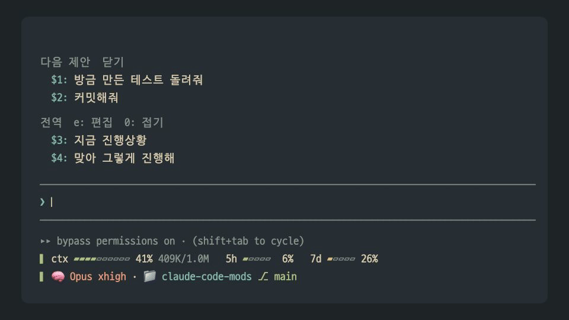

<div align="center">

# claude-code-mods

**직접 만든 Claude Code 모드 모음**

[](https://claude.com/claude-code)
[](#빠른-시작)
[](#모드-목록)
[](LICENSE)

</div>

입력창 위에는 다음에 보낼 말을, 입력창 아래에는 세션 상태를 둔다. 입력창에서는 파일 붙여넣기와 되돌리기를 손본다.

<p align="center"></p>

## 빠른 시작

저장소 자체가 `oobg` 마켓플레이스다. Claude Code 프롬프트에 차례로 입력한다.

```
/plugin marketplace add oobg/claude-code-mods
/plugin install next-prompts@oobg
/plugin install quick-replies@oobg
/plugin install dashboard@oobg
/plugin install key-assist@oobg
```

첫 줄로 마켓플레이스를 등록하고, 나머지 줄로 원하는 모드를 설치한다. 설치한 모드는 Claude Code를 다시 시작하면 적용된다.

## 모드 목록

| 모드 | 하는 일 | 자리 |
| --- | --- | --- |
| [next-prompts](#next-prompts) | 턴이 끝나면 다음에 보낼 만한 요청을 2~3개 제안한다 | 입력창 위 |
| [quick-replies](#quick-replies) | 자주 쓰는 문구를 전역과 저장소별 프리셋으로 둔다 | 입력창 위 |
| [dashboard](#dashboard) | 모델, 컨텍스트, 사용 한도, 브랜치를 두 줄로 그린다 | 입력창 아래 |
| [key-assist](#key-assist) | 붙여넣은 파일 이름을 `@경로`로 바꾸고, Cmd+Z로 입력창을 되돌린다 | 입력창 |

네 모드를 함께 설치하면 입력창 주변이 이렇게 보인다.

```
 다음 제안  닫기
   $1: 방금 만든 테스트 돌려줘
   $2: 커밋해줘
   $3: README에 바뀐 설치 방법 반영해줘

 전역  $e: 편집  $0: 접기
   $4: 지금 진행상황
   $5: 맞아 그렇게 진행해
 로컬
   $6: /ux-writing 문구 다듬어줘

 ──────────────────────────────────────────────────────────
 ❯ 이거 보고 $2
 ──────────────────────────────────────────────────────────
 ▸▸ bypass permissions on · (shift+tab to cycle)
 ▌ ctx ▰▰▰▰▱▱▱▱▱▱ 41% 409K/1.0M   5h ▰▱▱▱▱  6% (2h13m)   7d ▰▱▱▱▱ 26% (3d4h)
 ▌ 🧠 Opus xhigh · 📁 claude-code-mods ⎇ main · 🔑 you@example.com
```

입력창 위 두 목록은 번호를 이어서 매긴다. 문구를 넣는 방법은 세 가지다.

| 하는 일 | 결과 |
| --- | --- |
| 입력창에 `$2`를 친다 | 그 자리에 2번 문구가 들어간다. 글 중간에도 쓸 수 있다 |
| 번호(`$2:`)를 클릭한다 | 입력창 내용을 2번 문구로 바꾼다 |
| 문구를 클릭한다 | 그 문구를 바로 보낸다 |

`$e`를 치면 프리셋 편집 화면이 열리고, `$0`을 치면 프리셋을 접거나 편다. 이때 친 `$e`, `$0`은 입력창에 남지 않는다.

`$` 앞이 글 처음이나 공백일 때만 동작한다. `a$2`처럼 낱말 중간에 친 `$`는 그대로 둔다. 바꾼 결과를 되돌리려면 Cmd+Z를 누른다([key-assist](#key-assist)).

---

## next-prompts

> 방금 끝난 답을 보고, 다음에 칠 만한 요청을 미리 꺼내 둔다.

- 턴이 답으로 끝나면 작은 모델(haiku)에 한 번 물어 2~3개를 제안한다. 답이 120자보다 짧으면 묻지 않는다.
- 모델에는 마지막 요청과 답의 끝부분만 보낸다.
- 번호는 늘 `$1`부터다. 입력창에 `$1`을 치거나 번호를 클릭해 초안으로 넣고, 문구를 클릭하면 바로 보낸다.
- `닫기`를 클릭하면 제안을 닫는다. Claude가 작업하는 동안에는 숨기고, 새 프롬프트를 보내면 지운다.

이 모드는 [hamzafer/claude-code-mods](https://hamzafer.github.io/claude-code-mods/mods/next-steps/)의 next-steps에서 아이디어를 얻었다. 코드는 보지 않고 동작 설명만 보고 새로 만들었다.

---

## quick-replies

> 매번 치던 "지금 진행상황"을 `$4` 두 글자로 넣는다.

- **전역 프리셋**은 모든 저장소에서 보인다. 처음에는 "지금 진행상황", "맞아 그렇게 진행해" 두 개가 들어 있다.
- **로컬 프리셋**은 지금 git 저장소에서만 보인다. `로컬` 제목 아래에 따로 나온다.
- 번호는 다음 제안 다음부터 이어진다. 제안이 없으면 `$1`부터다. `$9`를 넘는 프리셋은 클릭으로만 쓴다.
- `/ux-writing README 다듬어줘`, `/compact`처럼 `/`로 시작하는 프리셋은 클릭하면 그 스킬이나 명령을 실행한다. 없는 이름이면 실행하지 않고 알림만 띄운다.
- `접기`를 클릭하면 전역과 로컬을 각각 한 줄에 제목만으로 잇는다. 12자보다 긴 프리셋은 작은 모델(haiku)이 접었을 때 보일 제목을 지어 준다. 접은 상태는 다음 세션에도 이어진다. 입력창에 `$0`을 쳐도 접고 편다.

```
 전역  $e: 편집  $0: 펼치기
   $4: 진행상황 | $5: 맞아 그렇게 진행해
 로컬
   $6: /ux-writing…
```

### 편집

입력창에 `$e`를 치거나 `편집`을 클릭하면 입력창 위가 편집 화면으로 바뀐다. 편집하는 동안 키보드는 입력창에 그대로 있고, 입력창에 치는 키를 모드가 가로챈다.

```
 프리셋 편집  a: 전역에 추가  l: 로컬에 추가  q: 완료
 전역 (모든 저장소)
 ▸ 1: 지금 진행상황
   2: 맞아 그렇게 진행해
 로컬 (claude-code-mods)
   3: /ux-writing 문구 다듬어줘
 고른 프리셋  e: 문구 수정  t: 제목  d: 삭제  m: 로컬로  k: 위로  j: 아래로
```

고르는 중에는 입력창에 친 글자가 들어가지 않고 아래 동작으로만 쓰인다. Enter도 Claude에게 보내지 않는다. 버튼을 클릭해도 같은 동작을 한다.

| 키 | 동작 |
| --- | --- |
| `1`~`9` | 프리셋 고르기 |
| `a`, `l` | 전역, 로컬에 추가 |
| `e` | 고른 프리셋의 문구 고쳐 쓰기 |
| `t` | 고른 프리셋에 제목 달기. 비워 저장하면 모델이 다시 짓는다 |
| `d` | 고른 프리셋 삭제 |
| `m` | 고른 프리셋을 전역과 로컬 사이로 옮기기 |
| `k`, `j` | 고른 프리셋을 위, 아래로 |
| `q` | 편집 끝내기 |

`a`, `l`, `e`, `t`를 치면 입력창이 입력칸이 된다. 입력창 글자가 다른 색으로 칠해지고, 문구를 고칠 때는 원래 글이 미리 채워진다. 다 쓰고 Enter를 치면 저장하고 결과를 한 줄로 알린다. 취소하려면 `$q`를 치거나 `취소`를 클릭한다. 입력창 테두리 색은 모드가 바꿀 수 없어 글자 색으로 편집 중임을 보인다.

편집하는 동안에는 다음 제안을 숨긴다.

### 저장 위치

프리셋은 Claude Code 설정 폴더 안, 이 모드 전용 저장 공간에 들어간다. 작업 중인 저장소에는 파일을 만들지 않는다. 로컬 프리셋은 git 저장소의 최상위 폴더 단위로 묶이고, git 저장소 밖이면 Claude Code를 연 폴더 단위로 묶인다.

---

## dashboard

> 상태줄 자리를 비우고, 세션 상태를 권한 모드 줄 밑에 두 줄로 그린다.

모드가 Claude Code에서 세션 값을 직접 읽어 그린다. 다른 프로그램을 설치하거나 실행하지 않는다.

```
▌ ctx ▰▰▰▰▱▱▱▱▱▱ 41% 409K/1.0M   5h ▰▱▱▱▱  6% (2h13m)   7d ▰▱▱▱▱ 26% (3d4h)   fable ▰▱▱▱▱ 12% (3d4h)
▌ 🧠 Opus xhigh · 📁 claude-code-mods ⎇ main · 🔑 you@example.com
```

| 칸 | 내용 |
| --- | --- |
| `ctx` | 컨텍스트가 찬 정도와 쓴 토큰, 전체 크기 |
| `5h`, `7d` | 사용 한도를 쓴 정도. 괄호 안은 다시 차기까지 남은 시간 |
| `fable` | 이번 주 Fable 한도 |
| `🧠 Opus xhigh` | 모델 계열과 effort |
| `📁 … ⎇ main` | 프로젝트 폴더와 git 브랜치 |
| `🔑` | 로그인한 계정의 이메일. API 키로 쓰면 빠진다 |

화면이 좁으면 이름표 줄 위에 값 줄을 놓는 표로 바뀐다. 컨텍스트가 50%를 넘으면 맨 앞 세로줄이 게이지와 같은 경고 색으로 바뀐다.

```
▌ MODEL          CONTEXT          5H   7D   FABLE  BRANCH
▌ 🧠 Opus xhigh  ▰▰▰▱▱▱▱▱ 41%     6%   26%  12%    ⎇ main
```

### 모양과 색

`/dashboard-style`로 모양을, `/dashboard-theme`으로 색 구성을 바꾼다. 이름 없이 실행하면 다음 것으로 넘어가고, 고른 값은 다음 세션에도 이어진다.

| 모양 | 생김새 |
| --- | --- |
| `gauge` (기본) | 위 그림처럼 윗줄에 게이지, 아랫줄에 모델과 위치 |
| `calm` | `◆ Opus(X) │ ████░░░░░░ 41% │ 409K/1.0M │ $18.17 │ 5시간 6% │ …` |
| `emoji` | `calm`의 각 칸 앞에 이모지를 붙인다 |
| `compact` | `◆ Opus(X) │ 41% │ $18.17 │ 5시간 6% │ 7일 26% │ Fable 12% │ 🌿 main` 한 줄 |

색 구성은 `everforest`(기본), `nord`, `rose-pine`, `kanagawa` 네 가지다. 모델 이름, 폴더, 브랜치에 색을 하나씩 쓰고, 숫자와 이름표는 각각 한 가지 색으로 맞춘다. 게이지는 여유 색에서 노랑, 주황, 빨강으로 차츰 바뀐다.

### 알아 둘 점

- 상태줄을 따로 쓰고 있다면 `~/.claude/settings.json`에서 `statusLine` 항목을 지운다. 그대로 두면 대시보드가 두 번 보인다.
- 메시지를 보낼 때, 턴이 끝날 때, effort가 바뀔 때, 30초마다 다시 그린다.
- effort는 첫 요청이 나간 뒤에 보인다. 모드가 직접 읽을 수 없어 요청에 실린 값을 받아 둔다.
- fast 모드는 모드가 상태를 읽을 수 없어 표시하지 않는다.
- 한도 값은 세션을 열 때와 10분마다 `/usage`를 읽어 채운다. 이때 Claude Code를 하나 더 띄워 `claude -p /usage --safe-mode --no-session-persistence`를 실행한다. 모델은 부르지 않고 기록도 남기지 않으며, 한 번에 3초쯤 걸린다.
- 입력창 아래 안내 줄은 맨 앞에 권한 모드 표시가 붙어 들여 써진다. 모드는 지금 권한 모드를 알아내 그 폭만큼 왼쪽으로 당긴다. shift+tab으로 바꾼 직후에는 다음 메시지를 보낼 때까지 이전 폭으로 그려진다.
- 0.1.0까지는 [claude-dashboard](https://github.com/uppinote20/claude-dashboard)를 실행해 그 출력을 옮겨 그렸다. 0.2.0부터는 화면과 공개된 README 설명만 보고 새로 만들었다.

---

## key-assist

> Finder에서 복사한 파일을 붙여넣으면 파일 이름 대신 `@경로`가 들어가고, Cmd+Z로 입력창을 되돌린다. macOS 전용이다.

### 파일 붙여넣기

Finder에서 파일을 복사해 입력창에 붙여넣으면 터미널은 파일 이름(`메뉴표준화_초안.html`)만 넣는다. 모드는 macOS 클립보드에서 그 파일의 전체 경로를 읽어 `@/Users/me/Downloads/메뉴표준화_초안.html`로 바꾼다.

- 붙여넣은 글이 클립보드에 든 파일의 이름이나 경로와 같을 때만 바꾼다. 보통 글을 붙여넣을 때는 아무것도 하지 않는다.
- 경로에 공백이 있으면 `@"/경로 이름/파일"`처럼 따옴표로 감싼다. 여러 파일을 한 번에 붙여넣어 이름들이 공백이나 줄바꿈으로 이어져 들어오면 모두 바꾼다.
- 붙여넣으면 곧바로 바뀐다. 그 순간을 놓치면 다음 키를 칠 때 바꾸고, 바로 Enter를 치면 보내는 글에서 바꾼다.
- 클립보드는 `osascript`로 읽는다. 글이 한 번에 덩어리로 들어올 때만 읽고, 한 글자씩 칠 때는 읽지 않는다.
- 한글 파일 이름은 Finder가 자모를 풀어(NFD) 넘길 때가 있다. 모드는 완성형(NFC)으로 맞춰 비교한다.

### Cmd+Z로 되돌리기

Claude Code에는 입력창 되돌리기(`chat:undo`, 기본 `ctrl+_`)가 이미 있다. 모드는 Command 키를 받지 못해 Cmd+Z를 직접 처리할 수 없다. 대신 설치한 뒤 처음 연 세션에서 키 설정 파일(`~/.claude/keybindings.json`)의 `Chat` 맥락에 아래 한 줄을 더하고 알림을 띄운다. 파일이 없으면 새로 만든다.

```json
"cmd+z": "chat:undo"
```

- 한 번만 더한다. 그 줄을 지우면 다시 넣지 않는다.
- `cmd+z`를 이미 다른 기능에 정했거나 `null`로 꺼 두었으면 건드리지 않는다. 파일을 JSON으로 읽을 수 없을 때도 그대로 둔다. 이때는 위 한 줄을 직접 넣는다.
- Command 키를 앱에 넘겨 주는 터미널(Kitty 키보드 프로토콜을 쓰는 Orca, Ghostty, kitty, WezTerm 등)에서만 동작한다.
- Ctrl+Z는 터미널에서 프로세스를 일시정지하는 키라서 쓰지 않는다. 눌러서 Claude Code가 멈췄다면 `fg`로 돌아온다.

---

## 입력창 위를 나눠 쓰는 방법

입력창 위 띠는 한 모드만 그릴 수 있다. 그래서 next-prompts와 quick-replies는 같은 틀(`oobg-band`)을 주고받으며 각자 자기 줄을 끼워 넣는다. 제안이 10번, 프리셋이 20번 자리다. 한쪽만 설치해도 그 모드의 줄만 그려진다.

번호는 각 모드가 스스로 매긴다. next-prompts는 `$1`부터, quick-replies는 지금 떠 있는 제안 개수 다음부터 매긴다. 띠를 합치는 순서와 상관없이 두 모드가 같은 번호를 본다. 편집 화면처럼 띠를 혼자 써야 할 때는 다른 모드가 줄을 넣지 않는 전용 틀을 쓴다.

## 업데이트와 삭제

새 버전은 마켓플레이스 목록을 새로 받으면 반영된다.

```
/plugin marketplace update oobg
```

모드를 지울 때는 아래처럼 입력한다. key-assist가 키 설정에 더한 `cmd+z` 줄은 남으니, 필요 없으면 `~/.claude/keybindings.json`에서 지운다.

```
/plugin uninstall next-prompts@oobg
/plugin uninstall quick-replies@oobg
/plugin uninstall dashboard@oobg
/plugin uninstall key-assist@oobg
```

## 개발

모드를 고칠 때는 설치하지 않고 폴더에서 바로 불러온다. 같은 모드를 설치해 둔 상태라면 두 번 돌지 않게 먼저 꺼 둔다.

```
claude --plugin-dir ./quick-replies
```

검사와 테스트는 모드 폴더마다 실행한다.

```
claude plugin validate ./next-prompts
claude plugin test ./next-prompts
```

README의 동작 장면(`docs/demo.gif`)은 `demo/`의 Remotion 프로젝트로 그린다. 장면을 고친 뒤 아래처럼 다시 렌더링한다.

```
cd demo
npm install
npm run render
```

### 구조

```
.
├── .claude-plugin/
│   └── marketplace.json      # oobg 마켓플레이스 정의
├── next-prompts/
│   ├── .claude-plugin/
│   │   └── plugin.json       # 모드 이름, 버전, 설명
│   ├── hooks/
│   │   ├── hooks.json        # 훅 모듈 목록
│   │   ├── register.tsx      # 턴이 끝나면 제안을 만들고 띠에 그림, $번호 치환
│   │   ├── suggest.ts        # 모델에 보낼 요청과 답 정리
│   │   └── band.ts           # 입력창 위를 나눠 쓰는 틀과 $번호 판별
│   ├── types/index.d.ts      # 모드가 쓰는 상태의 타입
│   └── tests/                # claude plugin test로 돌리는 테스트
├── quick-replies/
│   └── hooks/
│       ├── register.tsx      # 프리셋 줄과 편집 화면, $번호 치환
│       ├── title.ts          # 제목을 지을 때 모델에 보낼 요청과 답 정리
│       └── band.ts           # next-prompts와 같은 파일
├── dashboard/
│   └── hooks/
│       ├── register.tsx      # 세션 값을 모으고 입력창 아래에 그림
│       ├── lines.ts          # 세션 값으로 모양과 색을 짜는 순수 함수
│       └── footer.ts         # 입력창 아래를 나눠 쓰는 틀
├── key-assist/
│   └── hooks/
│       └── register.ts       # 붙여넣은 파일 이름을 경로로 바꾸고, Cmd+Z 키 설정을 한 번 더함
├── demo/                     # README 동작 장면을 그리는 Remotion 프로젝트
└── docs/demo.gif             # 렌더링한 동작 장면
```

`band.ts`는 next-prompts와 quick-replies에 똑같이 들어 있다. 고칠 때는 둘 다 고친다.

새 모드를 더하려면 폴더를 만들고 `.claude-plugin/marketplace.json`의 `plugins`에 항목을 추가한다.

## 호환성

Claude Code 2.1.296~2.1.299에서 만들고 테스트했다. 모드 기능은 아직 초기 공개 단계라서 이후 버전에서는 동작이 달라질 수 있다.

## 라이선스

[MIT](LICENSE)
