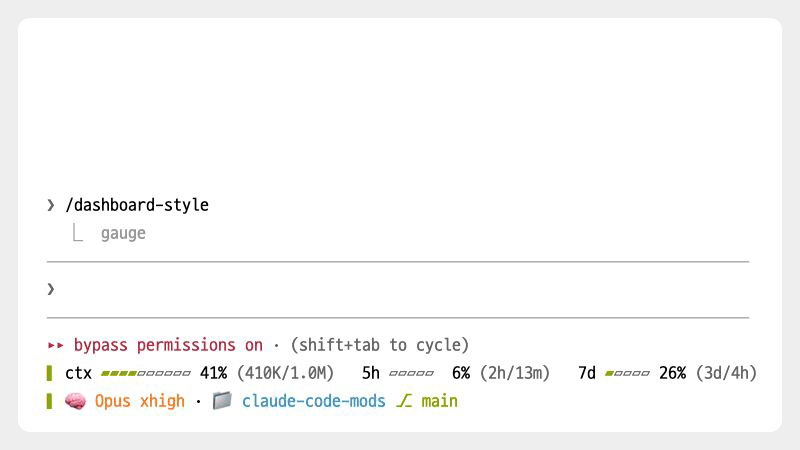

# dashboard

[← README로 돌아가기](../README.md)

> 입력창 아래 권한 모드 줄 밑에 모델, 컨텍스트, 사용 한도, 브랜치를 두 줄로 그린다.

<p><picture>
<source media="(prefers-color-scheme: dark)" srcset="./images/showcase/gauge-dark.gif">

</picture></p>

| 항목 | 값 |
| --- | --- |
| 버전 | 0.5.0 |
| 자리 | 입력창 아래(권한 모드 안내 줄 밑) |
| 요구 사항 | Claude Code 2.1.296 이상(2.1.296~2.1.299에서 테스트). 터미널과 데스크톱 화면에서만 그린다 |
| 외부 호출 | 모델 호출 없음. 하위 프로세스로 `git`, `tail`, `sh`(`ps`), `claude -p /usage`를 실행한다 |
| 저장 데이터 | 있음. 고른 모양과 색, `/usage`에서 읽은 한도 값을 모드 전용 저장 공간에 둔다 |

## 목차

- [개요](#개요)
- [빠른 시작](#빠른-시작)
- [사용법](#사용법)
- [키와 명령](#키와-명령)
- [화면 구성](#화면-구성)
- [동작 방식](#동작-방식)
- [설정과 저장 데이터](#설정과-저장-데이터)
- [외부 호출과 사용량](#외부-호출과-사용량)
- [제한 사항](#제한-사항)
- [문제 해결](#문제-해결)
- [소스 구성](#소스-구성)
- [변경 이력](#변경-이력)

## 개요

Claude Code의 상태줄(`statusLine`) 자리 대신 입력창 아래 안내 줄(`PromptHint`) 밑에 세션 상태를 그린다. 보여 주는 값은 모델 계열과 effort, 컨텍스트 사용률과 토큰 수, 5시간 한도와 주간 한도, 이번 주 Fable 한도, 프로젝트 폴더와 git 브랜치, 로그인 이메일이다. 모양에 따라 비용, 세션 시간, 분당 토큰도 나온다.

세션 값은 Claude Code가 모드에 넘겨주는 값(`$.session.usage()`, `$.session.model()`)을 그대로 쓴다. 따로 설치할 프로그램은 없다. Claude Code가 주지 않는 값(Fable 한도, 첫 응답 전의 한도, 브랜치, 권한 모드)만 하위 프로세스나 파일로 읽는다.

하지 않는 것:

- `~/.claude/settings.json`의 `statusLine` 설정을 읽거나 바꾸지 않는다. 상태줄을 끄는 일은 사용자가 직접 한다.
- fast 모드 여부는 표시하지 않는다. 모드가 읽을 수 있는 값이 아니다.
- 모델을 호출하지 않는다.

## 빠른 시작

```
/plugin install dashboard@oobg
```

설치하면 세션을 시작하자마자 입력창 아래에 기본 `gauge` 모양이 나온다. 윗줄은 게이지, 아랫줄은 모델과 위치다.

```
▌ ctx ▰▰▰▰▱▱▱▱▱▱ 41% (409K/1.0M)   5h ▰▱▱▱▱  6% (2h/13m)   7d ▰▱▱▱▱ 26% (3d/4h)   fable ▰▱▱▱▱ 12% (3d/4h)
▌ 🧠 Opus xhigh · 📁 claude-code-mods ⎇ main · 🔑 you@example.com
```

1. 메시지를 하나 보내면 모델 옆에 effort가 붙는다.
2. 모양을 바꾸려면 `/dashboard-style`을, 색을 바꾸려면 `/dashboard-theme`을 실행한다.
3. 상태줄과 정보가 겹쳐 보이면 [statusLine과 함께 쓸 때](#statusline과-함께-쓸-때)를 본다.

## 사용법

### 모양 바꾸기

<p><picture>
<source media="(prefers-color-scheme: dark)" srcset="./images/showcase/styles-dark.gif">

</picture></p>

`/dashboard-style`에 모양 이름을 붙이면 그 모양으로 바로 바뀐다. 이름 없이 실행하면 `gauge`, `calm`, `emoji`, `compact` 순서로 다음 모양으로 넘어가고, `compact` 다음은 다시 `gauge`다. 없는 이름을 넣으면 고를 수 있는 이름을 알려 주고 모양은 그대로 둔다.

```
/dashboard-style compact
```

아래는 같은 세션 값(Opus, effort `xhigh`, 컨텍스트 41%, 비용 $18.17, 5시간 6%, 주간 26%, Fable 12%, 세션 52분)을 각 모양으로 그린 결과다.

`gauge`(기본). 맨 앞 세로줄 `▌`이 두 줄을 묶는다.

```
▌ ctx ▰▰▰▰▱▱▱▱▱▱ 41% (409K/1.0M)   5h ▰▱▱▱▱  6% (2h/13m)   7d ▰▱▱▱▱ 26% (3d/4h)   fable ▰▱▱▱▱ 12% (3d/4h)
▌ 🧠 Opus xhigh · 📁 claude-code-mods ⎇ main · 🔑 you@example.com
```

`calm`. 칸 사이를 흐린 ` │ `로 나눈다.

```
◆ Opus(X) │ ████░░░░░░ 41% │ 409K/1.0M │ $18.17 │ 5시간 6% │ 7일 26% │ Fable 12%
📁 claude-code-mods (main) │ 🔑 you@example.com │ ⏱ 52분 │ 🔥 7.9K/min
```

`emoji`. `calm`과 칸이 같고, 칸마다 앞에 이모지를 붙인다. 브랜치는 괄호 대신 `🌿`로 표시한다.

```
🧠 Opus(X) │ ████░░░░░░ 41% │ 💬 409K/1.0M │ 💰 $18.17 │ ⏳ 5시간 6% │ 📅 7일 26% │ 🪶 Fable 12%
📁 claude-code-mods 🌿 main │ 🔑 you@example.com │ ⏱ 52분 │ 🔥 7.9K/min
```

`compact`. 모델, 컨텍스트 비율, 비용, 한도, 브랜치만 한 줄에 둔다. 막대, 토큰 수, 폴더, 이메일은 없다.

```
◆ Opus(X) │ 41% │ $18.17 │ 5시간 6% │ 7일 26% │ Fable 12% │ 🌿 main
```

### 색 바꾸기

`/dashboard-theme`에 색 구성 이름을 붙이면 그 색으로 바꾸고, 이름 없이 실행하면 `everforest`, `nord`, `rose-pine`, `kanagawa` 순서로 다음 색으로 넘어간다. 없는 이름을 넣으면 고를 수 있는 이름을 알려 준다.

```
/dashboard-theme nord
```

### 좁은 화면

`gauge` 모양이 화면에 다 들어가지 않으면 항목 이름을 윗줄에, 값을 아랫줄에 둔 표로 바뀐다.

```
▌ MODEL          CONTEXT          5H   7D   FABLE  BRANCH
▌ 🧠 Opus xhigh  ▰▰▰▱▱▱▱▱ 41%     6%   26%  12%    ⎇ main
```

전환 기준은 `gauge` 두 줄 중 긴 줄의 폭에 세로줄 폭(`SPINE_WIDTH` = 2)을 더한 값이다. 이 값이 터미널 너비에서 2를 뺀 값보다 크면 표로 그린다. 폭은 한글과 이모지를 두 칸으로 센다. Claude Code가 터미널 너비를 알려 주지 않으면 넓은 화면으로 본다.

표에는 토큰 수, 남은 시간, 폴더, 이메일이 빠진다. 컨텍스트 게이지는 8칸으로 줄어든다. 이 전환은 `gauge` 모양에서만 일어난다. 다른 모양은 줄이 넘치면 줄 끝을 잘라 낸다.

### statusLine과 함께 쓸 때

모드는 `statusLine` 설정을 건드리지 않으므로, 상태줄을 켜 둔 채 설치하면 상태줄과 대시보드가 둘 다 나온다. 상태줄에 모델이나 컨텍스트를 띄우고 있었다면 같은 정보가 두 번 보인다.

대시보드만 쓰려면 `~/.claude/settings.json`에서 `statusLine` 항목을 지운다. 되돌릴 수 있도록 지우기 전에 그 값을 따로 적어 둔다. 되돌릴 때는 `/plugin uninstall dashboard@oobg`로 모드를 지우고 적어 둔 `statusLine` 항목을 다시 넣는다.

### 화면 공유할 때

이메일을 숨기는 설정은 없다. 이메일이 나오지 않는 모양은 `compact`뿐이다. 좁은 화면 표에도 이메일이 빠진다.

## 키와 명령

| 입력 | 동작 | 조건 |
| --- | --- | --- |
| `/dashboard-style` | 다음 모양으로 바꾼다(`gauge` → `calm` → `emoji` → `compact` → `gauge`) | 언제나. 바로 실행되는 명령(`immediate`)이다 |
| `/dashboard-style <이름>` | `gauge`, `calm`, `emoji`, `compact` 중 그 모양으로 바꾼다 | 없는 이름이면 `없는 모양이에요.`로 시작하는 안내만 보이고 바뀌지 않는다 |
| `/dashboard-theme` | 다음 색으로 바꾼다(`everforest` → `nord` → `rose-pine` → `kanagawa` → `everforest`) | 언제나. 바로 실행되는 명령이다 |
| `/dashboard-theme <이름>` | 그 색 구성으로 바꾼다 | 없는 이름이면 `없는 색이에요.`로 시작하는 안내만 보이고 바뀌지 않는다 |
| `/usage` | Claude Code 기본 명령. 모드가 그 출력에서 5시간, 주간, Fable 한도를 읽어 값을 새로 고친다 | 출력에서 한도 줄을 하나 이상 찾았을 때 |
| shift+tab | Claude Code의 권한 모드 전환. 대시보드를 왼쪽으로 당기는 폭이 이 모드에 따라 달라진다 | 새 폭은 다음 메시지를 보낼 때 맞춰진다 |

## 화면 구성

### gauge 모양의 칸

| 요소 | 내용 | 표시 조건 |
| --- | --- | --- |
| `▌` | 두 줄을 묶는 세로줄. 평소에는 모델 색(`accent`), 컨텍스트가 50% 이상이면 그 비율의 게이지 색 | `gauge` 모양과 좁은 화면 표에서만 |
| `ctx` 게이지 | 컨텍스트 사용률. 10칸 막대와 비율, 흐린 괄호 안에 쓴 토큰 수와 컨텍스트 전체 크기(`409K/1.0M`) | 사용률이나 토큰 수를 알 때. 토큰 수를 모르면 괄호를 뺀다 |
| `5h`, `7d` 게이지 | 5시간 한도와 주간 한도 사용률. 5칸 막대와 비율, 흐린 괄호 안에 한도가 다시 차기까지 남은 시간 | 그 한도 값이 있을 때. 다시 차는 시각을 모르면 괄호를 뺀다 |
| `fable` 게이지 | 이번 주 Fable 한도 사용률. 5칸 막대와 남은 시간 | `/usage`에서 한 번이라도 읽었을 때 |
| `🧠 Opus xhigh` | 모델 계열과 effort. effort는 받은 값을 그대로(`xhigh`) 흐리게 쓴다 | effort는 첫 요청이 나간 뒤부터 |
| `📁 폴더 ⎇ 브랜치` | 프로젝트 루트 폴더 이름과 git 브랜치 | 브랜치는 git 저장소이고 분리된 HEAD가 아닐 때 |
| `🔑 이메일` | 로그인한 계정의 이메일 | `~/.claude.json`에 계정 이메일이 있을 때(API 키로 쓰면 없음) |

윗줄 게이지 사이는 공백 3칸, 아랫줄 칸 사이는 흐린 가운데 점으로 나눈다. 게이지 비율 숫자는 두 자리로 오른쪽 맞춤한다(`  6%`).

### calm, emoji, compact 모양의 칸

| 요소 | 내용 | 표시 조건 |
| --- | --- | --- |
| `◆ Opus(X)` | 모델 계열과 effort 약자. `low` → `L`, `medium` → `M`, `high` → `H`, `xhigh` → `X`, `max` → `Max`. 그 밖의 값은 그대로 쓴다 | effort는 첫 요청이 나간 뒤부터. `emoji`에서는 `◆` 대신 `🧠` |
| 막대 `████░░░░░░ 41%` | 컨텍스트 사용률 10칸 막대와 비율 | 사용률을 알 때. `compact`는 막대 없이 비율만 |
| `409K/1.0M` | 쓴 토큰 수와 컨텍스트 전체 크기 | 토큰 수를 알 때. `compact`에는 없음 |
| `$18.17` | Claude Code가 이 세션에 집계한 비용(달러, 소수 둘째 자리) | Claude Code가 비용 값을 줄 때 |
| `5시간 6%`, `7일 26%`, `Fable 12%` | 한도 사용률 | 값이 있을 때 |
| `📁 폴더 (브랜치)` | 폴더와 브랜치. `emoji`는 `📁 폴더 🌿 브랜치`, `compact`는 `🌿 브랜치`만 | 브랜치는 있을 때만 |
| `🔑 이메일` | 로그인 이메일 | 이메일이 있을 때. `compact`에는 없음 |
| `⏱ 52분` | 세션 시간. 1시간이 넘으면 `1시간 5분` | `calm`, `emoji`만 |
| `🔥 7.9K/min` | 분당 토큰. 지금 컨텍스트 토큰 수를 세션 시간(분)으로 나눈 값 | 토큰 수를 알고 세션이 1분을 넘었을 때. `calm`, `emoji`만 |

### 숫자 표기

| 값 | 표기 |
| --- | --- |
| 토큰 수 | 100만 이상은 `1.0M`, 1만 이상은 `409K`, 1천 이상은 `7.9K`, 그보다 작으면 정수 |
| 남은 시간(`resetLabel`) | 1시간 미만은 `38m`, 24시간 미만은 `2h/13m`, 그 이상은 `3d/4h`. 시각이 지났으면 `0m` |
| 비율 | 반올림한 정수와 `%` |

### 색

색은 칸마다 따로 정하지 않고 역할(`Palette` 필드)로 묶는다.

| 필드 | 쓰는 곳 |
| --- | --- |
| `accent` | 모델 이름(굵게), 평소 세로줄 |
| `primary` | 폴더 |
| `secondary` | 브랜치 |
| `text` | 숫자(토큰, 비용, 세션 시간, 분당 토큰)와 게이지 이름표(`ctx`, `5h`, `7d`, `fable`) |
| `muted` | 한도 이름표(`5시간`, `7일`, `Fable`), 이메일, 좁은 화면 표의 머리글 |
| `ok`, `warn`, `orange`, `high` | 사용률에 따른 색 |

색을 지정하지 않은 글자(구분자, 막대 빈칸, effort, 괄호 안 정보)는 흐린 회색으로 그린다.

| 테마 | `accent` | `primary` | `secondary` | `text` | `muted` | `ok` | `warn` | `orange` | `high` |
| --- | --- | --- | --- | --- | --- | --- | --- | --- | --- |
| `everforest`(기본) | `#a7c080` | `#7fbbb3` | `#d699b6` | `#d3c6aa` | `#859289` | `#a7c080` | `#dbbc7f` | `#e69875` | `#e67e80` |
| `nord` | `#88c0d0` | `#81a1c1` | `#b48ead` | `#d8dee9` | `#8691a8` | `#a3be8c` | `#ebcb8b` | `#d08770` | `#bf616a` |
| `rose-pine` | `#c4a7e7` | `#9ccfd8` | `#ea9a97` | `#e0def4` | `#908caa` | `#3e8fb0` | `#f6c177` | `#ea9a97` | `#eb6f92` |
| `kanagawa` | `#7e9cd8` | `#7fb4ca` | `#957fb8` | `#dcd7ba` | `#727169` | `#98bb6c` | `#e6c384` | `#ffa066` | `#e46876` |

사용률 색(`levelColor`)은 `LEVEL_STOPS` 구간을 따라 두 색을 RGB로 섞어 이어서 바뀐다.

| 사용률 | 색 |
| --- | --- |
| 0~40% | `ok` |
| 40~55% | `ok`에서 `warn`으로 |
| 55~72% | `warn`에서 `orange`로 |
| 72~90% | `orange`에서 `high`로 |
| 90% 이상 | `high` |

막대는 칸마다 그 칸의 오른쪽 끝 위치(10칸 막대라면 10%, 20%, …, 100%)의 색을 칠한다. 그래서 많이 찰수록 끝쪽 칸이 노랑, 주황, 빨강으로 물든다. 찬 칸 수는 비율을 칸 크기로 나눠 반올림한다. 비율 숫자는 마지막으로 찬 칸과 같은 색이고, 찬 칸이 없으면 `ok` 색이다. 한도 이름표 옆 비율(`calm` 등)과 좁은 화면 표의 비율은 그 비율 값 자체의 색을 쓴다.

세로줄은 컨텍스트 사용률이 50% 이상이면 그 비율의 사용률 색으로 바뀐다.

## 동작 방식

### 이벤트

| 이벤트 | 하는 일 | 소스 |
| --- | --- | --- |
| `session.start` | 세션 시작 준비(`start`)를 한 번 한다 | `hooks/register.tsx`: `register`, `start` |
| `prompt.submit` | 준비가 안 됐으면 하고, 다시 그린다 | `hooks/register.tsx`: `register` |
| `turn.step` | 메인 대화(`agentId` 없음)의 요청에 실린 `effort`가 바뀌었으면 받아 두고 다시 그린다. 요청은 그대로 흘려보낸다 | `hooks/register.tsx`: `register` |
| `turn.complete` | 준비가 안 됐으면 하고, 다시 그린다 | `hooks/register.tsx`: `register` |
| `classic.SessionStart`, `classic.UserPromptSubmit` | 이벤트에 실린 `permission_mode`를 받아 둔다 | `hooks/register.tsx`: `notePermissionMode` |
| `command.run`(`dashboard-style`, `dashboard-theme`) | 모양이나 색을 바꾸고 저장한 뒤 다시 그린다 | `hooks/register.tsx`: `register` |
| `command.run`(`usage`) | 사용자가 실행한 `/usage` 출력에서 한도를 읽어 저장하고 다시 그린다 | `hooks/register.tsx`: `register`, `saveUsage` |
| `ui.render`(`PromptHint`) | 엔진의 안내 줄 아래에 대시보드 구역을 붙인다. `terminal`, `desktop` 화면에서만 | `hooks/register.tsx`: `register`, `hooks/footer.ts`: `withSection` |

`start`는 모드를 불러온 뒤 한 번만 돈다. 권한 모드 처음 값을 정하고, 저장된 모양, 색, Fable 값을 읽고, 화면을 그리고, 두 명령을 등록하고, `/usage` 읽기를 한 번 시작하고, 타이머 두 개를 건다. 명령 등록이 실패해도 대시보드는 그린다. `/reload-plugins`는 `session.start`를 다시 보내지 않고 타이머도 지우므로, 다시 불러온 뒤에는 다음 `prompt.submit`이나 `turn.complete`에서 `start`가 다시 돈다.

### 다시 그리는 시점

- 세션 시작(`start` 안에서), 메시지 전송, 턴 끝
- effort가 바뀌었을 때
- `REFRESH_MS`(30초)마다
- 뒤에서 읽은 `/usage`가 성공했을 때, 사용자가 `/usage`를 실행했을 때
- `/dashboard-style`, `/dashboard-theme`를 실행했을 때

다시 그리기(`render`)는 세션 값을 모아 `snapshot`에 넣는 일이다. 줄 모양은 `ui.render` 때 화면 너비를 보고 `buildLayout`이 고른다. 다시 그리기에서 난 오류는 삼키고 이전 화면을 둔다. 아직 `snapshot`이 없으면 안내 줄만 그린다.

### 값의 출처

| 값 | 출처 |
| --- | --- |
| 모델 | `$.session.model()`. `claude-opus-5-5`에서 `claude-` 다음 단어를 꺼내 첫 글자를 대문자로(`Opus`) 쓴다. 형식이 다르면 받은 문자열 그대로 |
| effort | 메인 대화의 `turn.step` 이벤트에 실린 `effort`. 서브에이전트의 요청은 보지 않는다 |
| 컨텍스트 | `$.session.usage().context`. 사용률(`percent`)이 없으면 `tokens / window × 100`으로 계산한다 |
| 비용 | `$.session.usage().cost.usd` |
| 5시간, 주간 한도 | `$.session.usage().rateLimits`의 `five_hour`, `seven_day`. 이 값이 없는 종류(첫 응답 전 등)는 `/usage`에서 읽어 둔 값으로 채운다 |
| Fable 한도 | `/usage`에서 읽어 둔 값만 쓴다. 다시 차는 시각은 Fable 줄의 시각, 없으면 주간 한도의 시각 |
| 세션 시간 | 지금 시각에서 `$.session.usage().startedAt`을 뺀 값 |
| 폴더 | `$.session.root()`의 마지막 경로 이름 |
| 브랜치 | `git branch --show-current`. 실패하거나 출력이 비면 없음 |
| 이메일 | `~/.claude.json`의 `oauthAccount.emailAddress`. 파일을 못 읽으면 없음 |
| 권한 모드 | 아래 [권한 모드 폭 당기기](#권한-모드-폭-당기기) |

### /usage 읽기

Claude Code가 모드에 주는 한도 값에는 Fable이 없고, 첫 응답 전에는 5시간과 주간 한도도 없다. 그래서 따로 띄운 Claude Code에 `/usage`를 물어 읽는다(`pollFable`).

- 명령: `claude -p /usage --safe-mode --no-session-persistence`. `--safe-mode`로 훅, 플러그인, MCP를 띄우지 않고, `--no-session-persistence`로 기록 파일을 남기지 않는다.
- 실행 파일은 `claude`, `$HOME/.local/bin/claude`, `/opt/homebrew/bin/claude`, `/usr/local/bin/claude` 순서로 찾는다. 실행 자체가 실패한 경로만 건너뛴다.
- 시점: `start`에서 한 번, 그 뒤 `USAGE_EVERY_MS`(10분)마다.
- 제한 시간: 30초(`timeoutMs: 30_000`).
- 종료 코드가 0이면 출력을 읽어 저장하고 다시 그린다. 0이 아니거나 제한 시간을 넘기면 이전 값을 그대로 둔다. 값이 오래됐다는 표시는 없다.

출력에서 읽는 줄(`parseUsageLimits`)은 셋이다.

| 출력의 줄 | 한도 |
| --- | --- |
| `Current session: N% used` | 5시간(`five_hour`) |
| `Current week (all models): N% used` | 주간(`seven_day`) |
| `Current week (Fable): N% used` | Fable(`fable`) |

각 줄 뒤의 `resets Oct 14 at 5pm`, `resets Oct 17 at 5:59pm` 같은 시각은 이 컴퓨터 시간대 기준으로 읽는다. 읽은 날짜가 지금보다 하루 넘게 지났으면 내년으로 본다. 찾은 줄이 하나도 없으면 아무것도 저장하지 않는다.

사용자가 직접 `/usage`를 실행해도 같은 방식으로 그 출력을 읽는다. 모드가 대화 안에서 `/usage`를 직접 부르지 않는 까닭은 출력이 대화에 남기 때문이다.

### 권한 모드 폭 당기기

엔진은 입력창 아래 안내 줄 맨 앞에 권한 모드 표시를 그리고, 그 아래 줄들도 같은 폭만큼 들여쓴다. 모드는 대시보드 구역에 이 폭만큼 음수 왼쪽 여백(`marginLeft`)을 줘서 화면 왼쪽 끝에 맞춘다(`PILL_WIDTH`).

| 권한 모드 | 표시 | 당기는 폭 |
| --- | --- | --- |
| `default` | `⏸ manual mode on` | 19 |
| `acceptEdits` | `▸▸ accept edits on` | 21 |
| `plan` | `⏸ plan mode on` | 17 |
| `bypassPermissions` | `▸▸ bypass permissions on` | 27 |
| `auto` | `▸▸ auto mode on` | 18 |
| 그 밖의 값, 모름 | | 0 |

지금 권한 모드는 다음 순서로 정한다. 뒤에 온 값이 앞의 값을 덮는다.

1. 실행 인자: `start`에서 아직 값이 없으면 `sh -c`로 부모 프로세스를 6단계까지 따라 올라가 Claude Code 실행 줄을 찾는다(`ps -o args=`, 제한 시간 5초). `--dangerously-skip-permissions`가 있으면 `bypassPermissions`, `--permission-mode <값>`(또는 `=<값>`)이 있으면 그 값, 둘 다 없거나 찾지 못하면 `default`.
2. 훅 이벤트: `classic.SessionStart`, `classic.UserPromptSubmit`에 실린 `permission_mode`.
3. 기록 파일: 다시 그릴 때마다 세션 기록 파일(`~/.claude/projects/<폴더>/<세션 id>.jsonl`) 끝 256KiB를 `tail -c 262144`로 읽어 마지막 `"permissionMode"` 값을 쓴다. 기록 폴더는 프로젝트 루트, 현재 폴더 순서로 보고, 둘 다 없으면 `~/.claude/projects` 아래 폴더를 모두 본다. 값이 없으면 앞의 값을 둔다.

입력창 아래 바닥 틀(`oobg-footer`)은 여러 모드가 구역을 끼워 넣을 수 있는 구조다. 대시보드 구역의 키는 `oobg-footer:20:dashboard`(`ORDER` = 20)다. 구역을 끼울 때마다 틀 안 모든 구역의 당김을 지금 값으로 맞춘다. 지금 이 틀을 쓰는 모드는 dashboard뿐이다.

### 상태(atom)

모두 `plugin: 'dashboard'` 아래 세션 상태다. 세션 상태는 `/reload-plugins` 뒤에도 남는다.

| 키 | 내용 |
| --- | --- |
| `snapshot` | 마지막으로 모은 세션 값 |
| `permissionMode` | 지금 권한 모드 |
| `effort` | 메인 대화의 마지막 effort. 첫 요청 전에는 `null` |
| `layoutStyle` | 고른 모양 |
| `theme` | 고른 색 |
| `fableWeek` | 이번 주 Fable 사용률 |
| `polledLimits` | `/usage`에서 읽은 한도 목록 |

## 설정과 저장 데이터

설정은 `/dashboard-style`과 `/dashboard-theme` 두 명령뿐이다. 이메일 숨기기, 갱신 주기, `/usage` 읽기 끄기 같은 설정은 없다.

`$.store`에 저장하는 값은 아래와 같다. `$.store`는 Claude Code 설정 폴더 아래 이 모드 전용 JSON 파일이고, 다음 세션에도 이어진다.

| `$.store` 키 | 값 | 기본값 |
| --- | --- | --- |
| `style.v2` | 모양 이름 | `gauge` |
| `theme` | 색 구성 이름 | `everforest` |
| `fableWeek` | 이번 주 Fable 사용률(숫자) | 없음(Fable 칸을 뺀다) |
| `polledLimits` | `/usage`에서 읽은 한도 목록(`kind`, `percentUsed`, `resetsAt`) | 없음 |

0.4.0 전 버전이 쓰던 `style` 키는 읽지 않는다. 저장된 값이 목록에 없는 이름이면 기본값을 쓴다.

초기화 명령은 없다. 모양과 색은 `/dashboard-style gauge`, `/dashboard-theme everforest`로 기본값으로 돌린다.

## 외부 호출과 사용량

모델은 호출하지 않는다. 실행하는 하위 프로세스는 아래와 같다.

| 명령 | 시점 | 제한 시간 | 실패 시 |
| --- | --- | --- | --- |
| `claude -p /usage --safe-mode --no-session-persistence` | 세션 준비 때 한 번, 그 뒤 10분마다 | 30초 | 이전 값을 둔다 |
| `git branch --show-current` | 다시 그릴 때마다 | 지정 없음 | 브랜치를 뺀다 |
| `tail -c 262144 <기록 파일>` | 다시 그릴 때마다 | 지정 없음 | 다음 후보 경로를 보고, 모두 실패하면 이전 권한 모드를 둔다 |
| `sh -c '<부모 프로세스 탐색>'`(`ps` 사용) | 세션 준비 때, 권한 모드를 아직 모를 때 한 번 | 5초 | `default`로 본다 |

`claude -p /usage`는 모델을 부르지 않는 명령이라 응답 생성에 쓰는 사용량은 들지 않는다. 별도 Claude Code 프로세스를 띄우는 비용(시간, 메모리)은 든다.

## 제한 사항

- fast 모드 여부는 표시하지 않는다.
- effort는 요청에 실린 값을 받아 쓰므로 첫 요청 전에는 모델 이름만 나온다. effort를 바꾸면 다음 요청이 나갈 때 표시가 바뀐다.
- Fable 한도와 첫 응답 전의 5시간, 주간 한도는 최대 10분 늦은 값일 수 있다. `/usage` 읽기에 실패하면 더 오래된 값이 남고, 오래됐다는 표시는 없다.
- shift+tab으로 권한 모드를 바꾸면 다음 메시지를 보낼 때까지 이전 폭으로 당겨진다.
- 좁은 화면 표 전환은 `gauge` 모양에서만 일어난다. `calm`, `emoji`, `compact`는 넘치는 줄 끝을 잘라 낸다.
- 터미널과 데스크톱 화면에서만 그린다.
- 기록 파일 끝 256KiB에 `permissionMode`가 없고 훅 이벤트도 아직 오지 않았으면, 실행 인자로 정한 값을 쓴다.

## 문제 해결

| 증상 | 원인 | 해결 |
| --- | --- | --- |
| 상태줄과 대시보드에 같은 정보가 두 번 보인다 | 모드는 `statusLine`을 끄지 않는다 | `~/.claude/settings.json`에서 `statusLine` 항목을 지운다 |
| 모델 옆에 effort가 없다 | 아직 메인 대화의 요청이 나가지 않았다 | 메시지를 하나 보낸다 |
| `fable` 칸이 없다 | `/usage`를 한 번도 읽지 못했다. `claude`를 네 경로 어디에서도 실행하지 못했거나, 출력에 Fable 줄이 없다 | `/usage`를 직접 실행한다 |
| 한도 값이 바뀌지 않는다 | `/usage` 읽기가 실패해 이전 값이 남았다 | `/usage`를 직접 실행한다 |
| 브랜치가 안 보인다 | git 저장소가 아니거나 분리된 HEAD다 | 브랜치를 체크아웃한다 |
| 이메일이 안 보인다 | `~/.claude.json`에 `oauthAccount.emailAddress`가 없다(API 키 사용 등) | 해당 없음 |
| 대시보드가 오른쪽으로 밀리거나 너무 왼쪽으로 붙는다 | 권한 모드를 바꾼 직후이거나, 모르는 권한 모드다 | 메시지를 하나 보낸다 |
| `/reload-plugins` 뒤 값이 30초마다 갱신되지 않는다 | 다시 불러오면 타이머가 지워지고 `session.start`가 오지 않는다 | 메시지를 하나 보내면 타이머가 다시 걸린다 |
| 예전에 고른 `calm` 대신 `gauge`가 보인다 | 0.4.0부터 저장 키가 `style.v2`로 바뀌어 예전 선택을 읽지 않는다 | `/dashboard-style calm`으로 다시 고른다 |

## 소스 구성

| 파일 | 역할 |
| --- | --- |
| `mods/dashboard/.claude-plugin/plugin.json` | 모드 이름, 버전, 설명 |
| `mods/dashboard/hooks/hooks.json` | 불러올 모듈 목록(`./register.tsx`) |
| `mods/dashboard/hooks/register.tsx` | 이벤트 훅, 세션 값 모으기, `/usage` 읽기, 권한 모드 정하기, 명령, 화면 트리 |
| `mods/dashboard/hooks/lines.ts` | 순수 함수. 모양별 줄 짜기, 테마와 사용률 색, 숫자 표기, `/usage` 출력 해석, 폭 계산과 좁은 화면 전환 |
| `mods/dashboard/hooks/footer.ts` | 입력창 아래 바닥 틀(`oobg-footer`)에 구역 끼우기, 권한 모드별 당김 폭, 기록 파일과 실행 인자에서 권한 모드 읽기 |
| `mods/dashboard/types/index.d.ts` | `Segment`, `Style`, `Layout`, `Theme`, `Snapshot` 타입과 세션 상태 선언 |
| `mods/dashboard/tsconfig.json` | 타입 검사 설정 |
| `mods/dashboard/tests/dashboard.test.tsx` | 모양별 출력, 색, 숫자 표기, `/usage` 해석, 명령, 좁은 화면, 권한 모드 당김 테스트 |

## 변경 이력

- 0.5.0: `gauge` 모양에서 쓴 토큰을 `(409K/1.0M)`처럼 괄호로 감싸고, 남은 시간을 `(2h/13m)`, `(3d/4h)`처럼 단위 사이를 `/`로 나눈다. 게이지 이름표를 흐린 색 대신 본문 글자색으로 그린다.
- 0.4.5: `/usage`에서 5시간, 주간 한도와 다시 차는 시각도 읽어, 첫 응답 전에도 `5h`, `7d`를 보인다. Fable 남은 시간은 Fable 줄의 시각을 쓴다. `gauge`와 좁은 화면 표에서 세션 시간을 뺐다.
- 0.4.4: 기록 파일과 훅 이벤트에 권한 모드가 없으면 실행 인자에서 읽는다. 남은 시간을 괄호로 감쌌다.
- 0.4.3: 새 세션에서 권한 모드 폭만큼 당기지 못하던 문제를 고쳤다. `classic.SessionStart`, `classic.UserPromptSubmit`의 `permission_mode`를 쓴다.
- 0.4.2: 다시 불러와도 남는 예전 모양 세션 상태를 무시하도록 상태 이름을 `layoutStyle`로 바꿨다.
- 0.4.1: 예전 모양 선택을 무시하도록 저장 키를 `style.v2`로 바꿨다. `/reload-plugins` 뒤 다음 메시지나 턴 끝에서 타이머를 다시 건다.
- 0.4.0: 기본 모양 `gauge`, 좁은 화면 표, 사용률 그라데이션 색, 색 테마 네 가지와 `/dashboard-theme`, 세션 시작과 10분마다 `/usage` 자동 읽기를 더했다. 기본 모양에서 비용 칸을 뺐다.
- 0.3.0: `calm`, `emoji`, `compact` 모양과 `/dashboard-style`을 더했다. 사용자가 실행한 `/usage`에서 Fable 사용량을 읽는다.
- 0.2.0: [claude-dashboard](https://github.com/uppinote20/claude-dashboard) 실행을 없애고 세션 값을 직접 읽어 그린다. claude-dashboard 코드는 보지 않고 화면 출력과 공개 README 설명만 참고했다.
- 0.1.0: 설치된 claude-dashboard를 실행해 그 출력을 입력창 아래에 그렸다. 권한 모드는 기록 파일 끝에서 읽어 폭만큼 당겼다. 로그인 이메일 표시를 더했다.
