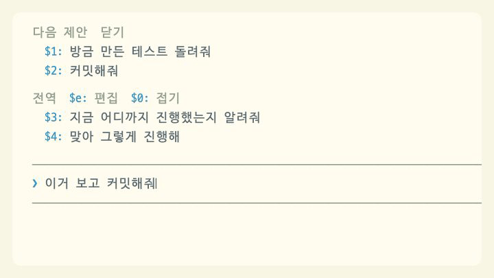

# key-assist

[← README로 돌아가기](../README.md)

> Finder에서 복사한 파일을 붙여넣으면 파일 이름이 `@경로`로 바뀌고, Cmd+Z로 입력 내용을 되돌릴 수 있다. macOS 전용이다.

## 파일 붙여넣기

<p><picture>
<source media="(prefers-color-scheme: dark)" srcset="../.github/assets/showcase/paste-dark.gif">

</picture></p>

Finder에서 파일을 복사해 입력창에 붙여넣으면 터미널에는 파일 이름(`메뉴표준화_초안.html`)만 들어온다. 모드는 macOS 클립보드에서 그 파일의 전체 경로를 읽어 `@/Users/me/Downloads/메뉴표준화_초안.html`로 바꾼다.

### 언제 바꾸나

입력창 글이 키 입력을 거치지 않고 한 덩어리로 늘어났을 때만 붙여넣기로 보고 클립보드를 읽는다. 한 글자씩 칠 때나 다른 모드가 입력창을 채울 때는 읽지 않는다. 공백만 있는 덩어리와 4000자보다 긴 덩어리도 건너뛴다.

클립보드는 `osascript`로 읽고, 클립보드에 든 파일들의 전체 경로를 받는다. 그다음 붙여넣은 덩어리를 아래 둘 중 하나와 비교해 같을 때만 바꾼다.

- 클립보드 파일들의 이름을 순서대로 공백 하나로 이은 글
- 클립보드 파일들의 전체 경로를 순서대로 공백 하나로 이은 글

비교하기 전에 양쪽 모두 완성형(NFC)으로 정규화하고, 앞뒤 공백을 떼고, 공백과 줄바꿈이 이어진 곳은 공백 하나로 줄인다. Finder에서 읽은 경로는 한글이 자모가 분리된 형태(NFD)일 때가 있어서 이렇게 맞춘다. 비교가 맞으면 덩어리 전체를 클립보드 파일 순서대로 `@경로`를 공백으로 이은 글로 바꾸고, 덩어리 앞뒤의 공백은 그대로 둔다.

- 경로에 공백이 있으면 `@"/경로 이름/파일"`처럼 따옴표로 감싼다.
- 여러 파일을 한 번에 붙여넣어도 이름을 하나씩 잘라 보지 않고 덩어리 전체를 한 번에 비교한다. 그래서 파일 이름에 공백이 들어 있어도 구별에 문제가 없다.
- 클립보드에 든 파일 전부가 같은 순서로 들어와야 바꾼다. 일부만 붙여넣었거나 순서가 다르면 바꾸지 않는다.
- 공백을 하나로 줄여 비교하므로 이름 안의 공백 개수만 다른 경우(`a  b`와 `a b`)는 구별하지 못한다. 이때도 바꾸는 경로는 클립보드에 든 실제 경로다.

### 바꾸지 못할 때

클립보드에 파일이 없거나, `osascript`가 실패하거나, 2초 안에 답하지 않으면 붙여넣은 글을 그대로 둔다. 따로 알림은 띄우지 않는다. 일반 텍스트를 붙여넣었을 때도 비교가 맞지 않으므로 그대로 들어간다.

### 바뀌는 시점

붙여넣기를 알아채는 시점에 따라 세 경로로 나뉜다.

| 시점 | 언제 | 보이는 결과 |
| --- | --- | --- |
| 붙여넣은 직후 | Claude Code가 붙여넣은 뒤 자동완성 후보를 확인할 때(`prompt.autocomplete`) | 입력창이 바로 `@경로`로 바뀐다 |
| 다음 키 | 그 전에 바꾸지 못했으면 붙여넣은 뒤 처음 누른 키를 적용하기 직전(`prompt.edit`) | 입력창이 바뀌고, 커서는 늘어난 길이만큼 뒤로 옮겨진다 |
| 전송 | 붙여넣고 곧바로 Enter를 눌렀을 때(`prompt.submit`) | 입력창에는 바뀐 모습이 보이지 않고, 보내는 글에서만 바뀐다 |

전송 시점에는 입력창에서 직접 쳐서 보낸 글만 바꾼다. 슬래시 명령으로 보내는 글은 바꾸지 않는다.

## Cmd+Z로 되돌리기

<p><picture>
<source media="(prefers-color-scheme: dark)" srcset="../.github/assets/showcase/undo-dark.gif">

</picture></p>

Claude Code에는 입력 내용을 되돌리는 기능(`chat:undo`, 기본 `ctrl+_`)이 이미 있다. 모드는 Command 키 입력을 받지 못해(Cmd+Z가 그냥 `z`로 들어온다) Cmd+Z를 직접 처리할 수 없다. 그래서 키 설정 파일에 Cmd+Z를 `chat:undo`로 잇는 항목을 넣는다.

### 자동으로 넣는 내용

설치한 뒤 처음 시작한 세션에서 `~/.claude/keybindings.json`(`CLAUDE_CONFIG_DIR`을 지정했다면 그 폴더의 `keybindings.json`)을 연다.

- 파일에 `"context": "Chat"` 블록이 있으면 그 블록의 `bindings`에 `"cmd+z": "chat:undo"`를 더한다.
- `Chat` 블록이 없으면 아래 블록을 `bindings` 배열 끝에 더한다.
- 파일이 없으면 아래 내용으로 새로 만든다.

```json
{
  "$schema": "https://www.schemastore.org/claude-code-keybindings.json",
  "$docs": "https://code.claude.com/docs/en/keybindings",
  "bindings": [
    {
      "context": "Chat",
      "bindings": {
        "cmd+z": "chat:undo"
      }
    }
  ]
}
```

저장할 때는 파일 전체를 2칸 들여쓰기 JSON으로 다시 쓴다. 넣고 나면 `key-assist: Cmd+Z로 입력한 내용을 되돌릴 수 있게 키 설정에 한 줄 추가했어요` 알림이 뜬다. 알림을 놓쳤다면 `keybindings.json`에 `"cmd+z": "chat:undo"`가 있는지 보면 된다. 바로 적용되지 않으면 Claude Code를 다시 시작한다.

### 넣지 않는 경우

아래 경우에는 파일을 건드리지 않고 알림도 띄우지 않는다. 한 번 이렇게 판단하면 다음 세션에서도 다시 시도하지 않는다.

- 어느 블록이든 `cmd+z`가 이미 있다. 다른 기능에 할당했거나 `null`로 꺼 둔 경우도 포함한다. `command+z`, `super+z`, `win+z`처럼 같은 키를 가리키는 다른 표기도 같은 키로 본다.
- 파일이 JSON으로 읽히지 않거나 최상위에 `bindings` 배열이 없다.

직접 설정하려면 이렇게 한다.

- `cmd+z`가 다른 기능에 있으면 그 값을 `"chat:undo"`로 바꿀지 먼저 정한다. 기존 기능을 그대로 쓰려면 아무것도 하지 않는다.
- 파일이 잘못된 JSON이면 먼저 JSON 오류를 고친다. 그다음 `Chat` 블록이 있으면 그 `bindings`에 `"cmd+z": "chat:undo"`를 넣고, 없으면 위 예시의 `Chat` 블록을 `bindings` 배열에 더한다.

파일이 있는데 읽지 못했거나 저장에 실패했을 때는 다음 세션에서 다시 시도한다.

### 알아 둘 점

- 이 항목은 한 번만 넣는다. 나중에 지워도 다시 넣지 않는다.
- key-assist를 삭제해도 이 항목은 남는다. 필요 없으면 직접 지운다.
- Command 키 입력을 Claude Code에 전달하는 터미널(Kitty 키보드 프로토콜을 쓰는 Orca, Ghostty, kitty, WezTerm 등)에서만 동작한다.
- Ctrl+Z는 터미널에서 프로세스를 일시 중지하는 키라서 되돌리기 키로 쓰지 않는다. 실수로 눌러 Claude Code가 멈췄다면 `fg`로 재개한다.
