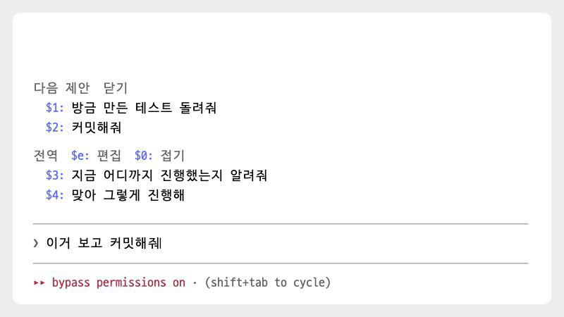

# key-assist

[← README로 돌아가기](../README.md)

> Finder에서 복사한 파일을 붙여넣으면 파일 이름이 `@경로` 멘션으로 바뀝니다. Cmd+Z로 입력 내용을 되돌릴 수도 있습니다. macOS 전용입니다.

<p><picture>
<source media="(prefers-color-scheme: dark)" srcset="./images/showcase/paste-dark.gif">

</picture></p>

| 항목 | 값 |
| --- | --- |
| 버전 | `0.2.1` |
| 자리 | 입력창 |
| 요구 사항 | macOS(클립보드를 `osascript`와 AppKit `NSPasteboard`로 읽습니다). Cmd+Z는 Command 키 입력을 Claude Code에 전달하는 터미널에서만 동작합니다. 필요한 Claude Code 버전은 확인되지 않았습니다 |
| 외부 호출 | 모델과 네트워크는 호출하지 않습니다. 하위 프로세스는 붙여넣기를 감지할 때마다 실행하는 `osascript`와 첫 세션에서 키 설정을 저장할 때 한 번 실행하는 `/bin/sh`입니다 |
| 저장 데이터 | `$.store` 키 `undo-key-done` 하나. 처음 세션에서 `keybindings.json`에 한 줄 추가 |

## 목차

- [개요](#개요)
- [빠른 시작](#빠른-시작)
- [사용법](#사용법)
- [키와 명령](#키와-명령)
- [화면 구성](#화면-구성)
- [동작 방식](#동작-방식)
- [설정과 저장 데이터](#설정과-저장-데이터)
- [외부 호출과 사용량](#외부-호출과-사용량)
- [제한 사항](#제한-사항)
- [문제 해결](#문제-해결)
- [소스 구성](#소스-구성)
- [변경 이력](#변경-이력)

## 개요

key-assist는 입력창의 파일 붙여넣기와 Cmd+Z 동작을 개선합니다.

- **파일 붙여넣기**: 개발 중 확인한 Orca에서는 Finder에서 복사한 파일을 터미널에 붙여넣으면 전체 경로 대신 파일 이름(`메뉴표준화_초안.html`)만 입력됩니다. 파일 이름만으로는 Claude가 파일을 찾을 수 없어, 모드가 macOS 클립보드에서 전체 경로를 읽고 `@/Users/me/Downloads/메뉴표준화_초안.html`로 바꿉니다.
- **Cmd+Z 되돌리기**: Claude Code에는 입력 내용을 되돌리는 기능(`chat:undo`)이 있지만 Cmd+Z에는 연결되어 있지 않습니다. 설치 후 첫 세션에서 `keybindings.json`에 `"cmd+z": "chat:undo"`를 한 번 추가합니다.

하지 않는 것도 있습니다.

- 일반 텍스트 붙여넣기는 건드리지 않습니다. 클립보드 파일의 이름이나 경로와 정확히 맞을 때만 바꿉니다.
- 슬래시 명령으로 보내는 글은 바꾸지 않습니다.
- 되돌리기 기능은 직접 구현하지 않고, 키 설정에서 Cmd+Z를 엔진의 `chat:undo`에 연결합니다.

## 빠른 시작

1. 마켓플레이스를 등록하지 않았다면 [마켓플레이스에서 설치](../README.md#마켓플레이스에서-설치)를 보고 먼저 등록합니다.
2. 모드를 설치하고, Claude Code를 다시 시작하거나 `/reload-plugins`를 실행합니다.

   ```
   /plugin install key-assist@oobg
   ```

3. 설치 후 첫 세션에서 Cmd+Z 키 설정이 추가되면 `key-assist: Cmd+Z로 입력한 내용을 되돌릴 수 있게 키 설정에 한 줄 추가했어요` 알림이 표시됩니다.
4. Finder에서 파일을 하나 이상 복사(Cmd+C)하고 입력창에 붙여넣습니다. 파일 이름이 `@경로`로 바뀝니다.
5. 입력창에서 Cmd+Z를 누르면 방금 바뀐 내용이 되돌아갑니다.

## 사용법

### 파일 붙여넣기

Finder에서 복사한 파일을 입력창에 붙여넣으면 붙여넣은 내용이 클립보드에 있는 파일의 `@경로` 멘션으로 바뀝니다.

```
붙여넣기 전 클립보드: /Users/me/Downloads/메뉴표준화_초안.html
터미널이 넣은 글:     이거 봐줘 메뉴표준화_초안.html
바뀐 글:             이거 봐줘 @/Users/me/Downloads/메뉴표준화_초안.html
```

붙여넣은 내용이 다음 두 형태 중 하나와 일치할 때만 바꿉니다.

- 클립보드에 있는 파일 이름을 순서대로 공백 하나로 연결한 문자열
- 클립보드에 있는 파일의 전체 경로를 순서대로 공백 하나로 연결한 문자열

비교하기 전에 양쪽을 완성형(NFC)으로 정규화하고 앞뒤 공백을 제거한 뒤, 연속된 공백과 줄바꿈을 공백 하나로 통일합니다. Finder에서 받은 경로의 한글은 자모가 분리된 형태(NFD)일 수 있지만 입력창에 붙여넣은 이름은 완성형이므로, 비교할 수 있도록 정규화합니다.

일치하면 붙여넣은 내용 전체를 클립보드의 파일 순서에 맞춰 `@경로`를 공백으로 연결한 문자열로 바꿉니다. 붙여넣은 내용 앞뒤의 공백은 유지합니다.

- 경로에 공백이 있으면 `@"/경로 이름/파일"`처럼 따옴표로 감쌉니다.
- 여러 파일을 붙여넣어도 이름을 개별적으로 분리하지 않고 붙여넣은 내용 전체를 비교합니다. 따라서 파일 이름에 공백이 있어도 처리할 수 있습니다.
- 클립보드에 있는 파일을 모두 같은 순서로 붙여넣었을 때만 변환합니다. 일부만 붙여넣거나 순서가 다르면 원래 내용을 유지합니다.

```
클립보드: /p/a.txt, /q/b c.txt
붙여넣은 글: a.txt b c.txt
바뀐 글:    @/p/a.txt @"/q/b c.txt"
```

붙여넣은 뒤 어떤 이벤트가 먼저 발생하느냐에 따라 변환 시점이 다음 세 가지로 나뉩니다.

| 시점 | 언제 | 보이는 결과 |
| --- | --- | --- |
| 붙여넣은 직후 | Claude Code가 붙여넣은 뒤 자동완성 후보를 요청할 때(`prompt.autocomplete`) | 입력창이 바로 `@경로`로 바뀝니다 |
| 다음 키 | 붙여넣기 직후 변환하지 못한 경우, 다음 키 입력을 처리하기 직전(`prompt.edit`) | 입력창이 바뀌고 그 키가 적용됩니다. 커서는 늘어난 길이만큼 뒤로 옮겨집니다 |
| 전송 | 붙여넣고 곧바로 Enter를 눌렀을 때(`prompt.submit`) | 입력창에는 변환 결과가 표시되지 않고, 전송되는 내용만 바뀝니다 |

### Cmd+Z로 되돌리기

<p><picture>
<source media="(prefers-color-scheme: dark)" srcset="./images/showcase/undo-dark.gif">

</picture></p>

설치 후 첫 세션에서 `~/.claude/keybindings.json`을 확인합니다. 환경 변수 `CLAUDE_CONFIG_DIR`이 설정되어 있으면 해당 폴더의 `keybindings.json`을 확인합니다.

- `"context": "Chat"` 블록이 있으면 해당 블록의 `bindings`에 `"cmd+z": "chat:undo"`를 추가합니다.
- `Chat` 블록이 없으면 `bindings` 배열 끝에 `Chat` 블록을 추가합니다.
- 파일이 없거나 비어 있으면 아래 내용으로 새로 만듭니다.

```json
{
  "$schema": "https://www.schemastore.org/claude-code-keybindings.json",
  "$docs": "https://code.claude.com/docs/en/keybindings",
  "bindings": [
    {
      "context": "Chat",
      "bindings": {
        "cmd+z": "chat:undo"
      }
    }
  ]
}
```

다른 블록과 키 값은 유지합니다. 다만 저장할 때 파일 전체를 공백 2칸 들여쓰기 형식의 JSON으로 다시 작성하므로 기존 줄바꿈과 들여쓰기는 바뀝니다.

이미 `cmd+z`가 설정된 파일은 수정하지 않습니다. 자세한 조건은 [설정과 저장 데이터](#설정과-저장-데이터)에 설명되어 있습니다. 직접 설정하려면 다음과 같이 수정합니다.

- `cmd+z`가 다른 동작에 연결되어 있다면 기존 설정을 `"chat:undo"`로 바꿀지 결정합니다. 원래 동작을 유지하려면 수정하지 않습니다.
- 파일의 JSON 형식이 올바르지 않다면 오류부터 수정합니다. `Chat` 블록이 있으면 해당 `bindings`에 `"cmd+z": "chat:undo"`를 추가하고, 없으면 위 예시의 `Chat` 블록을 `bindings` 배열에 추가합니다.

## 키와 명령

| 입력 | 동작 | 조건 |
| --- | --- | --- |
| 붙여넣기(Cmd+V) | 파일 이름을 `@경로` 멘션으로 바꿉니다 | 클립보드에 파일이 있고, 붙여넣은 내용이 해당 파일들의 이름이나 경로와 일치할 때 |
| 붙여넣은 뒤 아무 키 | 해당 키 입력을 처리하기 전에 붙여넣은 내용을 변환합니다 | 붙여넣은 직후에 바꾸지 못했을 때 |
| 붙여넣은 뒤 바로 Enter | 보내는 글의 파일 이름을 `@경로`로 바꿉니다 | 입력창에서 직접 보낸 글이고 슬래시 명령이 아닐 때 |
| Cmd+Z | 엔진의 `chat:undo`로 입력 내용을 되돌립니다 | `keybindings.json`에 `"cmd+z": "chat:undo"`가 있고, 터미널이 Command 키를 전달할 때 |

슬래시 명령은 없습니다.

## 화면 구성

| 요소 | 내용 | 표시 조건 |
| --- | --- | --- |
| 입력창 글 | 붙여넣은 파일 이름 자리에 `@경로` 멘션이 들어갑니다 | 붙여넣기를 감지하고 내용이 일치할 때 |
| 알림(토스트) | `key-assist: Cmd+Z로 입력한 내용을 되돌릴 수 있게 키 설정에 한 줄 추가했어요` | 처음 세션에서 `keybindings.json`에 줄을 실제로 써 넣었을 때 한 번 |

모드가 별도로 표시하는 UI 영역은 없습니다. 변환하지 못한 경우에도 알림을 표시하지 않습니다.

## 동작 방식

### 이벤트

| 이벤트 | 하는 일 | 소스 |
| --- | --- | --- |
| `session.start` | 입력창의 현재 내용을 읽어 `seen`에 저장합니다. 키 설정이 추가되기를 기다리지 않고 진행합니다 | `hooks/register.ts`: `register`, `enableUndoKey` |
| `prompt.autocomplete` | 입력창 내용이 `seen`과 다르면 붙여넣기인지 확인합니다. 조건이 맞으면 `$.prompt.fill({ text })`(기본 `replace`)로 입력창 전체를 변환된 내용으로 채웁니다. 자동완성 후보는 추가하지 않고 `next(e)`를 그대로 호출합니다 | `hooks/register.ts`: `register`, `rewrite` |
| `prompt.edit` | 키 입력을 처리하기 전 내용(`e.text`)이 `seen`과 다르면 변환된 내용을 전달하며 `next`를 호출합니다. `cursor`, `start`, `end`는 아래 규칙에 따라 조정합니다. 결과는 `seen`에 저장합니다 | `hooks/register.ts`: `register`, `rewrite` |
| `prompt.fill` | 채우기에 성공하면 `seen`을 갱신합니다. `replace`인 경우 `e.text`를, 그 외에는 `$.prompt.read()`로 읽은 내용을 사용합니다 | `hooks/register.ts`: `register` |
| `prompt.submit` | `seen`을 초기화합니다. 입력창에서 전송한 내용(`origin.kind === 'composer'`)이 슬래시 명령(`e.command`)이 아니고 `seen`과 다르면 전송 내용을 변환합니다 | `hooks/register.ts`: `register`, `rewrite` |

### 붙여넣기 알아채기

엔진에는 붙여넣기를 알려 주는 별도 이벤트가 없습니다. 개발 중에는 붙여넣기가 `prompt.edit`를 거치지 않는 것도 확인했습니다. 모드는 마지막으로 확인한 입력창 내용을 `seen`에 저장하고, 다음 이벤트에서 받은 내용이 다르면 그사이에 텍스트가 삽입된 것으로 판단합니다. `seen`은 입력창 내용을 전달하는 이벤트(`session.start`, `prompt.edit`, `prompt.fill`, `prompt.submit`)가 발생하거나 자동완성 과정에서 내용을 변환했을 때만 갱신합니다.

`rewrite`는 다음 순서로 변환 여부를 판단합니다.

1. `insertion(seen, 새 글)`: 이전 내용과 새 내용의 앞뒤에서 일치하는 부분을 제외하고, 가운데에 글자가 삽입된 경우인지 확인합니다. 기존 글자를 삭제하거나 수정한 경우에는 변환하지 않습니다.
2. 삽입된 내용이 공백뿐이거나 `MAX_PASTE`(`4000`)자를 넘으면 변환하지 않습니다. 이 경우 클립보드도 읽지 않습니다.
3. `clipboardFiles`로 클립보드 파일 경로를 읽습니다.
4. `asMentions`로 삽입된 내용을 비교하고, 일치하면 해당 부분만 `@경로`로 변환합니다.

`prompt.edit`에서 변환된 내용의 길이 차이는 `delta`(바뀐 글 길이 빼기 원래 덩어리 길이)로 계산합니다. 위치 값은 다음과 같이 조정합니다.

- 변환된 부분의 끝(`end`) 이후에 있는 위치: `delta`만큼 조정합니다.
- 변환된 부분 안쪽의 위치: 변환된 내용의 끝(`end + delta`)으로 이동합니다.
- 변환된 부분의 시작(`start`) 이전에 있는 위치: 변경하지 않습니다.

### 다른 모드가 채운 글

다른 모드가 `$.prompt.fill`로 입력창 내용을 채울 때도 키 입력 없이 글이 추가되어 붙여넣기와 구별하기 어렵습니다. 이를 구분하기 위해 `prompt.fill` 훅에서 변경된 내용을 `seen`에 먼저 반영합니다. 채우기가 거부되면(`isFilled: false`) `seen`은 갱신하지 않습니다.

### 자동완성 이벤트에서 바꾸는 이유

개발 중에는 타이머로 입력창 내용을 바꿔도 다음 키 입력 전까지 화면이 갱신되지 않았습니다. 반면 붙여넣기 직후 `prompt.autocomplete`가 호출될 때 그 안에서 변환하면 바로 화면에 반영됩니다. 이 이벤트가 호출되지 않으면 `prompt.edit`나 `prompt.submit`에서 변환합니다.

### Cmd+Z를 키 설정으로 잇는 이유

엔진이 모드에 키 이벤트를 전달할 때는 Command 수식키가 제외됩니다. 키 정보에는 `ctrl`, `shift`, `meta`만 있으며 Cmd+Z도 `z`로 전달됩니다. 따라서 모드에서는 Cmd+Z와 `z`를 구분할 수 없어 엔진 키 설정에서 `cmd+z`를 `chat:undo`에 연결합니다.

### 상수

| 이름 | 값 | 쓰임 |
| --- | --- | --- |
| `MAX_PASTE` | `4000` | 이보다 긴 덩어리는 클립보드를 읽지 않습니다 |
| `READ_FILES` | JXA 스크립트 | 클립보드 파일 경로를 한 줄에 하나씩 출력합니다 |
| `UNDO_KEY` | `'cmd+z'` | 넣는 키 |
| `UNDO_ACTION` | `'chat:undo'` | 키에 연결할 동작 |
| `UNDO_DONE` | `'undo-key-done'` | 키 설정 처리를 마쳤음을 나타내는 `$.store` 키 |

`seen`은 모듈 내부 변수로 관리하며, `$.state`나 `$.store`에는 저장하지 않습니다.

## 설정과 저장 데이터

모드에 설정 명령이나 옵션은 없습니다.

### `$.store`

| 키 | 값 | 뜻 |
| --- | --- | --- |
| `undo-key-done` | `true` | 키 설정 확인 및 처리를 마쳤음을 나타냅니다. 이 값이 있으면 다음 세션부터 `keybindings.json`을 다시 확인하지 않습니다 |

`$.store`는 Claude Code 설정 폴더 아래의 모드 전용 JSON 파일에 저장됩니다. 정확한 파일 경로와 초기화 방법은 확인되지 않았습니다.

### `keybindings.json`

| 항목 | 값 |
| --- | --- |
| 경로 | `$CLAUDE_CONFIG_DIR/keybindings.json`, 없으면 `$HOME/.claude/keybindings.json` |
| 넣는 줄 | `Chat` 블록의 `bindings`에 `"cmd+z": "chat:undo"` |
| 쓰는 방식 | `/bin/sh -c 'mkdir -p "$(dirname "$1")" && cat > "$1.key-assist" && mv "$1.key-assist" "$1"'`. 폴더를 만든 뒤 표준 입력으로 받은 내용을 `keybindings.json.key-assist`에 저장하고, 원래 파일 이름으로 변경합니다 |

다음 경우에는 `withUndoKey`가 파일을 수정하지 않습니다. 이때도 `undo-key-done`을 `true`로 저장하므로 이후 세션에서는 다시 시도하지 않습니다.

- 어느 블록이든 `bindings`에 `cmd+z`가 이미 있으면 수정하지 않습니다. 다른 동작에 연결했거나 `null`로 비활성화한 경우도 같습니다. 비교할 때는 키 이름을 소문자로 바꾸고 `command+`, `super+`, `win+`를 `cmd+`로 통일하므로 `Command+Z`, `super+z`, `win+z`도 같은 키로 처리합니다.
- 파일을 JSON으로 파싱할 수 없습니다. 주석이 포함된 파일도 해당합니다.
- 최상위에 `bindings` 배열이 없습니다.

다음 경우에는 `undo-key-done`을 저장하지 않고 다음 세션에서 다시 시도합니다.

- 파일은 존재하지만 읽기에 실패했습니다(`$.fs.read`는 실패하고 `$.fs.stat`은 성공).
- 쓰기 명령이 0이 아닌 코드로 끝났습니다.
- 처리 중 예외가 발생했습니다. 별도 알림 없이 무시합니다.

키 설정은 처음 한 번만 추가합니다. 이후 해당 줄을 삭제해도 `undo-key-done`이 남아 자동으로 다시 추가되지 않습니다.

> [!NOTE]
> key-assist를 제거해도 키 설정은 유지되므로 필요하지 않다면 직접 삭제해야 합니다.

## 외부 호출과 사용량

모델 호출과 네트워크 요청은 없습니다. 사용자 계정 사용량에 포함되지 않습니다.

| 하위 프로세스 | 언제 | 제한 시간 | 실패 시 |
| --- | --- | --- | --- |
| `osascript -l JavaScript -e <READ_FILES>` | 붙여넣기로 감지된 내용이 공백 이외의 글자를 포함하고 `4000`자 이하일 때마다 | 2000ms | 종료 코드가 0이 아니거나 예외가 나면 파일이 없는 것으로 보고 글을 그대로 둡니다 |
| `/bin/sh -c '...'`(위 쓰기 명령) | 설치 후 첫 세션에서 키 설정을 저장할 때 한 번 | 지정하지 않음 | 다음 세션에서 다시 시도합니다 |

`READ_FILES`는 JXA를 통해 `NSPasteboard.generalPasteboard`에서 `NSURL`을 `NSPasteboardURLReadingFileURLsOnlyKey: true` 옵션으로 읽어 파일 URL만 가져오고, 각 경로를 한 줄씩 출력합니다. 출력된 각 줄의 앞뒤 공백을 제거하고 NFC로 정규화한 뒤 `/`로 시작하는 경로만 사용합니다.

## 제한 사항

- macOS에서만 동작합니다. 클립보드를 `osascript`와 AppKit으로 읽습니다.
- 터미널에서 파일 이름만 붙여넣는 경우에 유용합니다. 개발 중에는 Orca에서 Finder의 파일을 붙여넣으면 이름만 입력되는 것을 확인했습니다. 다른 터미널의 동작은 확인하지 못했습니다. 전체 경로가 붙여넣어지는 경우에도 경로를 비교해 변환합니다.
- 연속된 공백을 하나로 통일해 비교하므로 파일 이름의 공백 개수 차이(`a  b`와 `a b`)는 구분하지 못합니다. 다만 변환할 때는 클립보드에 있는 실제 경로를 사용합니다.
- 붙여넣은 직후에 변환하려면 엔진에서 `prompt.autocomplete`를 호출해야 합니다. 이 이벤트가 발생하지 않으면 다음 키 입력이나 전송 시 변환됩니다. 전송 시 변환되면 입력창에는 변경 결과가 표시되지 않습니다.
- 붙여넣기는 `prompt.edit`를 거치지 않으므로 모드는 입력창의 이전 내용과 현재 내용을 비교해 새로 삽입된 부분을 찾습니다. 붙여넣은 뒤 다음 이벤트 전에 다른 변경이 발생하면 삽입된 부분을 구분하지 못해 변환하지 않습니다.
- Cmd+Z는 Command 키 입력을 Claude Code에 전달하는 터미널(Kitty 키보드 프로토콜을 쓰는 Orca, Ghostty, kitty, WezTerm 등)에서만 동작합니다. 모드에서는 Command 키를 직접 받을 수 없어 엔진의 키 설정을 사용합니다.
- Ctrl+Z는 터미널에서 프로세스를 일시 중지하므로 되돌리기 키로 사용하지 않습니다. 실수로 눌러 Claude Code가 중지됐다면 `fg`로 재개합니다.
- Command 키를 전달하지 않는 터미널에서는 Cmd+Z가 동작하지 않습니다. 대신 Claude Code의 기본 되돌리기 키인 `ctrl+_`를 사용합니다(`chat:undo`의 기본 키, [Claude Code 키 설정 문서](https://code.claude.com/docs/en/keybindings)).

## 문제 해결

| 증상 | 원인 | 해결 |
| --- | --- | --- |
| 붙여넣은 파일 이름이 그대로 남습니다 | 클립보드에 파일 대신 텍스트가 복사되어 있습니다 | Finder에서 파일을 다시 복사합니다 |
| 붙여넣은 파일 이름이 그대로 남습니다 | `osascript`가 실패했거나 2000ms 안에 답하지 않았습니다 | 다시 붙여넣습니다 |
| 붙여넣은 파일 이름이 그대로 남습니다 | 클립보드 파일 일부만 붙여넣었거나 순서가 다릅니다 | 복사한 파일 전부를 그대로 붙여넣습니다 |
| 붙여넣은 파일 이름이 그대로 남습니다 | 붙여넣은 내용이 `4000`자를 초과합니다 | 파일 수를 줄여 나눠 붙여넣습니다 |
| 입력창에서는 그대로였는데 보낸 글에서만 바뀌었습니다 | 붙여넣은 직후 Enter를 눌러 전송 과정에서 변환되었습니다 | 정상 동작입니다 |
| 설치 알림이 뜨지 않았고 Cmd+Z가 되돌리지 않습니다 | `keybindings.json`에 `cmd+z`가 이미 있습니다(다른 표기나 `null` 포함) | 기존 값을 `"chat:undo"`로 바꿀지 결정한 뒤 직접 수정합니다 |
| 설치 알림이 뜨지 않았고 Cmd+Z가 되돌리지 않습니다 | `keybindings.json`이 JSON으로 읽히지 않거나 `bindings` 배열이 없습니다 | JSON 오류를 고치고 [Cmd+Z로 되돌리기](#cmdz로-되돌리기)의 예시대로 직접 넣습니다 |
| `"cmd+z": "chat:undo"`가 있는데 Cmd+Z가 되돌리지 않습니다 | 터미널이 Command 키를 전달하지 않습니다 | Command 키를 넘겨 주는 터미널을 씁니다 |
| 지운 Cmd+Z 줄이 다시 생기지 않습니다 | `$.store`의 `undo-key-done`이 `true`입니다 | 직접 넣습니다 |

## 소스 구성

| 파일 | 역할 |
| --- | --- |
| `mods/key-assist/.claude-plugin/plugin.json` | 모드 이름, 버전(`0.2.1`), 설명, 키워드 |
| `mods/key-assist/hooks/hooks.json` | 훅 모듈 목록(`./register.ts`) |
| `mods/key-assist/hooks/register.ts` | 클립보드 읽기, 붙여넣기 비교와 멘션 변환, 키 설정 추가, 모든 이벤트 훅 |
| `mods/key-assist/tests/key-assist.test.ts` | `insertion`, `asMentions`, `mention`, NFC 정규화, 세 경로의 훅 동작, `withUndoKey` 테스트 |
| `mods/key-assist/tsconfig.json` | 타입 설정. `./.claude-plugin/types/tsconfig.json`을 확장합니다 |

## 변경 이력

- `0.2.1`: 알림 문구를 다듬었습니다(`12d2d6d`).
- 모드 폴더를 `key-assist/`에서 `mods/key-assist/`로 옮겼습니다(`e52c6d5`). 동작은 바뀌지 않았습니다.
- `0.2.0`: 설치 후 첫 세션에서 `keybindings.json`에 `"cmd+z": "chat:undo"`를 추가해 Cmd+Z 되돌리기를 활성화했습니다(`d234b88`).
- `0.1.0`: 붙여넣은 파일 이름을 `@경로` 멘션으로 변환하는 기능을 추가했습니다(`00283ae`).
