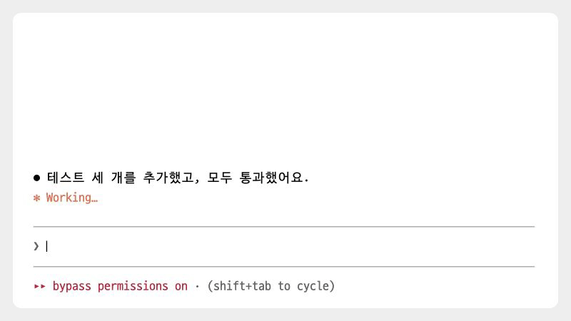

# next-prompts

[← README로 돌아가기](../README.md)

> Claude가 답을 마치면 다음에 보낼 만한 요청을 입력창 위에 제안합니다. 번호를 치거나 문구를 클릭해 바로 쓸 수 있습니다.

<p><picture>
<source media="(prefers-color-scheme: dark)" srcset="./images/showcase/suggest-dark.gif">

</picture></p>

## 빠른 시작

1. 마켓플레이스를 등록하지 않았다면 [마켓플레이스에서 설치](../README.md#마켓플레이스에서-설치)를 보고 먼저 등록합니다.
2. 모드를 설치하고, Claude Code를 다시 시작하거나 `/reload-plugins`를 실행합니다. 설치 직후에는 제안이 표시되지 않습니다.

   ```
   /plugin install next-prompts@oobg
   ```

3. 평소처럼 요청을 보내고 Claude의 답을 기다립니다.
4. 답이 끝나고 제안이 만들어지면 입력창 위에 `다음 제안`과 `$1:`, `$2:`처럼 번호가 붙은 문구가 나타납니다.
5. 문구를 클릭하면 해당 요청을 바로 보냅니다. 입력창에 `$1`을 입력하고 스페이스를 누르면 그 자리가 1번 문구로 바뀝니다.

## 사용법

```
다음 제안  닫기
  $1: 바뀐 내용을 README 문서에 반영해줘
  $2: 커밋해줘
```

- `$1` 뒤에 스페이스: `$1`이 1번 문구로 바뀌고 뒤에 스페이스가 하나 붙습니다. 글 중간에서도 쓸 수 있습니다. `$`는 글 맨 앞이나 공백 뒤에 있어야 합니다.
- `$1`에서 바로 Enter: 보낼 때 1번 문구로 바꿔 보냅니다. 입력창에는 바뀐 글이 보이지 않습니다.
- 번호(`$1:`) 클릭: 입력창 내용을 1번 문구로 바꾸고 제안을 닫습니다. 보내지는 않습니다.
- 문구 클릭: 그 문구를 바로 보냅니다. 입력창에 쓰던 글은 함께 보내지 않습니다.
- `닫기` 클릭: 제안을 닫습니다. 닫은 제안은 다시 열 수 없습니다.

바꾼 내용은 Claude Code의 되돌리기 키 `ctrl+_`로 되돌립니다.

제안은 한 줄씩 차례로 나타납니다. 다 나오기 전에 골라도 전체 문구가 들어갑니다. Claude가 작업하는 동안에는 숨기고, 새 요청을 보내면 지웁니다.

### quick-replies와 함께 쓰기

두 모드가 입력창 위를 나눠 씁니다. 다음 제안은 위에, 프리셋은 아래에 표시되고 번호가 이어집니다. 제안이 2개면 프리셋은 `$3`부터입니다. quick-replies의 접기(`$0`)는 프리셋에만 적용됩니다.

## 알아 둘 점

- 제안을 만들 때 모델을 호출하며, Claude Code 계정 사용량에 포함됩니다. 제안 만들기만 끄는 설정은 없습니다.
- 모델에는 최근에 보낸 요청 최대 5개와 Claude 마지막 답의 끝부분만 보냅니다. 긴 요청은 끝부분만 보냅니다. 이전 답과 도구 결과는 보내지 않습니다.
- 답이 짧거나, 중단·거절·오류로 끝났거나, 서브에이전트가 답한 턴에는 제안하지 않습니다.
- 너무 길거나 서로 겹치는 제안은 버립니다. 제안이 하나만 나오거나 없을 수도 있습니다.
- Claude Code를 `--debug`나 `--debug-file`로 실행하면, 제안이 3개보다 적게 나오거나 버린 문구가 있는 턴마다 모델이 보낸 원문과 버린 이유를 디버그 로그에 남깁니다. 대화에는 보이지 않고 외부로 보내지 않습니다. 디버그 모드를 켜지 않으면 남기지 않습니다.
- 문구를 클릭해 보낸 요청에서는 `@파일` 멘션이 펼쳐지지 않습니다.
- 터미널과 데스크톱 화면에서만 표시됩니다. Claude Code 2.1.296 이상이 필요합니다.

## 문제 해결

<details>
<summary>턴이 끝났는데 제안이 없습니다</summary>
<p>위 조건에 걸렸거나 모델 호출이 실패했을 수 있습니다. 실패해도 오류는 표시하지 않습니다. 다음 턴을 기다립니다.</p>
</details>

<details>
<summary><code>$1</code>을 쳤는데 바뀌지 않습니다</summary>
<p><code>$</code>를 글 맨 앞이나 공백 뒤에 치고, 번호 뒤에 스페이스를 누릅니다. 글을 선택한 상태에서는 바뀌지 않습니다.</p>
</details>

<details>
<summary>제안이 사라졌습니다</summary>
<p>Claude가 작업하는 동안에는 숨깁니다. 새 요청을 보내면 이전 제안은 지워지고, 답이 끝나면 새 제안이 나올 수 있습니다.</p>
</details>

## 변경 이력

- `0.8.1`: `$번호`를 바꾸면 문구 뒤에 스페이스를 하나 붙입니다.
- `0.8.0`: `$번호` 뒤에 스페이스를 쳐야 바뀝니다. 스페이스 없이 Enter를 눌러도 바꿔 보냅니다.
- `0.7.2`: 두 줄로 넘친 제안에 마우스를 올리면 모든 줄이 반전됩니다.
- `0.7.1`: 서브에이전트의 턴에서는 제안하지 않습니다.
- `0.7.0`: 제안이 한 줄씩 나타납니다.
- `0.6.0`: 숫자 키 대신 `$번호`로 문구를 넣습니다.
- `0.5.0`: 다음 제안은 접히지 않고 늘 전체 문구로 보입니다.
- `0.4.0`: 번호 클릭은 입력창에 넣고, 문구 클릭은 바로 보냅니다.
- `0.3.0`: 제안을 제목과 요청으로 나눠 받았습니다.
- `0.2.0`: 제안을 한 줄에 하나씩 보여 줍니다.
- `0.1.0`: 처음 공개.

이 모드는 [hamzafer/claude-code-mods](https://hamzafer.github.io/claude-code-mods/mods/next-steps/)의 next-steps에서 아이디어를 얻었습니다. 원본 코드는 보지 않고 동작 설명만 참고해 새로 구현했습니다.
