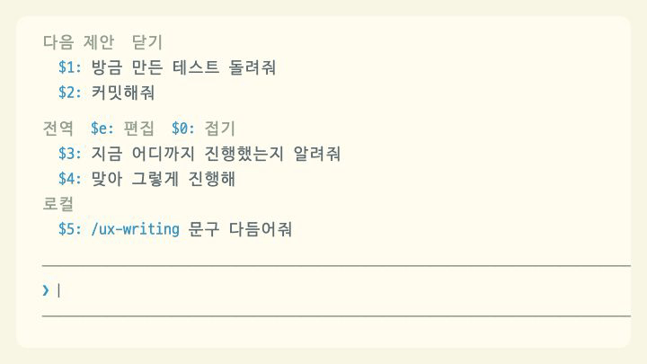
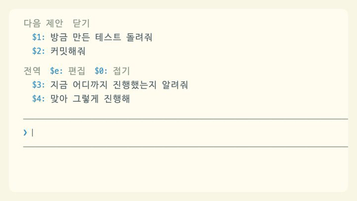

# quick-replies

[← README로 돌아가기](../README.md)

> 반복해서 입력하던 "지금 진행상황"을 `$4`처럼 번호 두 글자로 불러온다.

<p><picture>
<source media="(prefers-color-scheme: dark)" srcset="../.github/assets/showcase/substitute-dark.gif">

</picture></p>

## 프리셋

- **전역 프리셋**은 모든 저장소에서 보인다. 처음에는 "지금 진행상황", "맞아 그렇게 진행해" 두 개가 들어 있다.
- **로컬 프리셋**은 지금 작업하는 프로젝트에서만 보인다. `로컬` 제목 아래에 따로 나온다. git 저장소 안에서는 저장소의 최상위 폴더가 한 프로젝트이고, git 저장소 밖에서는 Claude Code를 연 폴더가 한 프로젝트다. 어느 폴더를 기준으로 할지는 세션을 시작할 때 정한다.
- 기본 프리셋 두 개는 전역 프리셋을 한 번도 저장한 적이 없을 때만 쓰인다. 프리셋을 추가하거나 고치거나 지우면 그때의 전역 목록이 저장되므로, 기본 프리셋을 지운 뒤에는 다시 생기지 않는다.

## 번호로 불러오기

- 입력창에 `$5`처럼 입력하면 그 자리에 그 번호의 프리셋 문구가 들어간다. 번호를 클릭해도 문구가 입력창에 들어가고, 문구를 클릭하면 바로 보낸다.
- 프리셋 번호는 [next-prompts](next-prompts.md)의 다음 제안 번호에 이어서 매긴다. 다음 제안이 3개 떠 있으면 첫 프리셋은 `$4`, 2개면 `$3`이다. 제안이 없거나 Claude가 작업 중이면 `$1`부터다.
- 번호는 `$9`까지만 붙는다. 그 뒤의 프리셋에는 번호가 없으므로 문구를 클릭해 바로 보내는 방법만 쓸 수 있다.
- `/ux-writing README 다듬어줘`, `/compact`처럼 `/`로 시작하는 프리셋은 클릭하면 그 스킬이나 명령을 실행한다. 해당 스킬이나 명령이 없으면 실행하지 않고 알림만 띄운다.

## 접기와 자동 제목

`접기`를 클릭하면 전역과 로컬 프리셋을 각각 한 줄로 접어 제목만 보여 준다. 입력창에 `$0`을 입력해도 접거나 펼칠 수 있다. 접어 둔 상태는 다음 세션에도 유지된다. 다음 제안은 접히지 않고 늘 전체 문구로 보인다.

<p><picture>
<source media="(prefers-color-scheme: dark)" srcset="../.github/assets/showcase/fold-dark.gif">

</picture></p>

아래는 다음 제안이 3개 떠 있을 때 접은 모습이다. 그래서 프리셋 번호가 `$4`부터 시작한다.

```
 전역  $e: 편집  $0: 펼치기
   $4: 진행상황 | $5: 맞아 그렇게 진행해
 로컬
   $6: /ux-writing…
```

- 12자 이하인 프리셋은 문구를 그대로 제목으로 쓴다.
- 프리셋이 12자보다 길고 제목이 없으면 작은 모델(haiku)이 접힌 상태에 표시할 12자 이내의 제목을 만든다. 세션을 시작할 때, 프리셋을 추가하거나 문구를 고친 직후, 제목을 비워서 저장한 직후에 만든다. 한 번 만든 제목은 저장되어 다시 만들지 않는다.
- 제목을 아직 만들지 못했거나 호출에 실패하면 문구의 앞 12자 뒤에 `…`를 붙여 보여 준다. 위 예시의 `/ux-writing…`처럼 보인다.
- 문구를 고치면 모델이 만든 제목은 버리고 새로 만든다. 직접 단 제목은 그대로 둔다.
- 제목 생성은 사용자의 Claude Code 세션과 같은 계정으로 haiku를 호출하므로 사용자의 Claude Code 사용량에 포함된다. 모델에는 프리셋 문구 하나만 보낸다. 이 호출만 끄는 설정은 없다. 12자 이하로 쓰거나 직접 제목을 달면 호출하지 않는다.

## 편집

<p><picture>
<source media="(prefers-color-scheme: dark)" srcset="../.github/assets/showcase/editor-dark.gif">

</picture></p>

입력창에 `$e`를 입력하거나 `편집`을 클릭하면 입력창 위 영역에 편집 화면이 표시된다. 편집 중에도 입력 포커스는 입력창에 그대로 있고, 입력창에 누른 키를 모드가 받아 편집 명령으로 처리한다. 편집하는 동안에는 다음 제안을 숨긴다.

```
 프리셋 편집  a: 전역에 추가  l: 로컬에 추가  q: 완료
 전역 (모든 저장소)
 ▸ 1: 지금 진행상황
   2: 맞아 그렇게 진행해
 로컬 (claude-code-mods)
   3: /ux-writing 문구 다듬어줘
 고른 프리셋  e: 문구 수정  t: 제목  d: 삭제  m: 로컬로  k: 위로  j: 아래로
```

로컬 제목 옆 괄호에는 로컬 프리셋의 기준 폴더 이름이 나온다.

### 프리셋 고르기와 명령

프리셋을 선택하는 동안 누른 키는 입력창에 글자로 들어가지 않고 아래 표의 명령으로 처리된다. Enter를 눌러도 Claude에게 메시지를 보내지 않는다. 대신 `q`로 편집을 끝내라는 안내를 보여 준다. 버튼을 클릭해도 같은 동작을 한다.

| 키 | 동작 |
| --- | --- |
| `1`~`9` | 프리셋 고르기 |
| `a`, `l` | 전역, 로컬에 추가 |
| `e` | 고른 프리셋의 문구 고쳐 쓰기 |
| `t` | 고른 프리셋에 제목 달기 |
| `d` | 고른 프리셋 삭제 |
| `m` | 고른 프리셋을 전역과 로컬 사이로 옮기기. 옮긴 프리셋은 그쪽 목록의 맨 뒤에 붙는다 |
| `k`, `j` | 고른 프리셋을 같은 목록 안에서 위, 아래로 |
| `q` | 편집 끝내기 |

키로 고를 수 있는 것은 전역과 로컬을 통틀어 1~9번까지다. 10번째부터는 편집 화면에서 프리셋 줄을 클릭해 고른다.

### 문구와 제목 입력

`a`, `l`, `e`, `t`를 누르면 입력창에 프리셋 문구나 제목을 입력할 수 있다. 이때 입력창의 글자 색이 바뀌고, 문구나 제목을 고칠 때는 기존 값이 미리 채워진다. 입력창 테두리 색은 모드가 바꿀 수 없어서 글자 색으로 편집 중임을 표시한다.

- Enter를 누르면 앞뒤 공백을 지우고 저장한 뒤 결과를 한 줄로 알려 준다.
- 문구가 비어 있으면 저장하지 않고 "문구가 비어 있어서 저장하지 않았어요"라고 알려 준다.
- 제목을 비워서 저장하면 제목을 지운다. 12자보다 긴 프리셋은 모델이 제목을 다시 만든다.
- 같은 문구가 이미 있어도 막지 않고 별도의 프리셋으로 저장한다.
- 입력을 취소하려면 `$q`를 입력하거나 `취소`를 클릭한다. 취소하면 아무것도 저장하지 않고 입력창을 비우며, 기존 문구와 제목은 그대로 남는다.

## 저장 위치

프리셋과 접힘 상태는 Claude Code가 관리하는 모드 저장 공간에 저장된다. 이 저장 공간은 사용자의 Claude Code 설정 폴더 안에 있는 이 모드 전용 JSON 파일이다. 작업 중인 저장소에는 프리셋 파일을 만들지 않는다. 전역 프리셋은 한 목록으로, 로컬 프리셋은 위에서 설명한 기준 폴더마다 따로 저장한다. 프리셋을 내보내거나 가져오는 기능은 없다.
