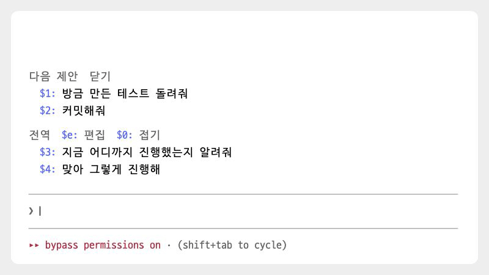

# quick-replies

[← README로 돌아가기](../README.md)

> 반복해서 입력하던 "지금 진행상황"을 `$4`처럼 번호 두 글자로 불러온다.

<p><picture>
<source media="(prefers-color-scheme: dark)" srcset="./images/showcase/substitute-dark.gif">

</picture></p>

| 항목 | 값 |
| --- | --- |
| 버전 | 0.11.1 |
| 자리 | 입력창 위 |
| 요구 사항 | Claude Code 2.1.296 이상(2.1.296~2.1.299에서 테스트). 입력창 위 영역을 그리는 터미널과 데스크톱에서만 보인다 |
| 외부 호출 | 긴 프리셋의 제목을 지을 때 haiku 호출. 세션 시작 때 `git rev-parse --show-toplevel` 한 번 |
| 저장 데이터 | 있음. 프리셋 목록과 접힘 상태를 모드 저장 공간(`$.store`)에 둔다 |

## 목차

- [개요](#개요)
- [빠른 시작](#빠른-시작)
- [사용법](#사용법)
- [키와 명령](#키와-명령)
- [화면 구성](#화면-구성)
- [동작 방식](#동작-방식)
- [설정과 저장 데이터](#설정과-저장-데이터)
- [외부 호출과 사용량](#외부-호출과-사용량)
- [제한 사항](#제한-사항)
- [문제 해결](#문제-해결)
- [소스 구성](#소스-구성)
- [변경 이력](#변경-이력)

## 개요

자주 보내는 문구를 프리셋으로 저장해 두고 입력창 위에 번호와 함께 늘어놓는다. 입력창에 `$번호`를 치면 그 자리에 문구가 들어가고, 번호를 클릭하면 입력창에 넣기만 하며, 문구를 클릭하면 바로 보낸다.

프리셋은 두 범위로 나뉜다.

- **전역 프리셋**은 모든 저장소에서 보인다.
- **로컬 프리셋**은 지금 작업하는 프로젝트에서만 보인다.

`/ux-writing README 다듬어줘`처럼 `/`로 시작하는 프리셋은 스킬이나 슬래시 명령으로 실행한다. 목록 추가, 문구 수정, 제목, 삭제, 범위 옮기기, 순서 바꾸기는 입력창에서 여는 편집 화면에서 한다.

이 모드가 하지 않는 것

- 프리셋을 파일로 내보내거나 가져오지 않는다.
- 작업 중인 저장소에 파일을 만들지 않는다.
- 다음에 보낼 요청을 제안하지 않는다. 그 일은 [next-prompts](next-prompts.md)가 하고, 이 모드는 그 제안 번호에 이어서 번호를 매긴다.

## 빠른 시작

1. 마켓플레이스를 등록했다면 다음 명령으로 설치하고, Claude Code를 다시 시작하거나 `/reload-plugins`를 실행한다.

   ```
   /plugin install quick-replies@oobg
   ```

2. 입력창 위에 기본 프리셋 두 개가 보인다.

   ```
    전역  $e: 편집  $0: 접기
     $1: 지금 진행상황
     $2: 맞아 그렇게 진행해
   ```

3. 입력창에 `$1`을 치면 그 자리가 "지금 진행상황"으로 바뀐다. Enter를 눌러 보낸다.
4. 프리셋을 더하려면 입력창에 `$e`를 치고, `a`를 누른 뒤 문구를 쓰고 Enter를 누른다. `q`로 편집 화면을 닫는다.

## 사용법

### 프리셋 범위

- 처음 설치하면 전역 프리셋에 "지금 진행상황", "맞아 그렇게 진행해" 두 개가 들어 있다. 로컬 프리셋은 비어 있다.
- 기본 프리셋 두 개는 전역 목록을 한 번도 저장한 적이 없을 때만 쓰인다. 프리셋을 추가하거나 고치거나 지우거나 옮기면 그때의 전역 목록이 저장된다. 그래서 기본 프리셋을 지운 뒤에는 다시 생기지 않고, 전역 프리셋을 모두 지우면 빈 목록으로 남는다.
- 로컬 프리셋의 기준 폴더는 git 저장소 안에서는 저장소의 최상위 폴더다. git 저장소 밖이거나 `git`을 실행하지 못하면 세션 폴더(Claude Code를 연 폴더)다. 기준 폴더는 세션을 시작할 때 한 번 정하고 그 세션 동안 바꾸지 않는다.

### 번호로 불러오기

- 입력창에 `$5`처럼 치면 `$`와 숫자가 그 번호 프리셋의 문구로 바뀐다. 문장 중간에서도 쓸 수 있다. 예를 들어 `그리고 $3`은 `그리고 지금 진행상황`이 된다.
- `$`는 입력창의 맨 앞이나 공백 바로 뒤에 있어야 한다. `a$3`처럼 낱말에 붙은 `$`는 바꾸지 않는다.
- 그 번호에 해당하는 프리셋이 없으면 친 글자가 그대로 남는다.
- 번호를 클릭하면 입력창의 내용을 그 문구로 바꾼다. 보내지는 않는다.
- 문구를 클릭하면 바로 보낸다. 대화 기록에는 사용자가 보낸 메시지로 남는다.

### 번호 매기기

- 번호는 전역 프리셋부터, 이어서 로컬 프리셋 순서로 매긴다.
- [next-prompts](next-prompts.md)의 다음 제안이 떠 있으면 프리셋 번호는 제안 개수 다음부터 시작한다. 다음 제안이 3개면 첫 프리셋은 `$4`, 2개면 `$3`이다.
- 다음 제안이 없거나 Claude가 작업 중이면 `$1`부터다. next-prompts를 설치하지 않았을 때도 `$1`부터다.
- 번호는 `$9`까지만 붙는다. 그 뒤의 프리셋에는 번호가 없으므로 문구를 클릭해 바로 보내는 방법만 쓸 수 있다. `$10`을 치려 해도 `$1`을 친 순간 이미 1번 문구로 바뀌기 때문이다.

### 스킬과 슬래시 명령 프리셋

- `/이름` 또는 `/이름 나머지 글`로 된 프리셋을 클릭하면 `이름`을 명령 이름, 나머지를 인자로 나눠 그 스킬이나 명령을 실행한다. 예를 들어 `/ux-writing README 다듬어줘`는 `ux-writing` 명령을 인자 `README 다듬어줘`로 실행하고, `/compact`는 인자 없이 실행한다.
- 실행 전에 지금 쓸 수 있는 명령 목록에서 이름을 찾는다. 없으면 실행하지 않고 "/이름에 해당하는 명령이나 스킬을 찾지 못했어요"라는 알림만 띄운다.
- 명령 이름에 `/`가 들어 있으면(`/usr/bin`처럼) 명령으로 보지 않고 일반 문구로 보낸다.
- 번호를 클릭하거나 `$번호`로 넣을 때는 명령으로 실행하지 않고 문구만 입력창에 넣는다.

### 접기와 자동 제목

`$0: 접기`를 클릭하거나 입력창에 `$0`을 치면 전역과 로컬 프리셋을 각각 한 줄로 접어 제목만 보여 준다. 다시 하면 펼친다. 접힘 상태는 저장되어 다음 세션에도 유지된다. 다음 제안은 접히지 않고 늘 전체 문구로 보인다.

<p><picture>
<source media="(prefers-color-scheme: dark)" srcset="./images/showcase/fold-dark.gif">

</picture></p>

아래는 다음 제안이 3개 떠 있을 때 접은 모습이다. 그래서 프리셋 번호가 `$4`부터 시작한다.

```
 전역  $e: 편집  $0: 펼치기
   $4: 진행상황 | $5: 맞아 그렇게 진행해
 로컬
   $6: /ux-writing…
```

- 접힌 줄에는 프리셋의 제목을 보여 준다. 제목이 없으면 문구를 12자로 줄이고 끝에 `…`를 붙인다. 12자 이하인 문구는 그대로 보인다.
- 12자보다 길고 제목이 없는 프리셋에는 작은 모델(haiku)이 12자 이내의 제목을 지어 단다. 세션을 시작할 때, 프리셋을 추가하거나 문구를 고친 직후, 제목을 비워서 저장한 직후에 짓는다. 지은 제목은 저장되므로 다시 짓지 않는다.
- 제목을 아직 짓지 못했거나 호출에 실패하면 줄인 문구를 보여 준다. 위 예시의 `/ux-writing…`이 그 경우다.
- 문구를 고치면 모델이 지은 제목은 버리고 새로 짓는다. 직접 단 제목은 그대로 둔다.
- 접어도 클릭하거나 `$번호`로 넣는 것은 원래 문구 전체다.

### 편집 화면

<p><picture>
<source media="(prefers-color-scheme: dark)" srcset="./images/showcase/editor-dark.gif">

</picture></p>

입력창에 `$e`를 치거나 `$e: 편집`을 클릭하면 입력창 위 영역에 편집 화면이 열린다. 편집 중에도 입력 포커스는 입력창에 그대로 있고, 입력창에 누른 키를 모드가 받아 편집 명령으로 처리한다. 편집 화면이 열려 있는 동안 다음 제안은 숨긴다.

```
 프리셋 편집  a: 전역에 추가  l: 로컬에 추가  q: 완료
 전역 (모든 저장소)
 ▸ 1: 지금 진행상황
   2: 맞아 그렇게 진행해
 로컬 (claude-code-mods)
   3: /ux-writing 문구 다듬어줘
 고른 프리셋  e: 문구 수정  t: 제목  d: 삭제  m: 로컬로  k: 위로  j: 아래로
```

편집 화면은 두 상태를 오간다.

**고르는 중.** 편집 화면을 처음 열었을 때의 상태다. 입력창에 친 글자는 들어가지 않고 [키와 명령](#키와-명령)의 편집 키로만 쓰인다. 붙여넣기와 지우기도 입력창에 반영되지 않는다. 숫자 `1`~`9`로 전역과 로컬을 통틀어 위에서부터 그 번호의 프리셋을 고른다. 10번째부터는 프리셋 줄을 클릭해 고른다. 고른 줄 앞에는 `▸`가 붙고, 맨 아래 줄이 고른 프리셋에 쓸 수 있는 키로 바뀐다. 이 상태에서 Enter를 누르면 보내지 않고 "프리셋 편집 중이에요. q로 편집을 끝낸 뒤 보내 주세요"라고 보내기를 막은 이유를 보여 준다.

**쓰는 중.** `a`, `l`, `e`, `t`를 누르면 입력창이 입력칸이 된다. 문구나 제목을 고칠 때는 기존 값이 입력창에 미리 채워진다. 입력창 테두리 색은 모드가 바꿀 수 없어서, 입력창의 글자 색을 바꿔 편집 중임을 표시한다.

- Enter를 누르면 앞뒤 공백을 지우고 저장한 뒤 입력창을 비운다. 결과는 보내기를 막은 이유 자리에 "프리셋을 추가했어요", "문구를 고쳤어요", "제목을 바꿨어요" 중 하나로 보인다.
- 문구가 비어 있으면 저장하지 않고 "문구가 비어 있어서 저장하지 않았어요"라고 알려 준다.
- 제목을 비워서 저장하면 제목을 지운다. 12자보다 긴 프리셋은 모델이 제목을 다시 짓는다.
- 직접 다는 제목은 길이를 자르지 않는다. 12자보다 길게 쓰면 접힌 줄에도 그대로 보인다.
- 같은 문구가 이미 있어도 막지 않고 별도의 프리셋으로 저장한다.
- 입력을 취소하려면 `$q`를 치거나 `$q: 취소`를 클릭한다. 아무것도 저장하지 않고 입력창을 비우며, 기존 문구와 제목은 그대로 남는다.
- 저장하거나 취소하면 고르는 중으로 돌아간다.

편집 화면을 닫으려면 고르는 중에 `q`를 누르거나 `완료`를 클릭한다. 쓰는 중에 `q`를 치면 글자로 들어가므로, 먼저 `$q`로 입력을 취소한다.

## 키와 명령

입력창에서 쓰는 것(편집 화면이 닫혀 있을 때)

| 입력 | 동작 | 조건 |
| --- | --- | --- |
| `$1`~`$9` | `$`와 숫자를 그 번호 프리셋의 문구로 바꾼다 | `$`가 맨 앞이나 공백 뒤. 한 글자씩 친 경우만(붙여넣기 제외). 그 번호의 프리셋이 있을 때 |
| `$e` | 편집 화면을 연다. 친 `$e`는 남기지 않는다 | `$` 위치 조건은 위와 같다. 소문자만 |
| `$0` | 프리셋을 접거나 편다. 친 `$0`은 남기지 않는다 | `$` 위치 조건은 위와 같다 |

입력창 위 영역 클릭

| 입력 | 동작 | 조건 |
| --- | --- | --- |
| 번호(`$4:`) 클릭 | 입력창 내용을 그 문구로 바꾼다. 보내지 않는다 | 번호가 `$9` 이하인 프리셋 |
| 문구 클릭 | 바로 보낸다. `/`로 시작하면 스킬이나 명령으로 실행한다 | 없는 명령이면 알림만 |
| `$e: 편집` 클릭 | 편집 화면을 연다 | |
| `$0: 접기`, `$0: 펼치기` 클릭 | 접거나 편다 | |

편집 화면, 고르는 중

| 입력 | 동작 | 조건 |
| --- | --- | --- |
| `1`~`9` | 그 번호의 프리셋을 고른다 | 전역과 로컬을 통틀어 9번째까지 |
| 프리셋 줄 클릭 | 그 프리셋을 고른다 | 10번째 이후도 가능 |
| `a` | 전역에 추가할 문구를 쓰기 시작한다 | |
| `l` | 로컬에 추가할 문구를 쓰기 시작한다 | |
| `e` | 고른 프리셋의 문구를 고쳐 쓴다 | 고른 프리셋이 있을 때 |
| `t` | 고른 프리셋의 제목을 쓴다 | 고른 프리셋이 있을 때 |
| `d` | 고른 프리셋을 지운다. 고른 상태도 풀린다 | 고른 프리셋이 있을 때. 확인 없이 지운다 |
| `m` | 고른 프리셋을 전역과 로컬 사이로 옮긴다. 옮긴 쪽 목록의 맨 뒤에 붙는다 | 고른 프리셋이 있을 때 |
| `k`, `j` | 고른 프리셋을 같은 목록 안에서 한 칸 위, 아래로 | 고른 프리셋이 있을 때. 목록 끝에서는 그대로 |
| `q` | 편집 화면을 닫는다 | |
| Enter | 보내지 않고 안내를 보여 준다 | |

편집 키는 대문자로 쳐도 같은 동작을 한다. 키 이름이 붙은 버튼을 클릭해도 같은 동작을 한다. `ctrl+x tab`이나 클릭으로 입력창 위 영역에 포커스를 옮긴 상태에서는 그 영역의 버튼 단축키로도 눌린다.

편집 화면, 쓰는 중

| 입력 | 동작 | 조건 |
| --- | --- | --- |
| 글자 | 입력창에 들어가고 강조 색으로 칠해진다 | |
| Enter | 저장하고 고르는 중으로 돌아간다 | 빈 문구는 저장하지 않는다. 빈 제목은 제목을 지운다 |
| `$q`, `$q: 취소` 클릭 | 저장하지 않고 입력창을 비운다 | `$`가 맨 앞이나 공백 뒤 |

## 화면 구성

보기 화면(편집 화면이 닫혀 있을 때)

| 요소 | 내용 | 표시 조건 |
| --- | --- | --- |
| 머리 줄 | 흐린 `전역` 글자, `$e: 편집`, `$0: 접기` 또는 `$0: 펼치기`. `$e:`, `$0:`은 강조 색, 뒤의 말은 흐린 색 | 늘 |
| 전역 프리셋 | 펼치면 한 줄에 하나씩, 접으면 한 줄에 `$4: 제목 \| $5: 제목`처럼 이어 붙인다. 줄이 넘치면 다음 줄로 넘어간다 | 전역 프리셋이 하나 이상 |
| `로컬` 제목 | 흐린 글자 | 로컬 프리셋이 하나 이상 |
| 로컬 프리셋 | 전역 프리셋과 같은 모양 | 로컬 프리셋이 하나 이상 |
| 번호 `$n:` | 강조 색 | 번호가 `$9` 이하인 프리셋 |
| 명령 부분 | 보이는 글이 `/이름`으로 시작하면 그 부분만 번호와 같은 강조 색 | 접힌 줄에서는 제목이 `/이름`으로 시작할 때만 |
| 구분선 `\|` | 흐린 글자 | 접힌 줄에서 프리셋 사이 |

편집 화면

| 요소 | 내용 | 표시 조건 |
| --- | --- | --- |
| 머리 줄 | 굵은 `프리셋 편집`, `a: 전역에 추가`, `l: 로컬에 추가`, `q: 완료` | 늘 |
| 전역 목록 | `전역 (모든 저장소)` 아래 프리셋 문구. 9번째까지는 앞에 강조 색 키 번호(`1:`)가 붙는다. 제목이 있으면 뒤에 흐리게 `제목: …` | 늘. 비어 있으면 `(비어 있음)` |
| 로컬 목록 | `로컬 (<기준 폴더 이름>)` 아래 같은 모양 | 늘. 비어 있으면 `(비어 있음)` |
| 고른 표시 `▸` | 고른 프리셋 줄 앞, 강조 색 | 고른 프리셋이 있을 때 |
| 입력 줄 | 강조 색 제목(`전역에 추가`, `로컬에 추가`, `문구 수정`, `제목`), 흐린 안내 문구, `$q: 취소` | 쓰는 중 |
| 아래 줄 | 고르기 전에는 "입력창에 프리셋 번호를 치면 문구 수정, 제목 달기, 삭제, 이동을 할 수 있어요." 고른 뒤에는 `e: 문구 수정  t: 제목  d: 삭제  m: 로컬로(또는 전역으로)  k: 위로  j: 아래로` | 늘 |

색과 위치

- 강조 색은 Claude Code 테마의 `suggestion` 색이다. 입력창의 `/명령`과 버튼 번호에 Claude Code가 쓰는 색과 같다. 편집 중 입력창의 글자도 이 색으로 칠한다.
- 입력창 위 영역 안에서 프리셋 줄은 next-prompts의 다음 제안 줄 아래에 온다. 줄마다 위에 한 칸을 띄운다.
- 설문이 입력창 위 영역을 차지하면 이 모드는 아무것도 그리지 않고 비켜 준다.

## 동작 방식

| 이벤트 | 하는 일 | 소스 |
| --- | --- | --- |
| `session.start` | 기준 폴더를 정하고 전역, 로컬 프리셋과 접힘 상태를 저장소에서 읽어 `$.state`에 채운다. 이어서 제목이 없는 긴 프리셋에 차례로 제목을 짓는다(기다리지 않음) | `hooks/register.tsx`: `load`, `titleAll` |
| `prompt.edit` | 보기 화면에서는 `$1`~`$9`를 문구로, `$e`를 편집 화면 열기로, `$0`을 접기로 처리한다. 편집 화면의 고르는 중에는 모든 입력을 막고 한 글자 키를 편집 동작으로 넘긴다. 쓰는 중에는 입력을 그대로 통과시키고 글자를 칠하며 `$q`를 취소로 처리한다 | `hooks/register.tsx`: `register`, `editorKey`, `cancelInput` |
| `prompt.submit` | 편집 화면이 열려 있고 입력창에서 보낸 것이면 보내기를 막는다. 쓰는 중이면 그 글을 저장하고 결과 문구를 막은 이유로 돌려준다 | `hooks/register.tsx`: `register`, `submitInput` |
| `ui.render` (`AbovePrompt`) | 보기 화면은 공용 띠 틀에 순서 20으로 프리셋 줄을 끼워 넣는다. 편집 화면은 띠를 혼자 쓰는 틀을 돌려준다 | `hooks/register.tsx`: `register`, `hooks/band.ts`: `withBandSection`, `exclusiveBand` |

`$` 입력 판정(`hooks/band.ts`: `typedAfterDollar`)

다음 조건을 모두 채울 때만 `$` 뒤의 글자 하나를 명령으로 본다.

- 키 하나로 생긴 입력이다. 붙여넣기나 여러 키가 묶인 입력은 제외한다.
- 친 글자가 `0`~`9` 또는 소문자 `a`~`z` 한 글자다.
- 선택 영역 없이 커서 위치에 넣는 입력이다.
- 커서 바로 앞 글자가 `$`이고, 그 `$`가 입력창 맨 앞이거나 공백 바로 뒤에 있다.

`typedNumber`는 이 중 `1`~`9`만 번호로 돌려준다. 문구로 바꿀 때는 `$`까지 덮어쓴다.

번호 계산

- 띠에 그리는 번호는 `isWorking`이면 0부터, 아니면 next-prompts의 `suggestions` 상태에서 문자열 항목 개수를 센 값부터 1씩 올린다.
- 입력창의 `$n`은 `n - 1 - (제안 개수)`번째 프리셋(전역 다음 로컬 순)으로 바꾼다. 결과가 범위 밖이면 그대로 둔다. 그래서 `$1`~`$제안 개수`는 next-prompts가 처리하고, 이 모드는 건드리지 않는다.
- next-prompts의 상태는 이 모드의 것이 아니므로 모양을 믿지 않고 걸러 읽는다. 읽지 못하면 0개로 친다.

띠 나눠 쓰기

- 입력창 위 영역에는 한 트리만 그려지므로 next-prompts와 `oobg-band` 키의 틀을 주고받는다. 각 모드의 줄은 `oobg-band:<순서>:<이름>` 키의 Box이고 순서대로 정렬한다. 이 모드는 `oobg-band:20:quick-replies`, next-prompts는 순서 10이다.
- 편집 화면은 `oobg-band-exclusive` 키의 틀을 돌려준다. 다른 모드는 이 틀을 보면 자기 줄을 넣지 않는다. 편집 중에 다음 제안이 숨는 이유다.
- `hooks/band.ts`는 next-prompts와 같은 파일을 쓴다.

상태(`$.state`)와 수명

| 키 | 값 | 수명 |
| --- | --- | --- |
| `repo` | 로컬 프리셋의 기준 폴더 경로. 읽기 전에는 `null` | 세션 동안. 모드 코드를 다시 불러와도 남는다 |
| `globalReplies` | 전역 프리셋 목록. 읽기 전에는 `null` | 같음 |
| `projectReplies` | 로컬 프리셋 목록. 읽기 전에는 `null` | 같음 |
| `mode` | `{ kind: 'view' }` 또는 `{ kind: 'edit', selected, input }`. `selected`는 고른 프리셋 id, `input`은 쓰는 중인 입력(`add`, `rename`, `title`) | 같음. 처음은 `view` |
| `compact` | 접혀 있는가. 읽기 전에는 `null` | 같음 |

그리기 훅은 상태를 쓰지 못하므로 위 값이 `null`이면 `$.store`에서 바로 읽는다.

제목 짓기

- 대상은 제목이 없고 문구가 12자(`MAX_TITLE_CHARS`)보다 긴 프리셋이다. 길이는 문자열 길이로 센다.
- 같은 프리셋에 같은 문구로 짓는 중이면 다시 묻지 않는다(메모리 안의 `titling` 표).
- 답의 첫 줄에서 `제목:`, 번호, 글머리 기호, 감싼 따옴표를 걷어 내고 12자를 넘으면 자른다. 남은 글이 없으면 저장하지 않는다.
- 답이 도착했을 때 문구가 바뀌었거나 그사이 사람이 제목을 달았으면 버린다. 저장한 제목에는 `autoTitle: true` 표시가 붙는다.

## 설정과 저장 데이터

설정 항목은 없다. 프리셋은 편집 화면에서, 접힘은 `$0`으로 바꾼다.

`$.store` 키

| 키 | 값 | 기본값 |
| --- | --- | --- |
| `global` | 전역 프리셋 배열 | 없으면 기본 프리셋 두 개(id `default-0`, `default-1`) |
| `repo:<기준 폴더 절대 경로>` | 그 폴더의 로컬 프리셋 배열 | 없으면 빈 배열 |
| `compact` | 접힘 여부(boolean) | 없으면 `false`(펼침) |

프리셋 하나는 `{ id, text, title?, autoTitle? }` 모양이다. `text`는 보내는 문구, `title`은 접힌 줄에 보일 이름, `autoTitle`은 모델이 지은 제목이라는 표시다. 새 프리셋의 id는 `crypto.randomUUID()`로 만든다.

- 프리셋을 바꿀 때마다 `global`과 지금 기준 폴더의 `repo:` 키를 함께 쓴다. 전역과 로컬 사이로 옮길 때 양쪽을 한 번에 저장하기 위해서다.
- `$.store`는 사용자의 Claude Code 설정 폴더 안에 있는 이 모드 전용 JSON 파일이다. 정확한 파일 경로는 확인되지 않음. 저장 공간 전체는 JSON 텍스트 4 MiB까지다.
- 작업 중인 저장소에는 파일을 만들지 않는다.
- 모드 안에 초기화 명령은 없다. 프리셋은 편집 화면에서 하나씩 지운다.

## 외부 호출과 사용량

모델 호출

| 항목 | 값 |
| --- | --- |
| 모델 | `haiku` |
| 보내는 내용 | 시스템 지시(12자 이내 제목 하나만 쓸 것, 문구의 언어와 말투를 따를 것, `/` 명령은 하는 일로 지을 것)와 프리셋 문구 하나. 대화 기록은 보내지 않는다 |
| 제한 | `maxTokens: 40`, `effort: 'low'`, `timeoutMs: 20_000` |
| 시점 | 세션 시작 때 대상 프리셋마다 한 번씩 차례로, 프리셋 추가와 문구 수정 직후, 제목을 비워 저장한 직후 |
| 실패 시 | 알림 없이 넘어가고 줄인 문구를 보인다. 다음 세션 시작 때 다시 시도한다 |
| 사용량 | 세션과 같은 API 클라이언트와 계정으로 호출하므로 사용자의 Claude Code 사용량에 포함된다 |

호출만 끄는 설정은 없다. 문구를 12자 이하로 쓰거나 직접 제목을 달면 호출하지 않는다.

하위 프로세스

| 항목 | 값 |
| --- | --- |
| 명령 | `git rev-parse --show-toplevel` |
| 시점 | 세션 시작 때 기준 폴더를 정할 때. 상태가 채워지기 전에 그리기가 먼저 오면 그때도 실행할 수 있다 |
| 제한 시간 | 코드에서 따로 정하지 않음 |
| 실패 시 | 종료 코드가 0이 아니거나 출력이 비었거나 실행하지 못하면 세션 폴더를 쓴다 |

네트워크 호출은 모델 호출 외에 없다.

## 제한 사항

- 번호는 `$9`까지다. 10번째 이후 프리셋은 문구 클릭으로만 보낼 수 있고, 편집 화면에서도 클릭으로만 고를 수 있다.
- `$` 명령은 키 하나씩 칠 때만 동작한다. `$3`을 붙여넣으면 바뀌지 않는다. `$E`처럼 대문자로 친 것도 알아보지 않는다.
- 기준 폴더는 세션을 시작할 때 정한다. 세션 도중 다른 저장소로 옮겨 가도 로컬 프리셋은 바뀌지 않는다.
- 편집 화면이 열려 있는 동안에는 입력창으로 Claude에게 메시지를 보낼 수 없다.
- `d`는 확인 없이 바로 지우고, 되돌리는 기능은 없다.
- 입력창 위 영역을 그리는 터미널과 데스크톱 화면에서만 보인다.
- 프리셋 내보내기와 가져오기 기능은 없다.

## 문제 해결

| 증상 | 원인 | 해결 |
| --- | --- | --- |
| `$3`을 쳤는데 글자가 그대로 남는다 | `$`가 낱말에 붙어 있거나, 붙여넣었거나, 그 번호의 프리셋이 없다. 번호가 next-prompts 제안에 해당하면 그쪽이 처리한다 | `$` 앞에 공백을 두고 한 글자씩 친다. 띠에 보이는 번호를 확인한다 |
| 입력창에 글자가 들어가지 않는다 | 편집 화면의 고르는 중이라 키를 편집 동작으로만 쓴다 | `q`로 편집 화면을 닫는다 |
| Enter를 눌렀는데 "프리셋 편집 중이에요. q로 편집을 끝낸 뒤 보내 주세요"가 뜬다 | 편집 화면이 열려 있다 | `q`로 닫고 다시 보낸다 |
| 쓰는 중에 `q`를 눌렀는데 편집 화면이 닫히지 않는다 | 쓰는 중에는 `q`가 글자로 들어간다 | `$q`로 입력을 취소한 뒤 `q`를 누른다 |
| `/이름` 프리셋을 클릭하면 "…찾지 못했어요" 알림만 뜬다 | 그 이름의 명령이나 스킬이 지금 목록에 없다 | 스킬이나 플러그인이 설치되어 있는지 확인하고 프리셋 문구의 이름을 고친다 |
| 다른 저장소에서 쓰던 로컬 프리셋이 안 보인다 | 로컬 프리셋은 기준 폴더마다 따로 저장된다. git 밖에서는 세션 폴더가 기준이다 | 그 저장소 안에서 세션을 연다. 모든 곳에서 쓰려면 `m`으로 전역에 옮긴다 |
| 접힌 줄에 `…`로 잘린 문구가 보인다 | 제목을 아직 짓지 못했거나 호출이 실패했다 | `t`로 직접 제목을 단다. 다음 세션 시작 때 다시 짓는다 |
| 프리셋 줄이 보이지 않는다 | 설문이 입력창 위 영역을 차지했거나 터미널, 데스크톱이 아닌 화면이다 | 설문을 끝낸다 |
| 지운 기본 프리셋이 돌아오지 않는다 | 기본 프리셋은 전역 목록을 한 번도 저장하지 않았을 때만 쓰인다 | `a`로 다시 추가한다 |

## 소스 구성

| 파일 | 역할 |
| --- | --- |
| `mods/quick-replies/.claude-plugin/plugin.json` | 플러그인 이름, 버전, 설명, 타입 경로 |
| `mods/quick-replies/.claude-plugin/types/` | 엔진 타입 선언. git에 올리지 않는다(`.gitignore`) |
| `mods/quick-replies/hooks/hooks.json` | 훅 모듈 목록(`./register.tsx`) |
| `mods/quick-replies/hooks/register.tsx` | 훅 등록, 프리셋 읽기와 저장, `$` 입력 처리, 편집 화면, 띠 그리기, 명령 실행, 제목 짓기 호출 |
| `mods/quick-replies/hooks/title.ts` | 제목 길이 상수, 모델 지시문과 프롬프트, 답 다듬기, 줄인 제목 |
| `mods/quick-replies/hooks/band.ts` | 입력창 위 띠를 next-prompts와 나눠 쓰는 틀, `$` 입력 판정, 번호 표시 |
| `mods/quick-replies/types/index.d.ts` | `Reply`, `Scope`, `EditInput`, `Mode` 타입과 `$.state` 키 선언 |
| `mods/quick-replies/tests/quick-replies.test.tsx` | 번호, 클릭, 편집 키, 접기, 제목, 범위, 띠 나눠 쓰기, 명령 실행, `$` 입력 테스트 |
| `mods/quick-replies/tsconfig.json` | 타입 검사 설정 |

## 변경 이력

- **0.11.1**: 편집 화면 안내, 저장 결과, 명령을 못 찾았을 때의 알림 문구를 다듬었다.
- 모드 폴더를 저장소 최상위 `quick-replies/`에서 `mods/quick-replies/`로 옮겼다(버전 변화 없음).
- **0.11.0**: 편집하는 동안 포커스를 입력창에 두고 입력창 키를 가로챈다. 쓰는 중에는 글자를 칠하고 Enter로 저장하며, `$q`로 취소한다.
- **0.10.0**: `$e`로 편집 화면을 열고 `$0`으로 접는다. 빈 입력창에서 숫자 `0` 하나로 접던 단축키를 없앴다.
- **0.9.0**: 빈 입력창의 숫자 단축키 대신 입력창에 `$번호`를 쳐서 문구를 넣는다. 띠의 번호 표시가 `$1:`이 됐다.
- **0.8.2**: 접기는 프리셋에만 적용하고 다음 제안은 늘 전체 문구로 보인다.
- **0.8.1**: `e` 키로 편집 화면을 연다.
- **0.8.0**: 긴 프리셋에 제목을 자동으로 짓는다. 번호 클릭은 입력창에 넣고, 문구 클릭은 바로 보낸다.
- **0.7.0**: 다음 제안과 프리셋을 한 줄씩 접는 컴팩트 모드를 더했다.
- **0.6.1**: 전역과 로컬 라벨을 붙이고 한 줄에 하나씩 나열해 번호를 맞췄다. `/명령` 색을 번호와 같은 테마 색으로 바꿨다.
- **0.6.0**: 키 하나로 쓰는 편집 화면, 전역과 프로젝트 줄 분리, 스킬 명령 색.
- **0.5.0**: `/`로 시작하는 프리셋을 스킬이나 슬래시 명령으로 실행한다.
- **0.4.0**: 입력창 위로 돌아오고 전역과 프로젝트 프리셋을 나눴다. next-prompts와 입력창 위 틀을 나눠 쓴다.
- **0.3.0**: 버튼을 권한 모드 줄 아래 별도 줄로 옮겼다. dashboard와 입력창 아래를 나눠 썼다.
- **0.2.0**: 답장 버튼을 입력창 아래 줄로 옮겼다.
- **0.1.0**: 입력창 위에 자주 쓰는 답장 버튼을 두는 모드로 처음 추가했다.
