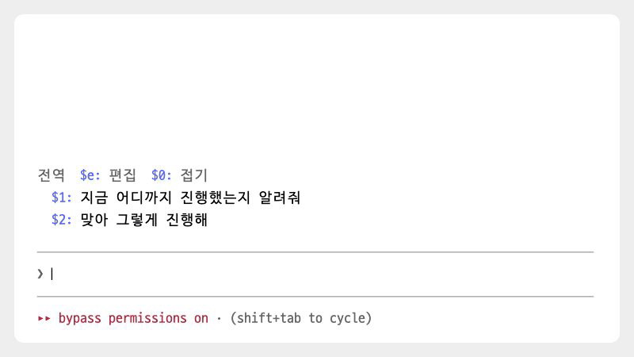
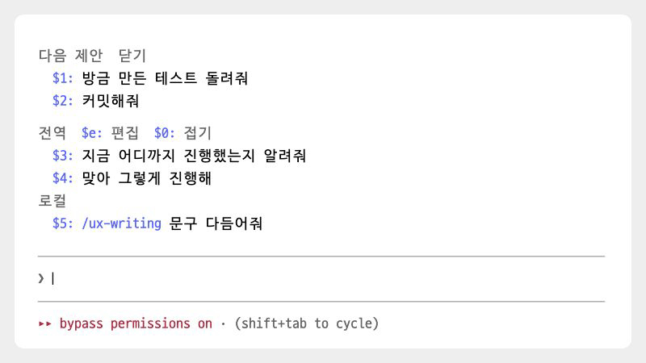

# quick-replies

[← README로 돌아가기](../README.md)

> 자주 쓰는 문구를 프리셋으로 저장해 두고, 입력창에 `$4`처럼 번호를 쳐서 불러옵니다.

<p><picture>
<source media="(prefers-color-scheme: dark)" srcset="./images/showcase/preset-dark.gif">

</picture></p>

## 빠른 시작

1. 마켓플레이스를 등록하지 않았다면 [마켓플레이스에서 설치](../README.md#마켓플레이스에서-설치)를 보고 먼저 등록합니다.
2. 모드를 설치하고, Claude Code를 다시 시작하거나 `/reload-plugins`를 실행합니다.

   ```
   /plugin install quick-replies@oobg
   ```

3. 입력창 위에 기본 프리셋 두 개가 보입니다.

   ```
    전역  $e: 편집  $0: 접기
     $1: 지금 진행상황
     $2: 맞아 그렇게 진행해
   ```

4. 입력창에 `$1`을 치고 스페이스를 누르면 그 자리가 "지금 진행상황"으로 바뀝니다. Enter를 눌러 보냅니다.
5. 프리셋을 추가하려면 입력창에 `$e`를 치고, `o`를 누른 뒤 문구를 쓰고 Enter를 누릅니다. `q`로 편집 화면을 닫습니다.

## 사용법

### 전역 프리셋과 로컬 프리셋

전역 프리셋은 모든 저장소에서 보이고, 로컬 프리셋은 지금 작업하는 저장소에서만 보입니다. git 저장소 밖에서는 Claude Code를 연 폴더가 기준입니다. 처음에는 전역에 기본 프리셋 두 개가 있고 로컬은 비어 있습니다.

다른 세션에서 고친 프리셋도 열려 있는 세션에 반영됩니다.

### 불러오기

- 입력창에 `$5`를 치고 스페이스를 누르면 그 자리가 5번 문구로 바뀌고, 뒤에 스페이스가 하나 붙습니다. 문장 중간에서도 쓸 수 있고, `$12`처럼 두 자리 번호도 됩니다.
- `$12` 뒤에 스페이스 없이 Enter를 누르면, 입력창에서 미리 바꾸지 않고 보낼 때 문구로 바꿉니다.
- 번호(`$4:`)를 클릭하면 입력창 내용을 그 문구로 바꿉니다. 보내지는 않습니다.
- 문구를 클릭하면 그 문구만 바로 보냅니다. 입력창에 쓰던 글은 함께 보내지 않습니다.

번호는 전역, 로컬 순서로 매깁니다. [next-prompts](next-prompts.md)의 다음 제안이 떠 있으면 제안 다음 번호부터 시작합니다. 제안이 3개면 첫 프리셋은 `$4`입니다.

### 스킬과 슬래시 명령

`/ux-writing README 다듬어줘`처럼 스킬이나 명령 이름으로 시작하는 프리셋은 문구를 클릭하면 그 스킬이나 명령을 실행합니다. `/compact`처럼 이름만 있어도 됩니다. 입력창에 `$번호`만 치고 Enter를 눌러도 실행합니다. 번호를 클릭하거나 `$번호` 뒤에 스페이스를 누르면 실행하지 않고 문구만 넣습니다.

없는 명령 이름이면 실행하지 않고 알림만 띄웁니다. `/usr/bin`처럼 경로를 적은 문구는 일반 요청으로 보냅니다.

### 접기

`$0`을 치거나 `$0: 접기`를 클릭하면 전역과 로컬 프리셋이 각각 한 줄로 접히고 제목만 보입니다. 다시 하면 펼쳐집니다. 접은 상태는 다음 세션에도 유지됩니다.

<p><picture>
<source media="(prefers-color-scheme: dark)" srcset="./images/showcase/fold-dark.gif">

</picture></p>

제목을 직접 달지 않은 긴 문구는 모델이 짧은 제목을 지어 줍니다. 제목이 아직 없으면 문구를 줄여 `…`를 붙여 보여 줍니다. 접어도 클릭하거나 `$번호`로 넣을 때는 문구 전체를 씁니다.

### 편집 화면

<p><picture>
<source media="(prefers-color-scheme: dark)" srcset="./images/showcase/editor-dark.gif">

</picture></p>

입력창에 `$e`를 치거나 `$e: 편집`을 클릭하면 입력창 위에 편집 화면이 열립니다. 키는 vim과 비슷합니다. 처음에는 프리셋을 고르는 상태라, 친 키가 글자로 들어가지 않고 아래 편집 명령으로 처리됩니다. 입력창 아래에는 `-- NORMAL --`이 보입니다.

| 키 | 동작 |
| --- | --- |
| `j`, `k` | 한 칸 아래나 위의 프리셋을 고릅니다 |
| `gg`, `G` | 첫 프리셋이나 마지막 프리셋을 고릅니다 |
| `1`~`9` | 그 번호의 프리셋을 고릅니다. 10번째부터는 `j`, `k`나 클릭으로 고릅니다 |
| `o` | 새 프리셋을 씁니다. 커서가 로컬에 있으면 로컬에, 아니면 전역에 추가합니다 |
| `i` | 고른 프리셋의 문구를 고칩니다 |
| `t` | 고른 프리셋의 제목을 답니다 |
| `dd` | 고른 프리셋을 지웁니다 |
| `u` | 마지막으로 지운 프리셋을 되살립니다. 편집 화면을 닫으면 되살릴 수 없습니다 |
| `m` | 고른 프리셋을 전역과 로컬 사이로 옮깁니다 |
| `K`, `J` | 고른 프리셋을 한 칸 위나 아래로 옮깁니다 |
| `q` | 편집 화면을 닫습니다 |

`o`, `i`, `t`를 누르면 입력창에 문구나 제목을 쓰는 상태가 되고, 입력창 아래에 `-- INSERT --`가 보입니다. Enter로 저장하고, `$q`로 취소합니다. 제목을 비워 저장하면 제목이 지워집니다. 키는 대소문자를 구분하고, 화면의 버튼을 클릭해도 같습니다.

## 알아 둘 점

- `$` 앞은 입력창 맨 앞이거나 공백이어야 하고, 한 글자씩 쳐야 합니다. 붙여넣은 `$3 `이나 대문자 `$E`는 바뀌지 않습니다.
- 로컬 프리셋의 기준 폴더는 세션을 시작할 때 정합니다. 세션 도중 다른 저장소로 옮겨도 바뀌지 않습니다.
- 편집 화면이 열려 있는 동안에는 메시지를 보낼 수 없습니다.
- 지운 기본 프리셋은 다시 생기지 않습니다.
- 제목을 지을 때 쓰는 모델 호출은 Claude Code 사용량에 포함됩니다. 문구가 12자 이하이거나 제목을 직접 달면 호출하지 않습니다.
- 프리셋 내보내기와 가져오기는 없습니다.
- 터미널과 데스크톱 화면에서만 보입니다. Claude Code 2.1.296 이상이 필요합니다.

## 문제 해결

<details>
<summary><code>$3</code>을 쳤는데 그대로 남습니다</summary>
<p><code>$</code> 앞에 공백을 두고 한 글자씩 친 뒤 스페이스를 누릅니다. 입력창 위에 그 번호가 있는지도 확인합니다.</p>
</details>

<details>
<summary>입력창에 글자가 들어가지 않습니다</summary>
<p>편집 화면이 열려 있습니다. <code>q</code>로 닫습니다.</p>
</details>

<details>
<summary>쓰는 중에 <code>q</code>를 눌러도 닫히지 않습니다</summary>
<p>쓰는 중에는 <code>q</code>가 글자로 들어갑니다. <code>$q</code>로 취소한 뒤 <code>q</code>를 누릅니다.</p>
</details>

<details>
<summary><code>/이름</code> 프리셋을 클릭하면 "찾지 못했어요" 알림만 뜹니다</summary>
<p>그 스킬이나 플러그인이 설치돼 있는지, 프리셋의 이름이 맞는지 확인합니다.</p>
</details>

<details>
<summary>다른 저장소에서 쓰던 로컬 프리셋이 안 보입니다</summary>
<p>로컬 프리셋은 저장소마다 따로입니다. 어디서나 쓰려면 편집 화면에서 <code>m</code>으로 전역에 옮깁니다.</p>
</details>

<details>
<summary>접힌 줄에 <code>…</code>로 잘린 문구가 보입니다</summary>
<p>제목을 아직 짓지 못했습니다. <code>t</code>로 직접 제목을 답니다.</p>
</details>

<details>
<summary>프리셋 줄이 보이지 않습니다</summary>
<p>설문이 떠 있으면 끝냅니다.</p>
</details>

## 변경 이력

- `0.13.2`: `$번호`를 바꾸면 문구 뒤에 스페이스를 하나 붙입니다.
- `0.13.1`: 편집 화면의 고르기 전 안내 문구를 다듬었습니다.
- `0.13.0`: `$번호` 뒤 스페이스로 바꾸고, 두 자리 번호를 지원합니다. 편집 화면이 vim처럼 동작합니다.
- `0.12.0`: 다른 세션에서 고친 프리셋을 열려 있는 세션에도 반영합니다.
- `0.11.2`: 두 줄 문구에 마우스를 올리면 모든 줄을 반전합니다.
- `0.11.1`: 편집 화면 안내와 알림 문구를 다듬었습니다.
- `0.11.0`: 편집 중에도 입력창에서 쓰고 Enter로 저장합니다.
- `0.10.0`: `$e`로 편집 화면을 열고 `$0`으로 접습니다.
- `0.9.0`: 입력창에 `$번호`를 쳐서 문구를 넣습니다.
- `0.8.2`: 접기는 프리셋에만 적용합니다.
- `0.8.1`: `e` 키로 편집 화면을 엽니다.
- `0.8.0`: 긴 프리셋의 제목을 자동으로 짓습니다. 번호 클릭과 문구 클릭을 나눴습니다.
- `0.7.0`: 한 줄로 접는 모드를 추가했습니다.
- `0.6.1`: 전역과 로컬 라벨을 추가했습니다.
- `0.6.0`: 편집 화면을 추가했습니다.
- `0.5.0`: `/`로 시작하는 프리셋을 스킬이나 명령으로 실행합니다.
- `0.4.0`: 전역과 프로젝트 프리셋을 나눴습니다.
- `0.3.0`, `0.2.0`: 버튼 위치를 옮겼습니다.
- `0.1.0`: 처음 공개.
