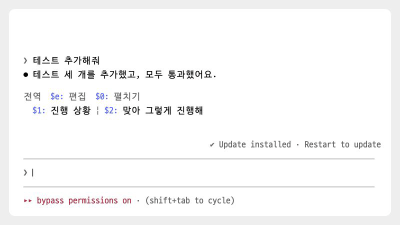

# relaunch


[← README로 돌아가기](../README.md)

> Claude Code 새 버전이 설치되면 입력창 위에 알립니다. Orca 터미널 탭에서는 `다시 열기` 버튼이나 `/relaunch`로 Claude Code를 다시 시작하고 기존 대화를 이어서 엽니다.

<p><picture>
<source media="(prefers-color-scheme: dark)" srcset="./images/showcase/relaunch-dark.gif">

</picture></p>

## 빠른 시작

1. 마켓플레이스를 등록하지 않았다면 [마켓플레이스에서 설치](../README.md#마켓플레이스에서-설치)를 보고 먼저 등록합니다.
2. 모드를 설치하고, Claude Code를 다시 시작하거나 `/reload-plugins`를 실행합니다.

   ```
   /plugin install relaunch@oobg
   ```

3. 새 버전이 설치되면 입력창 위에 버전과 `다시 열기` 버튼이 나타납니다. 설치 직후에는 바로 나타나지 않을 수 있습니다.
4. Orca 탭에서 `다시 열기`를 누르면 Claude Code를 다시 시작합니다. 대화 기록이 있으면 기존 대화를 이어서 엽니다.

## 사용법

- `다시 열기`: Claude Code를 다시 시작합니다. 답변이 진행 중이면 끝난 뒤 다시 누르라고 알립니다.
- `/relaunch`: Claude Code를 다시 시작합니다. 업데이트가 없어도 실행할 수 있고, 답변이 진행 중이면 끝난 뒤에 실행됩니다.
- `/relaunch now`: 작업 중인 에이전트가 있어도 다시 시작합니다. 에이전트의 작업은 중단될 수 있습니다.

다시 열 수 없는 상황이면 Claude Code를 종료하지 않고, 이유와 직접 입력할 명령을 알려 줍니다.

## 알아 둘 점

- 자동으로 다시 열려면 Orca 터미널 탭의 셸에서 `claude`를 직접 실행했어야 하고, `orca` 명령을 쓸 수 있어야 합니다. 업데이트 알림은 다른 터미널에서도 나타납니다.
- 처음 실행할 때 붙인 옵션(`--model`, `--permission-mode`, `--plugin-dir` 등)을 그대로 붙여 다시 엽니다. 처음에 함께 보낸 프롬프트, `--continue`처럼 세션을 고르는 옵션, `--name`은 붙이지 않습니다. 권한 옵션을 다시 붙이면 실행 중 바꾼 권한 모드가 처음 값으로 돌아갑니다.
- `--worktree`, 도움말에 없는 옵션처럼 그대로 다시 붙일 수 있는지 확신할 수 없는 옵션이 있으면 끝내지 않고 직접 여는 방법을 알려 줍니다.
- 옵션 값은 화면과 셸 기록에 남지 않습니다. 본인만 읽을 수 있는 임시 스크립트에 써 두고 셸에는 `/bin/sh <스크립트>`만 입력합니다. 스크립트는 실행되자마자 지워지고, 실행되지 않은 스크립트는 한 시간이 지난 뒤 Claude Code 세션이 시작될 때 지워집니다.
- `FOO=1 claude`처럼 명령 앞에 붙인 환경 변수는 다시 붙지 않습니다.
- 백그라운드에서 실행 중인 명령은 중단될 수 있습니다.
- 다시 여는 동안 그 탭에 다른 명령을 입력하면 다시 열기가 실패할 수 있습니다.
- macOS에서 Claude Code 2.1.303으로 테스트했습니다.

## 문제 해결

- **업데이트 알림이 보이지 않습니다.** 터미널에서 `claude --version`을 실행해 새 버전이 설치됐는지 확인합니다. 알림은 조금 늦게 나타날 수 있습니다.
- **종료된 뒤 다시 열리지 않습니다.** 같은 탭에서 `claude --resume`을 실행하고 목록에서 기존 대화를 고릅니다.
- **Orca 탭인데 자동으로 다시 열 수 없다고 나옵니다.** 셸에서 `claude`를 직접 실행했는지, `orca` 명령을 쓸 수 있는지 확인합니다. 안 되면 안내된 명령으로 직접 다시 엽니다.

## 변경 이력

- `0.2.1`: 옵션 값을 셸에 직접 치지 않고 임시 스크립트로 넘겨 화면과 셸 기록에 남지 않게 했습니다. 확신할 수 없는 옵션(도움말에 없는 옵션, 워크트리, 값인지 프롬프트인지 모호한 낱말)이 있으면 다시 열지 않습니다. 업데이트를 확인한 `claude`를 그 경로로 엽니다. 업데이트 알림을 프리셋 아래 오른쪽으로 옮겼습니다.
- `0.2.0`: 처음 실행할 때 붙인 옵션을 그대로 붙여 다시 엽니다.
- `0.1.0`: 처음 공개. 업데이트 알림과 `/relaunch`
