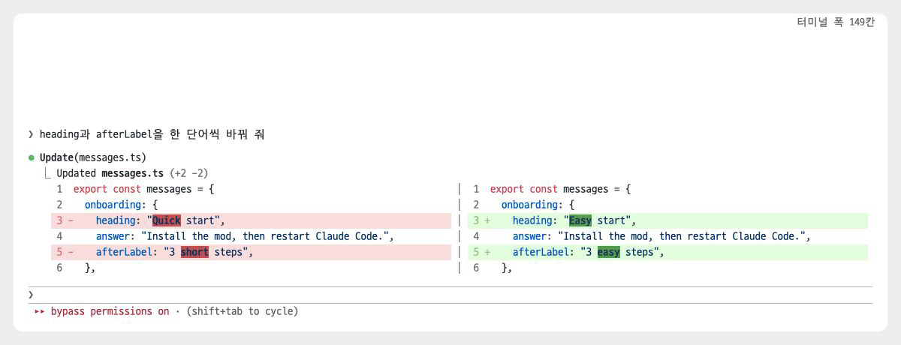

# split-diff

[← README로 돌아가기](../README.md)

> 터미널 폭이 120칸 이상이면 Edit와 Write 결과의 diff를 좌우로 나눠 표시합니다. 원래 내용은 왼쪽에, 바뀐 내용은 오른쪽에 두고, 바뀐 단어는 더 밝은 색으로 강조합니다.

<p><picture>
<source media="(prefers-color-scheme: dark)" srcset="./images/showcase/split-diff-dark.gif">

</picture></p>

## 빠른 시작

1. 마켓플레이스를 등록하지 않았다면 [마켓플레이스에서 설치](../README.md#마켓플레이스에서-설치)를 보고 먼저 등록합니다.
2. 모드를 설치하고, Claude Code를 다시 시작하거나 `/reload-plugins`를 실행합니다.

   ```
   /plugin install split-diff@oobg
   ```

3. 터미널 창을 120칸 이상으로 넓힙니다.
4. Claude에게 파일 수정을 요청합니다.
5. Edit 결과가 좌우로 나뉘어 표시됩니다.

## 사용법

설치하면 바로 적용됩니다. 키 입력이나 슬래시 명령은 없습니다.

다음 조건을 모두 충족할 때 좌우로 나눕니다. 하나라도 어긋나면 원래 diff가 표시됩니다.

- Claude Code의 터미널 화면에서만 적용됩니다. 데스크톱 앱, VS Code 확장 프로그램, 모바일 앱에서는 원래 diff가 표시됩니다.
- 터미널 폭이 120칸 이상이어야 합니다. 창 크기를 바꾸면 이미 표시된 결과도 새 너비에 맞춰 다시 표시됩니다.
- Edit 결과이거나 기존 파일을 덮어쓴 Write 결과여야 합니다. 새 파일을 만든 Write 결과는 원래대로 표시됩니다.
- 도구가 오류 없이 끝났어야 합니다.

삭제된 줄과 추가된 줄은 짝지어 같은 높이에 놓입니다. 한쪽 줄이 더 많으면 반대쪽은 비워 둡니다. 바뀐 구간이 여러 개이면 사이에 `...` 줄이 들어갑니다.

줄 대부분이 바뀌었거나 줄에 탭이 있으면 단어를 강조하지 않고 줄 배경색만 칠합니다.


## 알아 둘 점

- 대화 기록의 도구 결과만 바뀝니다. Edit 승인 요청 창의 diff는 원래대로 위아래로 표시됩니다.
- NotebookEdit 결과는 지원하지 않습니다.
- 줄이 길어 줄바꿈되면 가운데 구분선은 첫 줄에만 표시됩니다.
- 일부 기호나 이모지가 있는 줄에서는 단어 강조가 한두 칸 어긋날 수 있습니다. Claude Code가 업데이트되어 diff 배치가 바뀌어도 어긋날 수 있습니다.
- Claude Code 2.1.300에서 확인했습니다.

## 문제 해결

<details>
<summary>diff가 좌우로 나뉘지 않습니다</summary>
<p>터미널 폭이 120칸 이상인지 확인합니다. 새 파일을 만든 Write 결과나 오류가 난 결과는 원래대로 표시됩니다.</p>
</details>

<details>
<summary>승인 창의 diff는 위아래로 나옵니다</summary>
<p>승인 창은 바꿀 수 없습니다. 승인한 뒤 대화 기록의 결과는 좌우로 표시됩니다.</p>
</details>

<details>
<summary>단어 강조가 글자와 어긋납니다</summary>
<p>화면과 Claude Code 버전을 담아 이슈를 남겨 주세요.</p>
</details>

## 변경 이력

- `0.1.0`: 처음 공개. 넓은 터미널에서 Edit와 Write 결과를 좌우로 나누고 바뀐 단어를 강조
