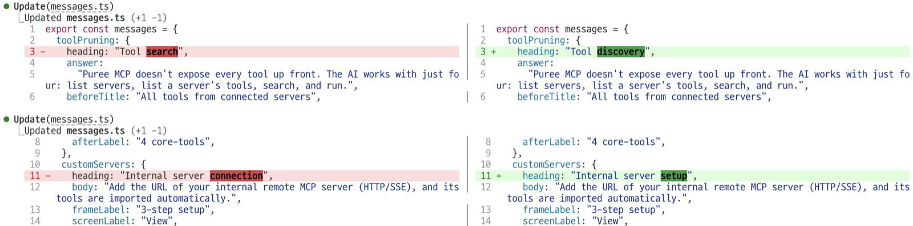

# split-diff

[← README로 돌아가기](../README.md)

> 터미널 폭이 120칸 이상이면 Edit와 Write 결과의 diff에서 원래 내용은 왼쪽에, 바뀐 내용은 오른쪽에 표시합니다. 바뀐 단어는 더 밝은 색으로 강조합니다.

<p><picture>
<source media="(prefers-color-scheme: dark)" srcset="./images/showcase/split-diff-dark.gif">

</picture></p>

| 항목 | 값 |
| --- | --- |
| 버전 | `0.1.0` |
| 자리 | 대화 기록의 도구 결과(Edit, Write) |
| 요구 사항 | 터미널 폭 120칸 이상. Claude Code 2.1.300에서 확인했습니다 |
| 외부 호출 | 모델 호출, 네트워크 요청, 하위 프로세스 실행이 없습니다 |
| 저장 데이터 | 없음 |

## 목차

- [개요](#개요)
- [빠른 시작](#빠른-시작)
- [사용법](#사용법)
- [키와 명령](#키와-명령)
- [화면 구성](#화면-구성)
- [동작 방식](#동작-방식)
- [설정과 저장 데이터](#설정과-저장-데이터)
- [외부 호출과 사용량](#외부-호출과-사용량)
- [제한 사항](#제한-사항)
- [문제 해결](#문제-해결)
- [소스 구성](#소스-구성)
- [변경 이력](#변경-이력)

## 개요

Claude Code는 Edit와 Write로 파일을 수정한 결과를 삭제된 줄과 추가된 줄이 위아래로 이어지는 diff로 표시합니다. 줄이 길면 어느 부분이 달라졌는지 찾기 어렵습니다.

split-diff는 터미널 폭이 넓을 때 이 결과를 왼쪽(원래 내용)과 오른쪽(바뀐 내용)으로 나눠 표시합니다.

- 삭제된 줄과 추가된 줄을 짝지어 같은 높이에 표시합니다.
- 줄 번호, 배경색, 구문 강조 색은 엔진의 diff와 같습니다.
- 짝지은 두 줄을 단어 단위로 비교하고, 바뀐 단어를 엔진의 기본 강조보다 밝은 색으로 표시합니다.

터미널 폭이 120칸보다 좁으면 엔진의 원래 diff를 그대로 표시합니다.

## 빠른 시작

1. 마켓플레이스를 등록하지 않았다면 [마켓플레이스에서 설치](../README.md#마켓플레이스에서-설치)를 보고 먼저 등록합니다.
2. 모드를 설치하고, Claude Code를 다시 시작하거나 `/reload-plugins`를 실행합니다.

   ```
   /plugin install split-diff@oobg
   ```

3. 터미널 창을 120칸 이상으로 넓힙니다.
4. Claude에게 파일 수정을 요청합니다.
5. Edit 결과가 좌우로 나뉘어 표시됩니다.

## 사용법

### 좌우로 나뉘는 조건

다음 조건을 모두 충족하면 좌우로 나눠 표시합니다. 하나라도 충족하지 않으면 엔진의 원래 diff를 표시합니다.

- 터미널 화면입니다. 데스크톱 앱, VS Code, 모바일 화면에서는 엔진의 원래 diff를 표시합니다.
- 터미널 폭이 `120`칸 이상입니다.
- Edit 결과 또는 기존 파일을 덮어쓴 Write 결과여야 합니다. 새 파일을 만든 Write 결과는 제외합니다.
- 도구 실행이 오류 없이 끝났고, 결과에 변경된 구간이 있어야 합니다.

창 크기를 바꾸면 이미 표시된 결과도 변경된 너비에 맞춰 다시 표시됩니다.

### 줄을 맞추는 방식

- 바뀌지 않은 줄(문맥 줄)은 양쪽에 같은 내용으로 표시합니다.
- 연속해서 삭제된 줄과 추가된 줄은 순서대로 짝지어 같은 높이에 배치합니다. 한쪽의 줄이 더 많으면 줄이 적은 쪽의 남는 자리를 비워 둡니다.
- 긴 줄은 각 칸의 너비에 맞춰 줄바꿈합니다. 줄바꿈된 부분에도 배경색이 이어집니다.
- 바뀐 구간이 여러 개이면 구간 사이에 `...` 줄을 넣습니다.

### 단어 강조

짝지은 두 줄을 단어, 공백, 기호 단위로 비교합니다. 한쪽에만 있는 부분을 찾아 왼쪽에서는 삭제된 부분을, 오른쪽에서는 추가된 부분을 강조합니다.

다음 경우에는 단어를 강조하지 않고 줄 배경색만 표시합니다.

- 두 줄에서 바뀌지 않은 글자(공백 제외)의 수가 더 긴 줄 길이의 40%보다 적을 때. 줄 전체가 바뀐 것으로 처리합니다.
- 줄에 탭이 있을 때. 엔진이 탭을 몇 칸 너비로 표시하는지 알 수 없어 강조 위치를 맞출 수 없습니다.
- 짝이 없는 줄일 때.

## 키와 명령

키 입력이나 슬래시 명령은 없습니다. 설치하면 바로 적용됩니다.

## 화면 구성

| 요소 | 내용 |
| --- | --- |
| 첫 줄 | `⎿ Updated <파일 경로> (+추가한 줄 수 -지운 줄 수)`. 경로는 작업 폴더 기준 상대 경로입니다 |
| 왼쪽 칸 | 원래 내용. 줄 번호, `-` 표시, 지운 줄의 빨간 배경 |
| 가운데 | 흐린 구분선 `│` |
| 오른쪽 칸 | 바뀐 내용. 줄 번호, `+` 표시, 추가한 줄의 초록 배경 |
| 단어 강조 | 바뀐 단어를 굵은 글자와 테마의 단어 강조색(`diffRemovedWord`, `diffAddedWord`)으로 표시 |
| 생략 줄 | 바뀐 구간 사이의 `...` |

줄 번호는 결과에서 자릿수가 가장 많은 번호에 맞춰 오른쪽 정렬합니다.

### 실제 화면

아래는 Claude Code 2.1.300에서 캡처한 실제 화면입니다. 위 GIF는 실제 화면을 바탕으로 재현한 애니메이션입니다.

<p><picture>
<source media="(prefers-color-scheme: dark)" srcset="./images/showcase/split-diff-dark.png">

</picture></p>

## 동작 방식

### 이벤트

| 이벤트 | 하는 일 |
| --- | --- |
| `ui.render` (`ToolResult`) | 조건을 충족하면 좌우로 나뉜 화면을 렌더링해 반환합니다. 충족하지 않으면 `next(e)`를 호출해 엔진의 기존 결과 화면을 표시합니다 |

### 칸 너비

한쪽 칸의 너비는 `(터미널 폭 - 들여쓰기 4 - 구분선 3) ÷ 2`입니다. 터미널 폭이 120칸이면 한쪽은 56칸이며, 줄 번호와 변경 표시가 차지하는 공간을 제외하면 코드가 한 줄에 약 50자 들어갑니다.

### 색을 엔진과 맞추는 방법

각 줄을 한 줄짜리 diff 구간으로 만들어 엔진의 `Code` 요소에 diff 형식으로 전달합니다. 줄 번호, 변경 표시, 배경색, 구문 강조 색은 엔진이 처리하므로 기존 diff와 동일하게 표시되며, 사용자가 테마를 바꾸면 함께 바뀝니다.

엔진은 각 칸에 표시하는 줄 번호의 자릿수에 따라 번호 영역의 너비를 정합니다. 그대로 두면 9와 10처럼 자릿수가 바뀌는 지점에서 내용이 한 칸 어긋나므로, 자릿수가 적은 번호 앞에 공백을 넣어 오른쪽 정렬합니다.

### 단어 강조를 그리는 방법

모드에서는 엔진의 diff 색을 변경할 수 없습니다. 대신 엔진이 렌더링한 줄 위의 같은 위치에 같은 글자를 강조색 배경으로 덧그립니다.

`-` 엔진의 diff 한 줄은 빈칸, 줄 번호, 빈칸, 표시(`+`, -, 빈칸), 내용 순서로 구성됩니다. 내용은 줄 번호 자릿수 + 3칸 뒤에서 시작합니다.
- 줄바꿈된 내용도 같은 열에서 이어지며, 단어 경계와 관계없이 글자 단위로 줄이 바뀝니다.
- 한글, 한자, 전각 문자, 일부 이모지는 두 칸으로 계산합니다. 너비가 두 칸인 글자가 줄 끝에 걸리면 다음 행으로 넘깁니다.

위치 계산은 Claude Code 2.1.300에서 실제 diff의 배치를 측정해 맞췄습니다.

### 상수

| 이름 | 값 | 쓰임 |
| --- | --- | --- |
| `MIN_COLUMNS` | `120` | 좌우로 나누는 최소 터미널 폭 |
| `INDENT` | `4` | 결과 본문의 들여쓰기. 엔진 diff처럼 `⎿` 아래에 맞춥니다 |
| 단어 강조 기준 | `0.4` | 바뀌지 않은 글자가 이 비율보다 적으면 단어를 강조하지 않습니다 |

## 설정과 저장 데이터

설정 명령이나 옵션은 없습니다. `$.store`나 `$.state`, 파일에는 아무것도 저장하지 않습니다. 기존 도구 결과는 수정하지 않고 화면에 표시하는 방식만 바꿉니다.

## 외부 호출과 사용량

모델 호출, 네트워크 요청, 하위 프로세스 실행이 없습니다. 사용자 계정 사용량에 포함되지 않습니다. 작업 폴더 경로는 엔진의 `$.session.cwd()`로 읽습니다.

## 제한 사항

- 대화 기록에 표시되는 도구 결과 화면만 바꿉니다. Edit 승인 요청 화면의 diff는 모드에서 다시 렌더링할 수 없어 기존 형태로 표시됩니다.
- 터미널 화면에서만 동작합니다.
- 단어 강조 위치는 엔진 diff의 칸 배치를 측정해 맞췄습니다. Claude Code 업데이트로 배치가 바뀌면 강조 위치가 어긋날 수 있습니다.
- 너비가 두 칸인 글자를 판별할 때는 주요 문자 범위만 다룹니다. 일부 기호나 이모지는 실제 표시 너비와 계산한 너비가 달라 강조 위치가 한두 칸 어긋날 수 있습니다.
- 좌우 칸의 내용이 줄바꿈되면 가운데 구분선은 첫 행에만 표시됩니다.
- NotebookEdit 결과는 형식이 달라 지원하지 않습니다.

## 문제 해결

| 증상 | 원인 | 해결 |
| --- | --- | --- |
| diff가 좌우로 나뉘지 않습니다 | 터미널 폭이 120칸보다 좁습니다 | 창을 넓히면 이미 표시된 결과도 변경된 너비에 맞춰 다시 표시됩니다 |
| diff가 좌우로 나뉘지 않습니다 | 새 파일을 생성한 Write 결과이거나, 도구 실행 중 오류가 발생했습니다 | 정상 동작입니다 |
| 권한 창의 diff는 위아래로 표시됩니다 | 권한 창은 모드가 다시 그릴 수 없습니다 | 승인 후 대화 기록의 결과는 좌우로 표시됩니다 |
| 단어 강조가 없습니다 | 줄 대부분이 바뀌었거나, 줄에 탭이 있습니다 | 정상 동작입니다 |
| 단어 강조가 글자와 어긋납니다 | Claude Code의 diff 배치가 바뀌었거나 일부 글자의 너비를 잘못 계산했습니다 | 문제가 발생한 화면과 Claude Code 버전을 포함해 이슈를 남겨 주세요 |

## 소스 구성

| 파일 | 역할 |
| --- | --- |
| `mods/split-diff/.claude-plugin/plugin.json` | 모드 이름, 버전(`0.1.0`), 설명, 키워드 |
| `mods/split-diff/hooks/hooks.json` | 훅 모듈 목록(`./register.tsx`) |
| `mods/split-diff/hooks/register.tsx` | 줄 맞추기(`toRows`), 단어 비교(`changedSpans`), 칸 위치 계산(`placeSpans`, `cellWidth`), `ui.render` 훅과 화면 렌더링 |
| `mods/split-diff/tests/split-diff.test.tsx` | 줄 맞추기, 줄 수 계산, 단어 비교, 칸 위치 계산, 넓은 화면과 좁은 화면의 렌더링 테스트 |
| `mods/split-diff/tsconfig.json` | 타입 설정. `./.claude-plugin/types/tsconfig.json`을 확장합니다 |

## 변경 이력

- `0.1.0`: 넓은 터미널에서 Edit와 Write 결과를 좌우로 나눠 표시하고, 바뀐 단어를 강조하는 기능을 추가했습니다.
